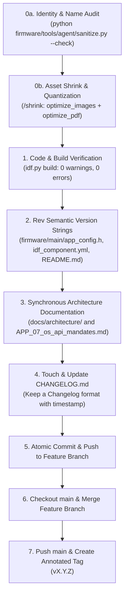

# Pre-Merge to Main Governance & Release Invariants

This rule governs the mandatory release and merge checklist required before ANY branch, feature, or bug fix is merged into the `main` branch of **Humid1-OS**.

---

## 1. The Pre-Merge Contract ("No Dirty Main")

The `main` branch represents production-grade, verifiable, and historical stability. Direct commits to `main` without completing the pre-merge checklist are strictly prohibited.

Before executing a merge into `main`, the developer or autonomous agent **MUST** satisfy all release invariants in the following order:



---

## 2. Invariant 1: Semantic Version Synchronization

Version strings must never drift across documentation, packaging metadata, and compiled binaries. Whenever merging to `main`, the version must be revved synchronously across canonical locations:
1. `firmware/main/app_config.h` (`APP_FIRMWARE_VERSION_STRING`)
2. `firmware/main/idf_component.yml` (`version`)
3. `README.md` (Version badge and header)
4. `CHANGELOG.md` (Release section header)

---

## 3. Invariant 2: Synchronous Architecture Documentation

Whenever APIs, cloud schemas, screens, or configurations change:
- Architecture documents under `docs/architecture/` (`APP_01` through `APP_07`) must be updated synchronously in the same commit.
- Any upstream H1OS API requirements or bugs must be logged in `docs/architecture/APP_07_os_api_mandates.md`.

---

## 4. Invariant 3: Living Changelog Discipline (`CHANGELOG.md`)

Every merge to `main` must touch `CHANGELOG.md` adhering to the [Keep a Changelog](https://keepachangelog.com/en/1.0.0/) standard:
1. Add a new dated section at the top of the ledger:
   ```markdown
   ## [X.Y.Z] - YYYY-MM-DD
   ```
2. Group changes under standard descriptive subheadings:
   - `### 🚀 Added` for new features, screens, or network capabilities.
   - `### 🔄 Changed` for architectural refactors or cloud schema changes.
   - `### 🛡️ Fixed & Hardened` for bug fixes, safety invariant patches, or memory reliefs.
   - `### 🗑️ Removed` for deprecated code or pruned orphans.

---

## 5. Invariant 4: Verified Clean Build

Before merging:
1. Compile using the canonical ESP-IDF v6.1 profile script:
   ```powershell
   & "C:\Espressif\tools\Microsoft.v6.1.PowerShell_profile.ps1"; idf.py -C firmware build
   ```
2. Build must exit with code 0 and ZERO warnings or `-Werror` breaks.

---

## 6. Invariant 5: Identity & Workstation Hygiene Audit

Before committing or merging:
1. Run the identity & name sanitizer:
   ```powershell
   python firmware/tools/agent/sanitize.py --check
   ```
2. Verify zero personal workstation paths, developer user names, or machine-specific tokens are staged.
