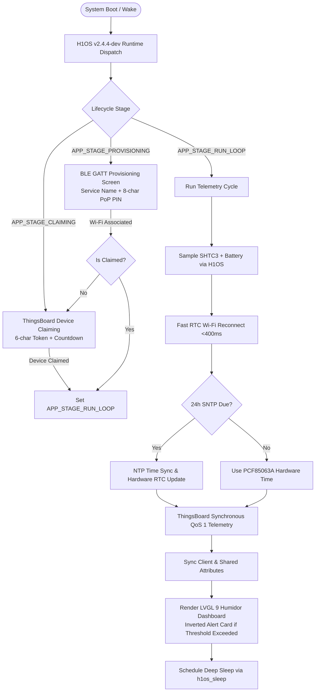

# HUMID1-OS - Architectural Specification & Blueprint

Welcome to the architectural roadmap for **HUMID1-OS**, an ultra-low-power, cloud-integrated environmental monitoring application built for precision cigar and tobacco humidor management.

`HUMID1-OS` is built directly on top of **H1OS v2.4.4-dev** (`Humidyne-Labs/H1OS`), which provides deterministic hardware orchestration, zero-heat psychrometrics, and low-power runtime management.

---

## 1. System Overview & Core Workflow

`HUMID1-OS` is engineered for a "zero-touch-after-setup" operational lifecycle:

---

## 2. Architectural Documentation Suite

Detailed technical specifications and schemas are partitioned into dedicated reference manuals under `docs/architecture/`:

- **[APP_01: System Architecture & Application Lifecycle](docs/architecture/APP_01_system_architecture.md)**: State machine, duty cycles, and H1OS integration boundary.
- **[APP_02: Self-Hosted ThingsBoard & Cloud Integration](docs/architecture/APP_02_cloud_and_telemetry.md)**: Custom cloud infrastructure on [Humid1.com](https://www.humid1.com/), MQTT telemetry schemas, dynamic shared attributes, and device claiming.
- **[APP_03: BLE GATT Provisioning Specification](docs/architecture/APP_03_ble_provisioning.md)**: BLE onboarding protocol, Proof of Possession PIN, and Wi-Fi credential storage.
- **[APP_04: LVGL v9 UI Architecture & Screen Specifications](docs/architecture/APP_04_ui_and_screens.md)**: 1-bit monochrome display layouts, humidor dashboard cards, and alert inversion mode.
- **[APP_05: Audio Subsystem & Acoustic Event Chimes](docs/architecture/APP_05_audio_feedback.md)**: ES8311 + NS4168 audio feedback matrix, event chimes, and quiet hours.
- **[APP_06: Over-The-Air (OTA) Firmware Deployment](docs/architecture/APP_06_ota_management.md)**: ThingsBoard self-hosted OTA updates, dual-slot 8MB flash partitioning, and diagnostic rollback guards.
- **[APP_07: OS API Feature Mandates](docs/architecture/APP_07_os_api_mandates.md)**: Official register of upstream H1OS API requests, component packaging fixes, and enhancements.
- **[H1OS Middleware Reference](docs/h1os_reference.md)**: Underlying hardware specifications, pinout mapping, and silicon errata managed by H1OS.

---

## 3. Hardware Target & Prerequisites

- **Target Board:** Waveshare ESP32-S3 Touch-ePaper-1.54" V2 (SKU: 32298)
- **SoC:** Espressif ESP32-S3-PICO-1-N8R8 (Xtensa 32-bit LX7 dual-core @ 240 MHz, 8 MB Flash, 8 MB Octal PSRAM)
- **Display:** 1.54" 200×200 1-bit Monochrome e-Paper Display (SSD1681)
- **Environmental Sensor:** Sensirion SHTC3 (I2C `0x70`)
- **Real-Time Clock:** NXP PCF85063A Hardware RTC (I2C `0x51`)
- **Audio:** Everest Semi ES8311 I2S Audio Codec + NS4168 Class-D Amplifier
- **Power Architecture:** Discrete LDO battery power hold latch (`GPIO 17`), battery voltage ADC divider (`GPIO 4`), and physical button wake (`GPIO 18`)
