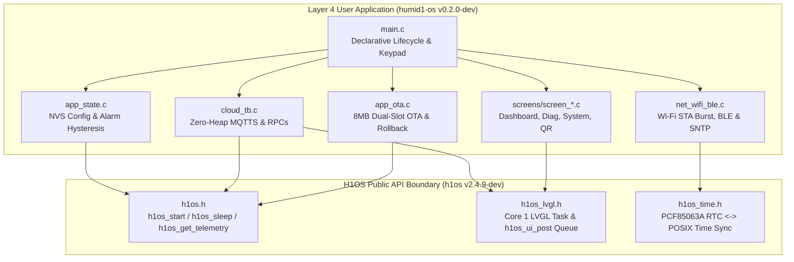

# Humid1-OS: Master Architectural Outline & Authoritative Index

> **Application Version:** `v0.2.0-dev` | **Target OS Component:** `H1OS >= v2.4.9-dev` | **ESP-IDF:** `>= v6.1.0`
> **Target Hardware:** Waveshare ESP32-S3 ePaper 1.54" V2 (`ESP32-S3-PICO-1-N8R8`, 8 MB QIO Flash, 8 MB Octal PSRAM, Non-Touch SSD1681 200×200 1-Bit e-Paper)

---

## 1. Purpose & "Documentation is Law" Mandate

This document is the root architectural index for **humid1-os**, the Layer 4 smart humidor and precision environmental monitoring application built on the **H1OS** middleware component (`components/h1os`).

To prevent scope creep, API hallucination, or accidental modification of H1OS kernel internals during application development, **all engineering work in this repository is governed by the modular `APP_01`–`APP_08` specification suite**:

| Spec ID | Document Path | Authoritative Scope & Mapped Firmware Modules |
| :--- | :--- | :--- |
| **APP_01** | [`docs/architecture/APP_01_system_architecture.md`](docs/architecture/APP_01_system_architecture.md) | 5-Layer system boundary, Dual-Core Flow B parallel execution (`on_boot`, `on_wake`, `on_sync`, `on_pre_sleep`, `on_shutdown`, `on_error`), Flow A/B period invariants (`60..14400s` / `300..86400s`), NVS schema (`app_state.c`), and compound alarm hysteresis (`main.c`). |
| **APP_02** | [`docs/architecture/APP_02_cloud_and_telemetry.md`](docs/architecture/APP_02_cloud_and_telemetry.md) | ThingsBoard CE MQTTS protocol (`mqtts://humid1.com:8883`), zero-heap static JSON telemetry & client attribute serialization, RTC ring-buffer batch history export (`h1os_get_telemetry_history`), shared attributes, and server RPC dispatch (`cloud_tb.c`). |
| **APP_03** | [`docs/architecture/APP_03_onboarding_and_claiming.md`](docs/architecture/APP_03_onboarding_and_claiming.md) | Out-of-box BLE GATT / SoftAP Wi-Fi provisioning (`net_wifi_ble.c`), integer-scaled `123×123 px` Version 6 QR code rendering (`screen_onboarding.c`), and ThingsBoard device claiming (`v1/devices/me/claim`). |
| **APP_04** | [`docs/architecture/APP_04_ui_and_screens.md`](docs/architecture/APP_04_ui_and_screens.md) | 200×200 1-bit monochrome LVGL v9.6.0 screen specifications (`screen_dashboard.c`, `screen_diagnostics.c`, `screen_system.c`, `screen_onboarding.c`), `H1OS_FONT_14..32` typography (`>= 14px` floor, `<= 188.0 px` width), Light/Dark polarity themes, and 2-button (`BOOT`/`POWER`) navigation. |
| **APP_05** | [`docs/architecture/APP_05_audio_feedback.md`](docs/architecture/APP_05_audio_feedback.md) | Layer 4 acoustic feedback via `h1os_audio_play_tone()`, `h1os_audio_play_chime()`, `h1os_audio_play_raw()`, and `h1os_set_volume()`. Enforces total acoustic silence on unattended `H1OS_WAKE_STATE_RTC_FLOW_B` wakes to preserve `<1.0 µA` ES8311 sleep isolation. |
| **APP_06** | [`docs/architecture/APP_06_ota_management.md`](docs/architecture/APP_06_ota_management.md) | Canonical 8 MB Dual-Slot OTA flash layout (`ota_0` 3 MB, `ota_1` 3 MB, `storage` 1.86 MB, `epd_frame` 16 KB), ThingsBoard `fw_*` shared attribute OTA state machine, `>= 25%` SoC (`3650 mV`) battery safety gate, `h1os_sync_hold()` sleep barrier lock, and rollback verification (`app_ota.c`). |
| **APP_07** | [`docs/architecture/APP_07_os_api_mandates.md`](docs/architecture/APP_07_os_api_mandates.md) | Cross-repository interface ledger tracking H1OS Layer 4 API contracts (`MANDATE-01` through `MANDATE-06`, all verified RESOLVED in `H1OS v2.4.9-dev`). |
| **APP_08** | [`docs/architecture/APP_08_audit_and_doc_governance.md`](docs/architecture/APP_08_audit_and_doc_governance.md) | Strict Layer 4 boundary enforcement, GFM rendering rules, IEEE/embedded engineering lexicon compliance (`sanitize.py`), and pre-flight verification gates (`check_string_width.py`). |
| **REF** | [`docs/h1os_reference.md`](docs/h1os_reference.md) | Authoritative quick-reference manual of all public `H1OS v2.4.9-dev` headers (`h1os.h`, `h1os_lvgl.h`, `h1os_time.h`, `h1os_fonts.h`), structs, macros, and hardware pin assignments. |

---

## 2. System Block Diagram & Dual-Core Concurrency



---

## 3. Repository Directory Structure

```text
humid1-os/
├── AGENTS.md                        # Master Agent Governance & Anti-Drift Guardrails
├── Architectural_Outline.md         # Root Architectural Index (This File)
├── CHANGELOG.md                     # Keep-a-Changelog Release Ledger
├── README.md                        # Developer Quick-Start & Build Guide
├── .agents/
│   ├── rules/                       # Always-active Layer 4 engineering & lexicon rules
│   └── skills/                      # On-demand ESP-IDF, LVGL, ThingsBoard & GFM skills
├── docs/
│   ├── h1os_reference.md            # Authoritative H1OS v2.4.9-dev Public API Reference
│   ├── architecture/                # Modular APP_01..APP_08 Specifications
│   └── audits/                      # Formal Third-Party Audit & Verification Reports
├── tools/
│   ├── agent/                       # sanitize.py, check_string_width.py, optimize_*.py
│   └── fonts/                       # Precomputed 1-BPP Montserrat 14..32px CSV metrics
└── firmware/
    ├── CMakeLists.txt               # ESP-IDF v6.1 Project Root
    ├── CMakePresets.json            # 'dev' (build_dev) and 'prod' (build_prod) presets
    ├── partitions.csv               # Canonical 8 MB Dual-OTA + epd_frame layout
    ├── sdkconfig.defaults           # Base ESP32-S3-PICO-1-N8R8 configuration
    ├── sdkconfig.defaults.dev       # Development debug overlay
    ├── sdkconfig.defaults.prod      # Production zero-leakage overlay
    └── main/
        ├── CMakeLists.txt           # Component registration & -Werror flags
        ├── idf_component.yml        # Declares h1os >= 2.4.9-dev dependency
        ├── app_config.h             # Compile-time limits, NVS keys, MQTT topics
        ├── app_types.h              # Shared structs & enums
        ├── app_state.h / .c         # NVS persistence, flow validation & alarm logic
        ├── net_wifi_ble.h / .c      # Wi-Fi STA burst, BLE provisioning & SNTP sync
        ├── cloud_tb.h / .c          # Zero-heap ThingsBoard MQTTS & RPC engine
        ├── app_ota.h / .c           # Dual-slot OTA verification & battery gate
        ├── main.c                   # Declarative H1OS lifecycle & keypad callbacks
        └── screens/
            ├── screen_dashboard.h / .c
            ├── screen_diagnostics.h / .c
            ├── screen_system.h / .c
            └── screen_onboarding.h / .c
```
