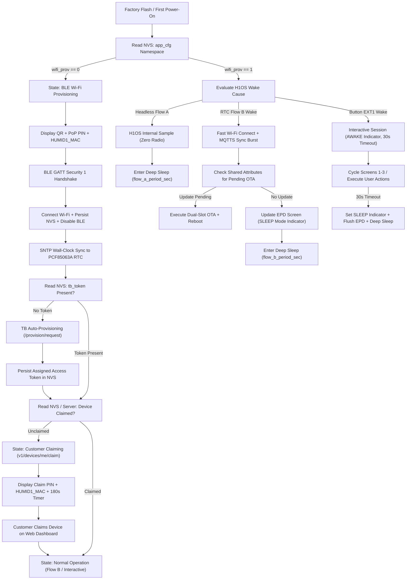

# Humid1-OS: Master Architectural Outline & System Blueprint

* **Document ID:** `HUMID1-ARCH-000` (Rev 2.0)
* **Target Hardware:** Custom ESP32-S3-WROOM-1-N16R8 Telemetry Instrument (`Humid1`)
* **Underlying Middleware:** `H1OS` v2.4.4+ (`https://github.com/voidired/H1OS.git`)
* **Cloud Backend:** ThingsBoard Community Edition (`mqtts://humid1.com:8883` / `https://app.humid1.com`)
* **Governance Policy:** Documentation is Law (`APP-STD-001` / `H1OS-STD-001`)

---

## 1. Executive Summary & Architectural Philosophy

**Humid1-OS** is the production Layer 4 embedded application firmware built on top of the **H1OS** operating system middleware. While H1OS encapsulates hardware pin multiplexing, deep-sleep pad isolation, ULP-RISC-V coprocessor wake arbitration, Tri-Node temperature compensation, and LVGL v9 1-bit monochrome e-Paper rendering, **Humid1-OS** implements the product-level business logic:

1. **Zero-Touch & Secure Onboarding:** First-boot BLE GATT Wi-Fi provisioning (with simultaneous on-screen QR code, TRNG Proof-of-Possession PIN, and MAC-derived device UID) using encrypted `protocomm_ble` Security 1, followed by immediate BLE stack teardown once Wi-Fi connects.
2. **Two-Phase Cloud Registration & Persistent Claiming:** Automated device entity registration on ThingsBoard via the Device Profile provisioning credentials (`/provision/request`), followed by user-initiated claiming (`v1/devices/me/claim`) with a 180-second on-screen countdown timer and random claim PIN. Once claimed, device ownership persists in the server registry across reboots and firmware updates until explicitly unclaimed or factory-reset.
3. **Server-Driven Telemetry & Attribute Architecture:** The ThingsBoard server defines the telemetry schema, alarm thresholds, display preferences, and wake cadence (`SHARED_SCOPE` attributes). All temperature telemetry and alarm thresholds are transmitted and evaluated in **Kelvin ($\text{K}$)** as the canonical base unit, while local display rendering converts Kelvin to the user-selected unit (`F`, `C`, or `K`).
4. **Server-Authority Alarm Management:** All environmental and battery threshold evaluations occur on the ThingsBoard server (`Alarms` Rule Chain) with hysteresis protection. The device synchronizes active alarm state via MQTT shared attributes during wake bursts and alerts the user visually (and audibly during interactive sessions when enabled).
5. **Dynamic Dual-Flow Power Orchestration:** Wake intervals for **Flow A** (headless ULP/RTC sensor sampling) and **Flow B** (periodic e-Paper refresh, MQTTS telemetry publish, shared attribute sync, and OTA check) are dynamically governed by server-pushed dashboard settings, while interactive button wakes enforce a hardcoded 30-second inactivity timeout.

---

## 2. Two-Tier Documentation & Repository Topology

```
humid1-os/ (Repository Root)
├── README.md                                     <-- Public Gateway, Quickstart & Build Guide
├── Architectural_Outline.md                      <-- Master Blueprint & Governance Index [THIS FILE]
├── AGENTS.md                                     <-- AI Agent Entrypoint & Mandatory Workflow Rules
├── CHANGELOG.md                                  <-- Authoritative SemVer Release & Modification Log
│
├── docs/
│   ├── h1os_reference.md                         <-- Layer 1-4 H1OS Public API & Hardware Reference
│   ├── architecture/                             <-- Normative Application Specifications ("Documentation is Law")
│   │   ├── APP_01_system_architecture.md         <-- State Machine, H1OS Hook Ordering & Dynamic Wake Flows
│   │   ├── APP_02_cloud_and_telemetry.md         <-- ThingsBoard MQTTS, Auto-Provisioning, Claiming & JSON Schemas
│   │   ├── APP_03_ble_provisioning.md            <-- BLE Security 1 Wi-Fi Onboarding, QR/PIN UI & Credential Reset
│   │   ├── APP_04_ui_and_screens.md              <-- 3-Screen UX, Mode Indicators, 2-Button Map & 188px Budget
│   │   ├── APP_05_audio_feedback.md              <-- Non-Blocking Audio Cues, Attribute Gates & Power Gating
│   │   ├── APP_06_ota_management.md              <-- Dual-Slot FOTA on Wake, NVS Preservation & Rollback Guards
│   │   ├── APP_07_os_api_mandates.md             <-- Formal Register of Required H1OS Middleware Extensions
│   │   └── APP_08_audit_and_doc_governance.md    <-- Formal Code Audit Standard (APP-STD-001) & Change Protocol
│   └── audits/                                   <-- Immutable Audit & Infrastructure Review Reports
│       └── APP_AUDIT_01_infrastructure_and_api_review.md <-- Full-Stack TB, Web Dash & H1OS Audit Report
│
├── firmware/                                     <-- ESP-IDF v5.4.1 Application Project Root
│   ├── CMakeLists.txt                            <-- Top-Level Project Definition & Compiler Hardening
│   ├── partitions.csv                            <-- 16 MB Flash Partition Table (Dual 4 MB OTA Slots)
│   ├── sdkconfig.defaults                        <-- Hardware, LwIP, NimBLE, MQTTS & Power Invariants
│   ├── main/
│   │   ├── CMakeLists.txt                        <-- Application Component Registration
│   │   ├── idf_component.yml                     <-- H1OS Middleware Dependency Manifest
│   │   ├── app_config.h                          <-- Compile-Time Constants, Endpoints & NVS Keys
│   │   ├── app_types.h                           <-- Server-Driven Telemetry, Attribute & State Structures
│   │   ├── app_state.h / app_state.c             <-- NVS Persistence, RTC Cache & Factory Reset Engine
│   │   ├── net_wifi_ble.h / net_wifi_ble.c       <-- BLE Provisioning, Fast RTC Wi-Fi Burst & SNTP Sync
│   │   ├── cloud_tb.h / cloud_tb.c               <-- ThingsBoard MQTTS Client, Auto-Provisioning & Claiming
│   │   ├── app_ota.h / app_ota.c                 <-- Dual-Slot HTTPS/MQTT FOTA Engine & Image Verification
│   │   ├── main.c                                <-- H1OS Lifecycle Callbacks & Top-Level Orchestration
│   │   └── screens/                              <-- LVGL v9 200x200 1-Bit Monochrome UI Screens
│   │       ├── screen_dashboard.h / .c           <-- Screen 1: Primary Climate & Connection Dashboard
│   │       ├── screen_diagnostics.h / .c         <-- Screen 2: Tri-Node Metrology, Network & Autonomy Diagnostics
│   │       ├── screen_system.h / .c              <-- Screen 3: Active Alarms, System Status & User Actions
│   │       └── screen_onboarding.h / .c          <-- Modal Screens: BLE QR+PIN, Claiming Countdown & OTA Progress
│   └── tools/
│       ├── generate_1bpp_fonts.py                <-- LVGL 1-BPP Font Generator Script
│       └── agent/                                <-- Automated Pre-Flight & Verification Utilities
│           ├── sanitize.py                       <-- Prohibited Lexicon & Formatting Scanner
│           ├── check_string_width.py             <-- 188px Pixel-Width Gate Verification Script
│           ├── optimize_images.py                <-- Image Context Optimizer
│           └── optimize_pdf.py                   <-- PDF Inspection Slicer
│
└── .agents/                                      <-- AI Agent Governance Rules & Domain Skills
    ├── rules/                                    <-- Always-On Architectural, Security & Style Constraints
    └── skills/                                   <-- Task-Specific Engineering Workflows
```

---

## 3. End-to-End Operational Lifecycle



---

## 4. Architectural Specification Index

Every subsystem in `humid1-os` is governed by a dedicated specification in `docs/architecture/`:

| Document ID | File Path | Primary Technical Scope |
| :--- | :--- | :--- |
| **`APP-01`** | [`docs/architecture/APP_01_system_architecture.md`](docs/architecture/APP_01_system_architecture.md) | 5-layer hierarchy, finite state machine, H1OS `on_boot`/`on_wake`/`on_pre_sleep`/`on_shutdown` execution order, dynamic Flow A/B interval synchronization, and hardcoded 30s interactive timeout. |
| **`APP-02`** | [`docs/architecture/APP_02_cloud_and_telemetry.md`](docs/architecture/APP_02_cloud_and_telemetry.md) | ThingsBoard MQTTS protocol, two-phase onboarding (`/provision/request` + `v1/devices/me/claim`), server-driven telemetry contract in Kelvin (`rh`, `temp`, `battery`, `rssi`), `CLIENT_SCOPE` and `SHARED_SCOPE` JSON schemas, and server-driven alarm synchronization. |
| **`APP-03`** | [`docs/architecture/APP_03_ble_provisioning.md`](docs/architecture/APP_03_ble_provisioning.md) | First-boot BLE GATT provisioning (`protocomm_ble` Security 1), MAC-derived `HUMID1_<MAC>` identity, simultaneous QR + PIN display, total BLE stack deinitialization after Wi-Fi connect, and factory credential reset. |
| **`APP-04`** | [`docs/architecture/APP_04_ui_and_screens.md`](docs/architecture/APP_04_ui_and_screens.md) | 200x200 1-bit monochrome LVGL v9 specification, 2-button navigation matrix (`BOOT` GPIO 0 / `POWER` GPIO 18), mandatory `AWAKE`/`SLEEP` mode indicator, 3 user screens (Dashboard, Diagnostics, System/Alarms/Actions), and 3 lifecycle screens. |
| **`APP-05`** | [`docs/architecture/APP_05_audio_feedback.md`](docs/architecture/APP_05_audio_feedback.md) | Non-blocking acoustic notifications via `h1os_audio_play_Async()`, dual gate enforcement (`sound_enabled && has_sd_card`), and zero-power unattended wake discipline. |
| **`APP-06`** | [`docs/architecture/APP_06_ota_management.md`](docs/architecture/APP_06_ota_management.md) | Dual-slot (`ota_0`/`ota_1`) ThingsBoard FOTA workflow on wake, SHA-256 verification, battery safety gates, NVS preservation across firmware upgrades, and boot confirmation (`esp_ota_mark_app_valid_cancel_rollback()`). |
| **`APP-07`** | [`docs/architecture/APP_07_os_api_mandates.md`](docs/architecture/APP_07_os_api_mandates.md) | Formal register of required H1OS middleware fixes and API additions (`MANDATE-01` through `MANDATE-05`). |
| **`APP-08`** | [`docs/architecture/APP_08_audit_and_doc_governance.md`](docs/architecture/APP_08_audit_and_doc_governance.md) | Application Code Audit Framework (`APP-STD-001`), mechanized verification gates, and mandatory rules for documenting architectural and code changes. |
| **`AUDIT-01`** | [`docs/audits/APP_AUDIT_01_infrastructure_and_api_review.md`](docs/audits/APP_AUDIT_01_infrastructure_and_api_review.md) | Formal full-stack audit of ThingsBoard Rule Chains, Web Dashboard source, and H1OS v2.4.4-dev middleware, including concrete JSON/TypeScript/C remediation patches. |

---

## 5. Summary of Governance Rules ("Documentation is Law")

1. **Specification-First Development:** No application C/H source file, MQTT topic handler, NVS key, or LVGL screen layout may be added or altered without first updating the corresponding `docs/architecture/APP_0X_*.md` specification.
2. **Strict Layer Boundary:** Application code (`firmware/main/`) interacts with hardware exclusively through public `<h1os/h1os.h>` APIs. If an operation requires access to internal H1OS headers or new driver functionality, a formal mandate must be logged in [`docs/architecture/APP_07_os_api_mandates.md`](docs/architecture/APP_07_os_api_mandates.md).
3. **Mandatory Pre-Merge Audit:** Every code modification must pass the 5-step audit workflow defined in [`docs/architecture/APP_08_audit_and_doc_governance.md`](docs/architecture/APP_08_audit_and_doc_governance.md), including `sanitize.py`, `check_string_width.py`, zero runtime heap allocation checks, and clean `-Werror -Wdouble-promotion` builds.
