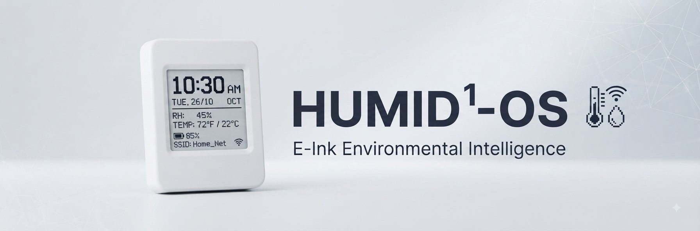
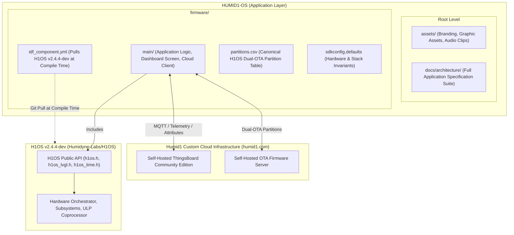

# HUMID1-OS: Application & Custom Cloud Ecosystem

<p align="center">
  
</p>

[](https://idf.espressif.com/)
[](https://github.com/Humidyne-Labs/H1OS)
[](https://www.waveshare.com)
[](https://lvgl.io/)
[](https://www.humid1.com/)
[](LICENSE)

[](https://tools.signupgenius.com/c/support-humid1-project)  

**`HUMID1-OS`** is an instrument-grade, open-source environmental telemetry and monitoring application engineered for precision cigar and tobacco humidor management.

Built upon **H1OS v2.4.4-dev** as its bare-metal OS and middleware foundation, `HUMID1-OS` delivers deterministic battery longevity, high-contrast 1-bit e-Paper presentation, BLE GATT device onboarding, and seamless telemetry synchronization with **Humid1's self-hosted ThingsBoard instance on our custom cloud ([Humid1.com](https://www.humid1.com/))**.

---

## 1. Architecture & The H1OS Middleware Backbone

`HUMID1-OS` maintains a strict separation between low-level hardware control and high-level application workflows:



- **H1OS Middleware (`Humidyne-Labs/H1OS`)**: Handles SSD1681 1-bit display rendering, 6-cycle anti-ghosting full refreshes, SHTC3 zero-heat psychrometrics, PCF85063A RTC, ES8311 audio codecs, battery LDO latching (`GPIO 17`), and ULP-RISC-V coprocessor execution.
- **`HUMID1-OS` Application**: Implements the humidor end-user experience, LVGL v9 screens, BLE GATT provisioning, acoustic event chimes, and telemetry reporting to our self-hosted cloud.

---

## 2. Self-Hosted Custom Cloud Infrastructure

Unlike consumer IoT devices dependent on proprietary third-party clouds:
- **Dedicated Self-Hosting:** Device telemetry, dynamic shared attributes, and OTA deployment pipelines connect directly to **Humid1's self-hosted ThingsBoard Community Edition instance running on our custom cloud ([Humid1.com](https://www.humid1.com/))**.
- **Data Privacy & Ownership:** Users own all environmental data with complete independence from third-party SaaS cloud platforms.
- **Dynamic Configuration:** Temperature units (°F / °C / K), duty cycle sleep intervals (60s to 24h), sound toggles, and multi-stage humidor warning/critical alarm thresholds are dynamically synchronized from the server.

---

## 3. Comprehensive Documentation Suite

- **[System Architecture Blueprint](Architectural_Outline.md)**: High-level system overview and lifecycle flow.
- **[APP_01: System Architecture & Lifecycle](docs/architecture/APP_01_system_architecture.md)**: State machine, duty cycles, and H1OS boundary.
- **[APP_02: Self-Hosted ThingsBoard & Cloud Integration](docs/architecture/APP_02_cloud_and_telemetry.md)**: Cloud schema, telemetry keys, shared attributes, and claiming protocol.
- **[APP_03: BLE GATT Provisioning Specification](docs/architecture/APP_03_ble_provisioning.md)**: BLE onboarding protocol and Proof of Possession PIN.
- **[APP_04: LVGL v9 UI Architecture & Screen Specifications](docs/architecture/APP_04_ui_and_screens.md)**: 1-bit monochrome UI layouts, humidor dashboard, and alert inversion mode.
- **[APP_05: Audio Subsystem & Acoustic Event Chimes](docs/architecture/APP_05_audio_feedback.md)**: Acoustic feedback matrix and quiet hours.
- **[APP_06: Over-The-Air (OTA) Firmware Deployment](docs/architecture/APP_06_ota_management.md)**: Dual-slot OTA update workflows and diagnostic rollback guards.
- **[APP_07: OS API Feature Mandates](docs/architecture/APP_07_os_api_mandates.md)**: Formal register of upstream H1OS API requests, packaging fixes, and enhancements.
- **[H1OS Middleware Reference](docs/h1os_reference.md)**: Hardware specifications and silicon errata.

---

## 4. Hardware Platform Specifications

Standardized on the **Waveshare ESP32-S3 Touch-ePaper-1.54" V2 (SKU: 32298)**:
- **SoC:** Espressif ESP32-S3-PICO-1-N8R8 (Xtensa® dual-core 32-bit LX7 @ up to 240 MHz, 8 MB Flash, 8 MB Octal PSRAM).
- **Display:** 1.54-inch 200×200 pixel monochrome e-Paper display (SSD1681 driver, non-touch).
- **Environmental Sensor:** Sensirion SHTC3 (I2C `0x70`) high-precision temperature & relative humidity sensor.
- **Real-Time Clock:** NXP PCF85063A ultra-low-power calendar RTC (I2C `0x51`) with 32.768 kHz crystal backup.
- **Audio:** Everest Semi ES8311 I2S codec + NS4168 Class-D amplifier driving an onboard speaker.
- **Storage:** MicroSD card slot (1-bit SDMMC FATFS mode) + Onboard Flash partitions (`epd_frame`, `nvs`, `storage`).
- **Power Architecture:** Discrete LDO battery power hold latch (`GPIO 17`), calibrated battery voltage ADC (`GPIO 4`), and physical button wake (`GPIO 18`).

---

## 5. Build & Development Instructions

### Prerequisites
- **ESP-IDF v6.1** installed in canonical path (`C:\esp\v6.1\esp-idf`).
- Git for Windows.

### Compilation
1. Open PowerShell and activate the ESP-IDF v6.1 environment:
   ```powershell
   . C:\Espressif\tools\Microsoft.v6.1.PowerShell_profile.ps1
   ```
2. Navigate to the `firmware/` directory:
   ```powershell
   cd firmware
   ```
3. Build the application (ESP-IDF Component Manager automatically resolves H1OS from Git):
   ```powershell
   idf.py build
   ```
4. Flash and monitor the hardware target:
   ```powershell
   idf.py -p COM3 flash monitor
   ```

---

## 6. License

This project is licensed under the [MIT License](LICENSE).  
Brand assets and media in `assets/` are governed by [LICENSE-ASSETS](LICENSE-ASSETS).
