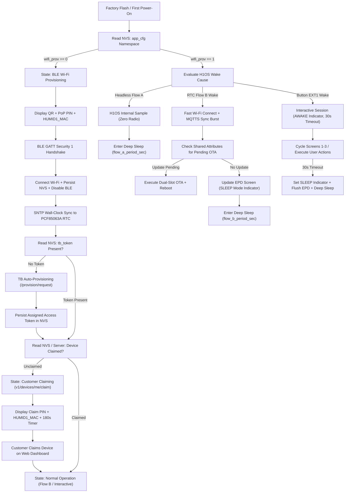
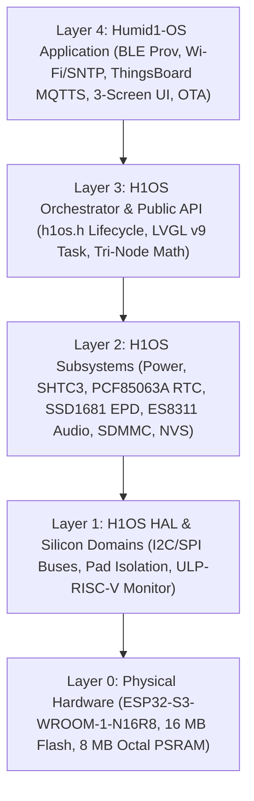
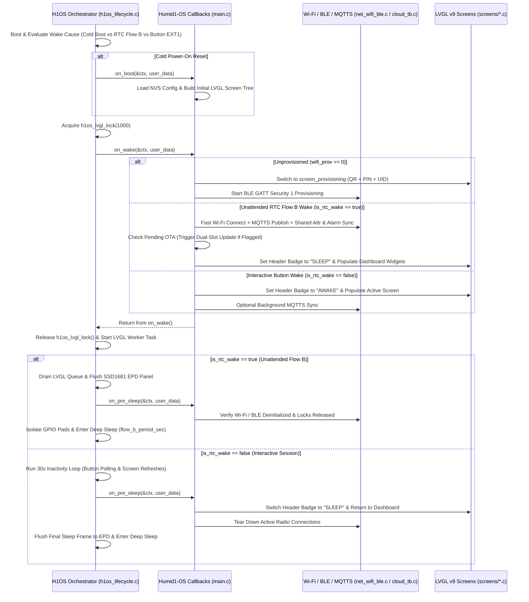
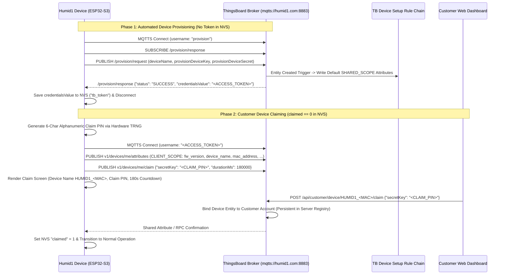
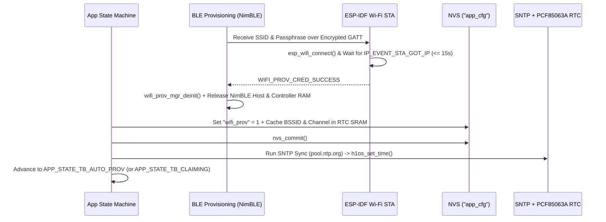
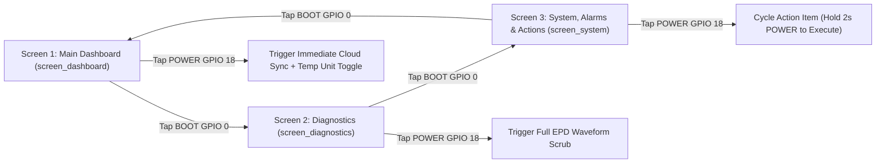

# Humid1-OS: Master Architectural Outline & System Blueprint

* **Document ID:** `HUMID1-ARCH-000` (Rev 2.0)
* **Target Hardware:** Custom ESP32-S3-WROOM-1-N16R8 Telemetry Instrument (`Humid1`)
* **Underlying Middleware:** `H1OS` v2.4.4+ (`https://github.com/voidired/H1OS.git`)
* **Cloud Backend:** ThingsBoard Community Edition (`mqtts://humid1.com:8883` / `https://app.humid1.com`)
* **Governance Policy:** Documentation is Law (`APP-STD-001` / `H1OS-STD-001`)

---

## 1. Executive Summary & Architectural Philosophy

**Humid1-OS** is the production Layer 4 embedded application firmware built on top of the **H1OS** operating system middleware. While H1OS encapsulates hardware pin multiplexing, deep-sleep pad isolation, ULP-RISC-V coprocessor wake arbitration, Tri-Node temperature compensation, and LVGL v9 1-bit monochrome e-Paper rendering, **Humid1-OS** implements the product-level business logic:

1. **Zero-Touch & Secure Onboarding:** First-boot BLE GATT Wi-Fi provisioning (with simultaneous on-screen QR code, TRNG Proof-of-Possession PIN, and MAC-derived device UID) using encrypted `protocomm_ble` Security 1, followed by immediate BLE stack teardown once Wi-Fi connects.
2. **Two-Phase Cloud Registration & Persistent Claiming:** Automated device entity registration on ThingsBoard via the Device Profile provisioning credentials (`/provision/request`), followed by user-initiated claiming (`v1/devices/me/claim`) with a 180-second on-screen countdown timer and random claim PIN. Once claimed, device ownership persists in the server registry across reboots and firmware updates until explicitly unclaimed or factory-reset.
3. **Server-Driven Telemetry & Attribute Architecture:** The ThingsBoard server defines the telemetry schema, alarm thresholds, display preferences, and wake cadence (`SHARED_SCOPE` attributes). All temperature telemetry and alarm thresholds are transmitted and evaluated in **Kelvin ($\text{K}$)** as the canonical base unit, while local display rendering converts Kelvin to the user-selected unit (`F`, `C`, or `K`).
4. **Server-Authority Alarm Management:** All environmental and battery threshold evaluations occur on the ThingsBoard server (`Alarms` Rule Chain) with hysteresis protection. The device synchronizes active alarm state via MQTT shared attributes during wake bursts and alerts the user visually (and audibly during interactive sessions when enabled).
5. **Dynamic Dual-Flow Power Orchestration:** Wake intervals for **Flow A** (headless ULP/RTC sensor sampling) and **Flow B** (periodic e-Paper refresh, MQTTS telemetry publish, shared attribute sync, and OTA check) are dynamically governed by server-pushed dashboard settings, while interactive button wakes enforce a hardcoded 30-second inactivity timeout.

---

## 2. Two-Tier Documentation & Repository Topology

```
humid1-os/ (Repository Root)
├── README.md                                     <-- Public Gateway, Quickstart & Build Guide
├── Architectural_Outline.md                      <-- Master Blueprint & Governance Index [THIS FILE]
├── AGENTS.md                                     <-- AI Agent Entrypoint & Mandatory Workflow Rules
├── CHANGELOG.md                                  <-- Authoritative SemVer Release & Modification Log
│
├── docs/
│   ├── h1os_reference.md                         <-- Layer 1-4 H1OS Public API & Hardware Reference
│   ├── architecture/                             <-- Normative Application Specifications ("Documentation is Law")
│   │   ├── APP_01_system_architecture.md         <-- State Machine, H1OS Hook Ordering & Dynamic Wake Flows
│   │   ├── APP_02_cloud_and_telemetry.md         <-- ThingsBoard MQTTS, Auto-Provisioning, Claiming & JSON Schemas
│   │   ├── APP_03_ble_provisioning.md            <-- BLE Security 1 Wi-Fi Onboarding, QR/PIN UI & Credential Reset
│   │   ├── APP_04_ui_and_screens.md              <-- 3-Screen UX, Mode Indicators, 2-Button Map & 188px Budget
│   │   ├── APP_05_audio_feedback.md              <-- Non-Blocking Audio Cues, Attribute Gates & Power Gating
│   │   ├── APP_06_ota_management.md              <-- Dual-Slot FOTA on Wake, NVS Preservation & Rollback Guards
│   │   ├── APP_07_os_api_mandates.md             <-- Formal Register of Required H1OS Middleware Extensions
│   │   └── APP_08_audit_and_doc_governance.md    <-- Formal Code Audit Standard (APP-STD-001) & Change Protocol
│   └── audits/                                   <-- Immutable Audit & Infrastructure Review Reports
│       └── APP_AUDIT_01_infrastructure_and_api_review.md <-- Full-Stack TB, Web Dash & H1OS Audit Report
│
├── firmware/                                     <-- ESP-IDF v5.4.1 Application Project Root
│   ├── CMakeLists.txt                            <-- Top-Level Project Definition & Compiler Hardening
│   ├── partitions.csv                            <-- 16 MB Flash Partition Table (Dual 4 MB OTA Slots)
│   ├── sdkconfig.defaults                        <-- Hardware, LwIP, NimBLE, MQTTS & Power Invariants
│   ├── main/
│   │   ├── CMakeLists.txt                        <-- Application Component Registration
│   │   ├── idf_component.yml                     <-- H1OS Middleware Dependency Manifest
│   │   ├── app_config.h                          <-- Compile-Time Constants, Endpoints & NVS Keys
│   │   ├── app_types.h                           <-- Server-Driven Telemetry, Attribute & State Structures
│   │   ├── app_state.h / app_state.c             <-- NVS Persistence, RTC Cache & Factory Reset Engine
│   │   ├── net_wifi_ble.h / net_wifi_ble.c       <-- BLE Provisioning, Fast RTC Wi-Fi Burst & SNTP Sync
│   │   ├── cloud_tb.h / cloud_tb.c               <-- ThingsBoard MQTTS Client, Auto-Provisioning & Claiming
│   │   ├── app_ota.h / app_ota.c                 <-- Dual-Slot HTTPS/MQTT FOTA Engine & Image Verification
│   │   ├── main.c                                <-- H1OS Lifecycle Callbacks & Top-Level Orchestration
│   │   └── screens/                              <-- LVGL v9 200x200 1-Bit Monochrome UI Screens
│   │       ├── screen_dashboard.h / .c           <-- Screen 1: Primary Climate & Connection Dashboard
│   │       ├── screen_diagnostics.h / .c         <-- Screen 2: Tri-Node Metrology, Network & Autonomy Diagnostics
│   │       ├── screen_system.h / .c              <-- Screen 3: Active Alarms, System Status & User Actions
│   │       └── screen_onboarding.h / .c          <-- Modal Screens: BLE QR+PIN, Claiming Countdown & OTA Progress
│   └── tools/
│       ├── generate_1bpp_fonts.py                <-- LVGL 1-BPP Font Generator Script
│       └── agent/                                <-- Automated Pre-Flight & Verification Utilities
│           ├── sanitize.py                       <-- Prohibited Lexicon & Formatting Scanner
│           ├── check_string_width.py             <-- 188px Pixel-Width Gate Verification Script
│           ├── optimize_images.py                <-- Image Context Optimizer
│           └── optimize_pdf.py                   <-- PDF Inspection Slicer
│
└── .agents/                                      <-- AI Agent Governance Rules & Domain Skills
    ├── rules/                                    <-- Always-On Architectural, Security & Style Constraints
    └── skills/                                   <-- Task-Specific Engineering Workflows
```

---

## 3. End-to-End Operational Lifecycle



---

## 4. Architectural Specification Index

Every subsystem in `humid1-os` is governed by a dedicated specification in `docs/architecture/`:

| Document ID | File Path | Primary Technical Scope |
| :--- | :--- | :--- |
| **`APP-01`** | [docs/architecture/APP\_01\_system\_architecture.md](https://www.google.com/search?q=docs/architecture/APP_01_system_architecture.md) | 5-layer hierarchy, finite state machine, H1OS `on_boot`/`on_wake`/`on_pre_sleep`/`on_shutdown` execution order, dynamic Flow A/B interval synchronization, and hardcoded 30s interactive timeout. |
| **`APP-02`** | [docs/architecture/APP\_02\_cloud\_and\_telemetry.md](https://www.google.com/search?q=docs/architecture/APP_02_cloud_and_telemetry.md) | ThingsBoard MQTTS protocol, two-phase onboarding (`/provision/request` + `v1/devices/me/claim`), server-driven telemetry contract in Kelvin (`rh`, `temp`, `battery`, `rssi`), `CLIENT_SCOPE` and `SHARED_SCOPE` JSON schemas, and server-driven alarm synchronization. |
| **`APP-03`** | [docs/architecture/APP\_03\_ble\_provisioning.md](https://www.google.com/search?q=docs/architecture/APP_03_ble_provisioning.md) | First-boot BLE GATT provisioning (`protocomm_ble` Security 1), MAC-derived `HUMID1_<MAC>` identity, simultaneous QR + PIN display, total BLE stack deinitialization after Wi-Fi connect, and factory credential reset. |
| **`APP-04`** | [docs/architecture/APP\_04\_ui\_and\_screens.md](https://www.google.com/search?q=docs/architecture/APP_04_ui_and_screens.md) | 200x200 1-bit monochrome LVGL v9 specification, 2-button navigation matrix (`BOOT` GPIO 0 / `POWER` GPIO 18), mandatory `AWAKE`/`SLEEP` mode indicator, 3 user screens (Dashboard, Diagnostics, System/Alarms/Actions), and 3 lifecycle screens. |
| **`APP-05`** | [docs/architecture/APP\_05\_audio\_feedback.md](https://www.google.com/search?q=docs/architecture/APP_05_audio_feedback.md) | Non-blocking acoustic notifications via `h1os_audio_play_Async()`, dual gate enforcement (`sound_enabled && has_sd_card`), and zero-power unattended wake discipline. |
| **`APP-06`** | [docs/architecture/APP\_06\_ota\_management.md](https://www.google.com/search?q=docs/architecture/APP_06_ota_management.md) | Dual-slot (`ota_0`/`ota_1`) ThingsBoard FOTA workflow on wake, SHA-256 verification, battery safety gates, NVS preservation across firmware upgrades, and boot confirmation (`esp_ota_mark_app_valid_cancel_rollback()`). |
| **`APP-07`** | [docs/architecture/APP\_07\_os\_api\_mandates.md](https://www.google.com/search?q=docs/architecture/APP_07_os_api_mandates.md) | Formal register of required H1OS middleware fixes and API additions (`MANDATE-01` through `MANDATE-05`). |
| **`APP-08`** | [docs/architecture/APP\_08\_audit\_and\_doc\_governance.md](https://www.google.com/search?q=docs/architecture/APP_08_audit_and_doc_governance.md) | Application Code Audit Framework (`APP-STD-001`), mechanized verification gates, and mandatory rules for documenting architectural and code changes. |
| **`AUDIT-01`** | [docs/audits/APP\_AUDIT\_01\_infrastructure\_and\_api\_review.md](https://www.google.com/search?q=docs/audits/APP_AUDIT_01_infrastructure_and_api_review.md) | Formal full-stack audit of ThingsBoard Rule Chains, Web Dashboard source, and H1OS v2.4.4-dev middleware, including concrete JSON/TypeScript/C remediation patches. |

---

## 5. Summary of Governance Rules ("Documentation is Law")

1. **Specification-First Development:** No application C/H source file, MQTT topic handler, NVS key, or LVGL screen layout may be added or altered without first updating the corresponding `docs/architecture/APP_0X_*.md` specification.
2. **Strict Layer Boundary:** Application code (`firmware/main/`) interacts with hardware exclusively through public `<h1os/h1os.h>` APIs. If an operation requires access to internal H1OS headers or new driver functionality, a formal mandate must be logged in [docs/architecture/APP\_07\_os\_api\_mandates.md](https://www.google.com/search?q=docs/architecture/APP_07_os_api_mandates.md).
3. **Mandatory Pre-Merge Audit:** Every code modification must pass the 5-step audit workflow defined in [docs/architecture/APP\_08\_audit\_and\_doc\_governance.md](https://www.google.com/search?q=docs/architecture/APP_08_audit_and_doc_governance.md), including `sanitize.py`, `check_string_width.py`, zero runtime heap allocation checks, and clean `-Werror -Wdouble-promotion` builds.


# APP_01: System Architecture, State Machine & Lifecycle Orchestration

* **Document ID:** `APP-ARCH-001` (Rev 2.0)
* **Parent Blueprint:** \[suspicious link removed\]
* **Normative Scope:** Layer 4 Application State Machine, H1OS Callback Execution Order, Dynamic Flow A/B Timing, and NVS/RTC State Partitioning

---

## 1. Five-Layer Architectural Hierarchy

The `humid1-os` firmware stack enforces strict unidirectional dependencies from Layer 4 (`firmware/main/`) into Layer 3 (`h1os.h`):



### 1.1 Architectural Boundaries

- **H1OS Responsibility (Layers 1–3):** Early boot wake-stub arbitration (`orch_wake_stub.c`), ULP-RISC-V button/RTC pin monitoring (`GPIO 0`, `GPIO 18`, `GPIO 5`), SHTC3 + MCU Die + EPD Glass Tri-Node temperature sampling, LiPo OCV battery metrology, SPI e-Paper LUT refresh waveforms, and deep-sleep GPIO pad hold isolation.
- **Humid1-OS Responsibility (Layer 4):** First-boot BLE Wi-Fi provisioning, SNTP wall-clock synchronization, ThingsBoard two-phase registration and claiming, server-driven MQTTS telemetry publishing and shared attribute synchronization, server alarm presentation, dual-slot OTA execution, and the 3-screen user interface.

---

## 2. Dynamic Wake Cadence: Flow A, Flow B & Interactive Sessions

H1OS operates two distinct periodic wake flows alongside user-initiated interactive wakes. As required by product specifications, the periods for **Flow A** and **Flow B** are dynamically controlled by the ThingsBoard server via Shared Attributes (`SHARED_SCOPE`), while the interactive inactivity timeout is hardcoded at **30 seconds**.

| Flow / Mode | Trigger Source | Radio State | Display State | Default Period | Configuration Source |
| :--- | :--- | :--- | :--- | :--- | :--- |
| **Flow A (Headless Sample)** | PCF85063A RTC Countdown (`GPIO 5`) when `wake_counter < ratio` | **OFF** (Zero RF) | **OFF** (High-Z) | `60 s` | Server Shared Attribute `flow_a_period_sec` (persisted in NVS `flow_a_sec`) |
| **Flow B (Telemetry & EPD Sync)** | PCF85063A RTC Countdown (`GPIO 5`) when `wake_counter >= ratio` | **ON** (Fast Wi-Fi + MQTTS Burst) | **ON** (Partial/Full Refresh with `SLEEP` badge) | `900 s` (15 min) | Server Shared Attribute `sleep_interval_sec` / `flow_b_period_sec` (persisted in NVS `flow_b_sec`) |
| **Interactive Session** | Tactile Button Press (`BOOT` `GPIO 0` or `POWER` `GPIO 18`) | **ON** (On-demand sync / actions) | **ON** (Active UI with `AWAKE` badge) | `30 s` timeout | Hardcoded constant `APP_INACTIVITY_TIMEOUT_SEC = 30U` |

### 2.1 Dynamic Flow A/B Synchronization Math

In H1OS, the wake stub (`orch_wake_stub.c`) wakes the main CPU into a full session (`Flow B`) every $R$ wakes of `Flow A`, where the integer ratio $R$ is computed as:

$$
R = \max\left(1, \left\lfloor \frac{T_{\text{Flow B}}}{T_{\text{Flow A}}} \right\rfloor\right)
$$

When the ThingsBoard server pushes an updated `sleep_interval_sec` (or `sleep_interval_min * 60`) or `flow_a_period_sec`:
1. The application validates bounds ($T_{\text{Flow A}} \in [15\,\text{s}, 3600\,\text{s}]$, $T_{\text{Flow B}} \in [60\,\text{s}, 86400\,\text{s}]$, and $T_{\text{Flow B}} \ge T_{\text{Flow A}}$).
2. The application commits the updated intervals to the `app_cfg` NVS namespace (`flow_a_sec`, `flow_b_sec`).
3. The application updates the active H1OS session timing configuration prior to `h1os_sleep()` so the PCF85063A alarm timer arms with the new interval immediately (see `MANDATE-04` in [APP\_07\_os\_api\_mandates.md](https://www.google.com/search?q=APP_07_os_api_mandates.md)).

---

## 3. H1OS Lifecycle Callback Execution Order

Understanding the exact call sequence inside `h1os_start()` (`h1os_lifecycle.c`) is mandatory for deterministic radio and UI operation:



### 3.1 Critical Execution Invariant on Unattended RTC Wakes (`Flow B`)

In `h1os_lifecycle.c`, when `is_rtc_wake == true` (unattended periodic Flow B wake), H1OS invokes `on_wake()`, starts the LVGL task, drains the display buffer once, and immediately invokes `h1os_sleep()`. Therefore:
- During an unattended RTC `Flow B` wake, the fast Wi-Fi connection, ThingsBoard MQTTS telemetry publish, shared attribute fetch, and OTA check **must execute synchronously inside `on_wake()`** (bounded to $\le 3500\,\text{ms}$) before `on_wake()` returns.
- Inside `on_wake()`, the application updates the LVGL screen labels with the latest psychrometric readings, active server alarm state, and the `SLEEP` status indicator, so the single post-`on_wake()` EPD flush writes the complete, up-to-date frame prior to deep sleep.

---

## 4. Application Finite State Machine

The application state machine (`app_fsm_state_t` in `app_types.h`) transitions deterministically across seven states:

| State Enum | Description | Entry Condition | Exit Transition |
| :--- | :--- | :--- | :--- |
| `APP_STATE_BOOT_INIT` | Initial NVS load, RTC fast-cache check, and hardware identity derivation (`HUMID1_<MAC>`). | Cold boot or wake from deep sleep. | Transitions to `BLE_PROV` if `wifi_prov == 0`, else evaluates token/claim state. |
| `APP_STATE_BLE_PROV` | BLE GATT Wi-Fi provisioning (`protocomm_ble` Security 1) with QR + PoP PIN on screen. | `wifi_prov == 0` in NVS. | Wi-Fi IP acquired $\rightarrow$ BLE stack completely deinitialized $\rightarrow$ `SNTP_SYNC`. |
| `APP_STATE_SNTP_SYNC` | NTP wall-clock acquisition (`pool.ntp.org`, `time.cloudflare.com`) written to PCF85063A RTC. | First Wi-Fi connection after provisioning, or RTC drift refresh ($\ge 24\,\text{h}$). | Valid Unix epoch ($\ge 2026$) $\rightarrow$ `TB_AUTO_PROV` or `TB_CLAIMING` or `FLOW_B_SYNC`. |
| `APP_STATE_TB_AUTO_PROV` | Phase 1 ThingsBoard device registration via `/provision/request` to obtain `tb_token`. | `wifi_prov == 1` and `tb_token` empty in NVS. | `credentialsValue` saved to NVS `tb_token` $\rightarrow$ `TB_CLAIMING`. |
| `APP_STATE_TB_CLAIMING` | Phase 2 customer device claiming via `v1/devices/me/claim` with 180s countdown on EPD. | `tb_token` valid, `claimed == 0` in NVS. | Customer claims device on dashboard (confirmed via attribute/RPC) $\rightarrow$ `INTERACTIVE`. |
| `APP_STATE_FLOW_B_SYNC` | Unattended RTC wake: fast Wi-Fi burst, MQTTS telemetry publish, attribute/alarm sync, OTA check. | Unattended RTC Flow B wake (`wifi_prov == 1 && claimed == 1`). | If OTA flagged $\rightarrow$ `OTA_UPDATE`; else EPD flush (`SLEEP` badge) $\rightarrow$ Deep Sleep. |
| `APP_STATE_INTERACTIVE` | User button wake: `AWAKE` badge, 30s inactivity timer, 2-button navigation across Screens 1–3. | `BOOT` (`GPIO 0`) or `POWER` (`GPIO 18`) button press. | 30s inactivity timeout $\rightarrow$ `SLEEP` badge flush $\rightarrow$ Deep Sleep. |
| `APP_STATE_OTA_UPDATE` | Dual-slot firmware download (`ota_0`/`ota_1`), SHA-256 verification, and reboot. | `manual_ota_trigger == true` or `auto_update_enabled && fw_version > current`. | Image verified $\rightarrow$ `esp_restart()`; on error $\rightarrow$ report `FAILED` and resume sleep. |

---

## 5. Non-Volatile Storage (`app_cfg`) & RTC Fast Cache Architecture

To prevent NVS flash wear (`PIT-05-D`) while surviving deep sleep resets (`PIT-05-A`), state is partitioned between the `app_cfg` NVS namespace (written only on configuration changes) and `RTC_DATA_ATTR` SRAM (retained across deep sleep with zero flash wear):

### 5.1 NVS Key Registry (Namespace: `"app_cfg"`)

| NVS Key | Type | Default | Description |
| :--- | :--- | :--- | :--- |
| `"wifi_prov"` | `u8` | `0` | `1` when Wi-Fi SSID/password are provisioned in NVS. |
| `"claimed"` | `u8` | `0` | `1` when customer claiming is completed and verified. |
| `"tb_token"` | `str` (64B) | `""` | Permanent device access token returned by ThingsBoard `/provision/response`. |
| `"nickname"` | `str` (32B) | `""` | User-assigned device nickname synchronized from ThingsBoard `device_nickname`. |
| `"temp_unit"` | `u8` | `0` (`'F'`) | Display temperature unit (`0` = Fahrenheit, `1` = Celsius, `2` = Kelvin). |
| `"theme_dark"` | `u8` | `0` | `0` = Light theme (black ink on white background), `1` = Dark theme (inverted). |
| `"sound_en"` | `u8` | `1` | `1` = Audio feedback enabled during interactive sessions, `0` = Muted. |
| `"auto_ota"` | `u8` | `1` | `1` = Automatic OTA updates enabled on wake check, `0` = Manual trigger only. |
| `"flow_a_sec"` | `u32` | `60` | Headless sensor sampling interval in seconds (`Flow A`). |
| `"flow_b_sec"` | `u32` | `900` | Telemetry publish and display sync interval in seconds (`Flow B`). |

### 5.2 RTC Slow SRAM Cache (`RTC_DATA_ATTR app_rtc_cache_t`)

| Field | Type | Purpose |
| :--- | :--- | :--- |
| `magic` | `uint32_t` | Validation constant (`0x48314150UL`, `"H1AP"`) verifying initialized RTC memory. |
| `last_bssid[6]` | `uint8_t[6]` | Cached AP BSSID for single-channel fast Wi-Fi scanning ($\le 300\,\text{ms}$ association). |
| `last_channel` | `uint8_t` | Cached Wi-Fi primary channel (1–13) to bypass full 13-channel scan on Flow B wakes. |
| `last_sntp_epoch` | `uint32_t` | Unix timestamp of last successful SNTP sync (re-syncs once every 24 hours). |
| `active_alarm` | `app_alarm_state_t` | Cached server alarm state (`active`, `severity`, `type`, `message`) for UI display. |
| `thresholds` | `app_thresholds_t` | Cached server alarm thresholds (in Kelvin and %RH) for local reference. |
| `consecutive_net_fails` | `uint16_t` | Exponential backoff counter when Wi-Fi or MQTTS broker is unreachable. |
| `last_err_code` | `int32_t` | Most recent `esp_err_t` or MQTT protocol error displayed on Screen 3 (`screen_system`). |


# APP_02: ThingsBoard Cloud Protocol, Onboarding & Server-Driven Telemetry

* **Document ID:** `APP-ARCH-002` (Rev 2.0)
* **Parent Blueprint:** \[suspicious link removed\]
* **Normative Scope:** MQTTS Transport, Two-Phase Device Onboarding (Auto-Provisioning + Claiming), Server-Driven Telemetry Schema (Kelvin Base Unit), Shared/Client Attributes, and Server-Managed Alarms

---

## 1. Cloud Transport & Security Architecture

All cloud communication targets the ThingsBoard Community Edition broker over mutually verifiable TLS (`MQTTS`):

- **Broker Endpoint:** `mqtts://humid1.com:8883` (production alias `mqtts://app.humid1.com:8883`)
- **TLS Verification:** Enforced via ESP-IDF `esp_crt_bundle_attach` (Mozilla Root CA bundle). Plaintext MQTT (`1883`) and unverified TLS connections are strictly prohibited in production builds.
- **Prerequisite Wall-Clock Gate:** X.509 certificate expiration verification requires a valid system clock ($\text{year} \ge 2026$). On first boot after Wi-Fi provisioning (or if `h1os_rtc_is_time_valid()` returns `false`), the firmware executes SNTP synchronization (`pool.ntp.org`, `time.cloudflare.com`) and updates the PCF85063A hardware RTC via `h1os_set_time()` **before** initiating the TLS handshake.

---

## 2. Two-Phase ThingsBoard Onboarding Protocol

Inspection of the production ThingsBoard Device Profile (`Humid1 Device`, profile ID `f00235c0-a123-11f1-b530-9b9631e0c365`) and rule chains establishes a mandatory **two-phase onboarding sequence** separating device identity creation from customer ownership claiming.



### 2.1 Phase 1: Device Auto-Provisioning (`/provision/request`)

When `tb_token` is absent in NVS, the device connects to `mqtts://humid1.com:8883` using MQTT username `"provision"` (empty password), subscribes to `/provision/response`, and publishes the following JSON document to `/provision/request`:

```json
{
  "deviceName": "HUMID1_A1B2C3",
  "provisionDeviceKey": "joz5hqceqbkzzft3qzaf",
  "provisionDeviceSecret": "d9xpuylns0pdlk2w70hc"
}
```

- **`deviceName`:** Deterministic hardware UID formatted as `HUMID1_<MAC_LAST_3_BYTES_HEX>` (derived from `esp_read_mac(mac, ESP_MAC_WIFI_STA)`).
- **Server Action:** ThingsBoard creates the device under the `Humid1 Device` profile and executes the `Device Setup Chain` (`838f4410-a3f7-11f1-9ad5-91546bc9dd79`), initializing default `SHARED_SCOPE` attributes.
- **Response (`qos = 1` on `/provision/response`):**
  ```json
  {
    "status": "SUCCESS",
    "credentialsType": "ACCESS_TOKEN",
    "credentialsValue": "AbCdEfGhIjKlMnOpQrSt"
  }
  ```
- The firmware stores `credentialsValue` in NVS key `"tb_token"` and calls `nvs_commit()`.

### 2.2 Phase 2: Persistent Customer Claiming (`v1/devices/me/claim`)

Once `tb_token` is stored in NVS (and while NVS `"claimed" == 0`):
1. The firmware reconnects to `mqtts://humid1.com:8883` using `tb_token` as the MQTT username.
2. The firmware generates a random 6-character alphanumeric Claim PIN via `esp_fill_random()`.
3. The firmware publishes the claiming initiation JSON document to `v1/devices/me/claim`:
   ```json
   {
     "secretKey": "9K4M2P",
     "durationMs": 180000
   }
   ```
4. The e-Paper display renders `screen_claiming`, showing the **Device Name** (`HUMID1_A1B2C3`), **Claim PIN** (`9K4M2P`), optional **Nickname**, and a live **180-second countdown timer**.
5. If the 180-second window expires before the user completes claiming on the Web Dashboard (`POST /api/customer/device/{deviceName}/claim`), the user can press a button to regenerate a fresh PIN and restart the 180-second window.
6. **Persistence Rule:** Once claimed, ownership is permanently stored in the ThingsBoard server database and cached in NVS (`"claimed" = 1`). Across reboots and OTA firmware updates, the device does **not** re-enter claiming mode unless the customer explicitly unclaims the device or triggers a full factory reset on Screen 3 (`screen_system`).

---

## 3. Server-Driven Telemetry Architecture & Kelvin Base Unit

### 3.1 Server-Driven Data Structure Principle

To prevent firmware fragmentation across hardware revisions and OTA updates, **the server dictates the telemetry structure**:
- The server specifies enabled telemetry fields via the shared attribute `telemetry_schema_mask` (defaulting to the canonical 4-key set if unspecified).
- The firmware populates a unified internal telemetry dictionary from `h1os_get_telemetry()` and serializes only the server-requested keys into a single JSON document published to `v1/devices/me/telemetry`.
- **Canonical Base Unit for Temperature:** All temperature values transmitted to ThingsBoard (`temp`) and all temperature alarm thresholds (`tempLowCritical`, `tempLowWarning`, `tempHighWarning`, `tempHighCritical`, `tempHist`) are strictly represented in **Kelvin ($\text{K}$)**:

$$
T_{\text{K}} = T_{^\circ\text{C}} + 273.15
$$

Using Kelvin eliminates negative numbers, prevents Fahrenheit/Celsius ambiguity inside server rule chains, and aligns with the `Alarms`, `Compose and Send Email`, and `POST FCM Alerts` ThingsBoard rule chains.

### 3.2 Canonical Telemetry JSON Document (`v1/devices/me/telemetry`)

Published on every `Flow B` wake and interactive sync (`QoS 1`):

```json
{
  "ts": 1774310400000,
  "values": {
    "rh": 68.42,
    "temp": 294.26,
    "battery": 88,
    "rssi": -62
  }
}
```

#### Extended Server-Selectable Telemetry Keys (Optional via `telemetry_schema_mask`)

When diagnostic telemetry is requested by the server via `telemetry_schema_mask`, the unified serializer appends the requested fields from `h1os_telemetry_t`:

| JSON Key | Unit | Source in `h1os_telemetry_t` | Bitmask Flag | Description |
| :--- | :--- | :--- | :--- | :--- |
| `"rh"` | `%` | `ambient_rh_pct` | `BIT(0)` (Default) | Compensated relative humidity ($0.0\text{--}100.0\%$). |
| `"temp"` | $\text{K}$ | `ambient_temp_c + 273.15f` | `BIT(1)` (Default) | Tri-Node compensated ambient temperature in **Kelvin**. |
| `"battery"` | `%` | `battery.soc_pct` | `BIT(2)` (Default) | LiPo state-of-charge percentage ($0\text{--}100\%$). |
| `"rssi"` | $\text{dBm}$ | `esp_wifi_sta_get_ap_info()` | `BIT(3)` (Default) | Wi-Fi AP received signal strength indicator. |
| `"dew_point"` | $\text{K}$ | `dew_point_c + 273.15f` | `BIT(4)` (Extended) | Psychrometric dew point temperature in **Kelvin**. |
| `"vbat_mv"` | $\text{mV}$ | `battery.voltage_mv` | `BIT(5)` (Extended) | Raw calibrated battery terminal voltage in millivolts. |
| `"autonomy_days"` | $\text{days}$ | `battery.autonomy_days` | `BIT(6)` (Extended) | Projected remaining battery life in days. |
| `"confidence"` | `%` | `confidence_pct` | `BIT(7)` (Extended) | Tri-Node thermal equilibrium confidence ($0\text{--}100\%$). |

---

## 4. Client & Shared Attribute Schemas

### 4.1 Client Attributes (`CLIENT_SCOPE` -> `v1/devices/me/attributes`)

Published by the device on boot, after OTA updates, and whenever network metadata changes:

```json
{
  "fw_version": "0.1.0-dev",
  "fw_title": "humid1-os",
  "h1os_version": "2.4.4-dev",
  "device_name": "HUMID1_A1B2C3",
  "device_nickname": "Desktop Humidor",
  "mac_address": "34:85:18:A1:B2:C3",
  "ssid": "Humidor_VLAN",
  "ip_address": "192.168.1.142",
  "has_sd_card": true,
  "audio_synced": true
}
```

### 4.2 Shared Attributes (`SHARED_SCOPE` <- `v1/devices/me/attributes/response/+`)

Requested on every `Flow B` wake via `v1/devices/me/attributes/request/1`:

```json
{
  "shared": {
    "sleep_interval_sec": 900,
    "sleep_interval_min": 15,
    "flow_a_period_sec": 60,
    "device_theme": "light",
    "sound_enabled": false,
    "auto_update_enabled": true,
    "manual_ota_trigger": false,
    "email_alerts_enabled": true,
    "temp_unit": "F",
    "device_nickname": "Desktop Humidor",
    "telemetry_schema_mask": 15,
    "alarm_thresholds": {
      "rhLowCritical": 60.0,
      "rhLowWarning": 62.0,
      "rhHighWarning": 72.0,
      "rhHighCritical": 75.0,
      "tempLowCritical": 288.71,
      "tempLowWarning": 290.93,
      "tempHighWarning": 295.37,
      "tempHighCritical": 297.59,
      "batteryLowCritical": 10.0,
      "batteryLowWarning": 20.0,
      "rhHist": 1.0,
      "tempHist": 0.3,
      "battHist": 2.0
    },
    "alarm_state": {
      "active": false,
      "severity": "NONE",
      "type": "",
      "message": "All metrics within nominal range"
    }
  }
}
```

---

## 5. Server-Driven Alarm Synchronization Protocol

Per system requirements, **all alarm threshold evaluation and hysteresis logic execute exclusively on the ThingsBoard server** (`Alarms` Rule Chain `92da2e30-a9ab-11f1-9663-1fc19e23cbce`):

1. **Why Shared Attributes + MQTT Notification Are Used:** Because the Humid1 instrument spends $>99.8\%$ of its lifecycle in deep sleep with Wi-Fi powered down, an asynchronous RPC pushed while the device is asleep would be missed. By storing the evaluated `alarm_state` JSON object in `SHARED_SCOPE` (with `notifyDevice: true` in the `Alarms` Rule Chain) AND subscribing to `v1/devices/me/attributes` while awake:
   - If the device is currently in an **Interactive Session (`AWAKE`)**, it receives the alarm transition immediately over `v1/devices/me/attributes`.
   - If the device is in **Deep Sleep (`SLEEP`)**, it retrieves the authoritative `alarm_state` during its next `Flow B` wake via `v1/devices/me/attributes/request/1`.
2. **Device Response to Active Server Alarm (`alarm_state.active == true`):**
   - **Screen 1 (`screen_dashboard`) & Screen 3 (`screen_system`):** Displays an inverted high-contrast alarm banner indicating the alarm type (`RH`, `TEMP`, `BATTERY`) and severity (`WARNING` or `CRITICAL`).
   - **Critical Alarm Full-Screen Inversion:** When `alarm_state.severity == "CRITICAL"`, the dashboard header and breached metric box invert polarity to maximize visual visibility across the room on the bistable e-Paper panel.
   - **Audio Alert Gate:** If `alarm_state.active == true` AND the device is in an interactive session (`is_rtc_wake == false`) AND `sound_enabled == true` AND `has_sd_card == true`, the device plays `/sdcard/alarm_warn.wav` or `/sdcard/alarm_crit.wav` via `h1os_audio_play_Async()`. Unattended RTC wakes remain strictly silent.

---

## 6. RPC Command Contract (`v1/devices/me/rpc/request/+`)

While awake, the firmware subscribes to `v1/devices/me/rpc/request/+` and supports the following server-to-device and device-to-server RPC methods:

| Method Direction | `"method"` Name | `"params"` Structure | Action & Response (`v1/devices/me/rpc/response/{id}`) |
| :--- | :--- | :--- | :--- |
| Device $\rightarrow$ Server | `"getCurrentTime"` | `{}` | Fallback time query handled by `Boot RPC Trigger` rule chain; returns `{"epoch_ms": 1774310400000}`. |
| Server $\rightarrow$ Device | `"setTheme"` | `{"theme": "dark"}` | Updates NVS `"theme_dark"`, triggers `h1os_lvgl_request_full_refresh()`, replies `{"status": "OK"}`. |
| Server $\rightarrow$ Device | `"triggerOta"` | `{"version": "0.2.0"}` | Flags immediate transition to `APP_STATE_OTA_UPDATE`, replies `{"status": "OTA_SCHEDULED"}`. |
| Server $\rightarrow$ Device | `"clearSettings"` | `{"factoryReset": false}` | Clears Wi-Fi credentials (and claim state if `factoryReset == true`) and reboots into BLE provisioning. |


# APP_03: BLE Wi-Fi Provisioning, Device Identity & Credential Reset

* **Document ID:** `APP-ARCH-003` (Rev 2.0)
* **Parent Blueprint:** \[suspicious link removed\]
* **Normative Scope:** First-Boot BLE GATT Onboarding, `protocomm_ble` Security 1 Encryption, Simultaneous QR + PIN Display, Radio Teardown, and Credential Reset Flows

---

## 1. Onboarding Trigger & Security Model

When the device boots and NVS key `"wifi_prov"` in namespace `"app_cfg"` equals `0` (or when the user invokes **Clear Wi-Fi / Factory Reset** from Screen 3), the firmware enters `APP_STATE_BLE_PROV`.

### 1.1 Encrypted `protocomm_ble` Security 1 Transport

- **Transport Stack:** ESP-IDF `wifi_provisioning` manager over NimBLE (`WIFI_PROV_SCHEME_BLE`) with `WIFI_PROV_EVENT_HANDLER_FREE_BTDM` so Bluetooth controller and host memory are completely freed the instant provisioning completes.
- **Encryption Level:** **`WIFI_PROV_SECURITY_1`** (Curve25519 Elliptic-Curve Diffie-Hellman key exchange + AES-CTR session encryption authenticated with a Proof-of-Possession PIN). Unencrypted `WIFI_PROV_SECURITY_0` is strictly prohibited.
- **Hardware TRNG Proof-of-Possession (PoP) PIN:** On entering provisioning mode, the firmware generates a random 8-character numeric/alphanumeric PoP code using the ESP32-S3 hardware true random number generator (`esp_fill_random()`).

---

## 2. Deterministic Hardware Identity (`HUMID1_<MAC>`)

Every Humid1 unit derives a unique, immutable hardware identifier from its factory-burned IEEE 802.11 Station MAC address:

```c
uint8_t mac[6] = {0};
esp_read_mac(mac, ESP_MAC_WIFI_STA);
snprintf(dev_uid, sizeof(dev_uid), "HUMID1_%02X%02X%02X", mac[3], mac[4], mac[5]);
```

- **Format:** `HUMID1_A1B2C3` (13 characters, uppercase hexadecimal).
- **Usage:**
  1. Advertised as the BLE GATT service name during Wi-Fi provisioning.
  2. Sent as `"deviceName"` in ThingsBoard Phase 1 Auto-Provisioning (`/provision/request`).
  3. Displayed on the Claiming Screen (`screen_claiming`) so the user can enter the exact Device Name and Claim PIN in the Web Dashboard (`ClaimDeviceModal.tsx`).
  4. Displayed on the Main Dashboard (`screen_dashboard`) whenever a custom `device_nickname` has not yet been assigned on the server.

---

## 3. Simultaneous On-Screen QR Code & Manual PIN Display

To support both camera-based mobile app scanning and manual entry in the Web Dashboard (Web Bluetooth API or companion utility), `screen_provisioning` **must simultaneously render both the QR code and the human-readable credentials** on the $200 \times 200$ e-Paper panel:

### 3.1 ESP-IDF Provisioning QR URI Format

The QR code encodes the standard ESP-IDF JSON provisioning string:

```json
{"ver":"v1","name":"HUMID1_A1B2C3","pop":"84920173","transport":"ble"}
```

### 3.2 `screen_provisioning` Layout Contract ($200 \times 200$, $188\,\text{px}$ Usable Width)

| Region | Vertical Band ($Y$) | Content | Typography & Rendering |
| :--- | :--- | :--- | :--- |
| **Header Bar** | $0\text{--}22\,\text{px}$ | `"WIFI SETUP"` (Left) + `"AWAKE"` (Right) | `h1os_font_ui_12` ($12\,\text{pt}$ Bold), 2px bottom divider. |
| **QR Canvas** | $26\text{--}130\,\text{px}$ | $100 \times 100\,\text{px}$ 1-bit QR code centered horizontally ($X = 50$). | Crisp 1-BPP module matrix (`lv_qrcode` or static bitmap generator), zero anti-aliasing. |
| **Device ID Row** | $134\text{--}154\,\text{px}$ | `"ID: HUMID1_A1B2C3"` | `h1os_font_ui_12` centered, guaranteed $\le 188\,\text{px}$. |
| **PoP PIN Row** | $156\text{--}178\,\text{px}$ | `"PIN: 8492-0173"` | `h1os_font_mono_14` / `h1os_font_ui_14` high-contrast inverted box. |
| **Footer Hint** | $180\text{--}196\,\text{px}$ | `"SCAN QR OR ENTER PIN"` | `h1os_font_ui_10` centered. |

---

## 4. Post-Provisioning BLE Teardown & Transition Sequence

Per system requirements (*"once wifi is up, shut down ble"*), BLE is used exclusively during Wi-Fi credential onboarding and must never remain active during normal operation:



1. **Immediate Radio Teardown:** Upon receiving `WIFI_PROV_END` after `IP_EVENT_STA_GOT_IP`, `wifi_prov_mgr_deinit()` stops the NimBLE GATT server, disables the BLE controller, and releases all Bluetooth RAM (`ESP_BT_MODE_BLE` memory freed).
2. **Failure Handling:** If the supplied Wi-Fi credentials fail authentication (`WIFI_PROV_CRED_FAIL`), the screen updates the footer status to `"AUTH FAILED - RETRY"` and resets the provisioning state so the user can submit corrected credentials without rebooting.
3. **Provisioning Timeout:** If no user connects over BLE within $180\,\text{seconds}$, the device renders `"SETUP PAUSED - PRESS BTN"` on the e-Paper panel and enters deep sleep (`h1os_sleep(0)` waiting for an `EXT1` button press wake) to protect the LiPo battery from depletion on a warehouse shelf.

---

## 5. Clearing Settings & Factory Reset (Screen 3 Actions)

Users can reset device settings directly from **Screen 3 (`screen_system`)** using the 2-button interface. The firmware supports two distinct reset scopes:

| Reset Action | Trigger on Screen 3 | NVS Keys Cleared | ThingsBoard Impact | Next Boot State |
| :--- | :--- | :--- | :--- | :--- |
| **Clear Wi-Fi Only (Re-Provision Network)** | Select `"CLEAR WIFI"` $\rightarrow$ Hold `POWER` (`GPIO 18`) for $2\,\text{s}$ to confirm. | Clears ESP-IDF `nvs.net80211` Wi-Fi credentials and sets `"wifi_prov" = 0`. Preserves `"tb_token"` and `"claimed" = 1`. | Device retains its ThingsBoard identity and customer claim; reconnects to new Wi-Fi AP and resumes telemetry. | `APP_STATE_BLE_PROV` $\rightarrow$ `APP_STATE_FLOW_B_SYNC`. |
| **Full Factory Reset (Re-Provision & Re-Claim)** | Select `"FACTORY RESET"` $\rightarrow$ Hold `POWER` (`GPIO 18`) for $3\,\text{s}$ to confirm. | Erases `"nvs.net80211"` and resets all `"app_cfg"` keys (`"wifi_prov" = 0`, `"claimed" = 0`, `"nickname" = ""`, default intervals). | If still connected prior to wipe, publishes `{"claimed": false}` / unclaim telemetry; re-enters full onboarding flow on reboot. | `APP_STATE_BLE_PROV` $\rightarrow$ `APP_STATE_TB_AUTO_PROV` $\rightarrow$ `APP_STATE_TB_CLAIMING`. |


# APP_04: User Interface, 3-Screen Navigation & 1-Bit LVGL Architecture

* **Document ID:** `APP-ARCH-004` (Rev 2.0)
* **Parent Blueprint:** \[suspicious link removed\]
* **Normative Scope:** $200 \times 200$ 1-Bit Monochrome Display Rules, Mandatory `AWAKE`/`SLEEP` Indicator, 2-Button Interaction Matrix, 3 Core User Screens, and 3 Lifecycle Modal Screens

---

## 1. Physical Display & Typography Constraints

The Humid1 instrument uses a **Waveshare 1.54-inch SSD1681 electrophoretic (e-Paper) panel** driven via H1OS LVGL v9 integration:

- **Resolution:** $200 \times 200\,\text{pixels}$ ($1\,\text{bit per pixel}$, pure black `#000000` and pure white `#FFFFFF`).
- **Safe Text Width Budget:** Every screen enforces a $6\,\text{px}$ horizontal margin on left and right edges, leaving a **maximum usable horizontal width of $188\,\text{px}$** (`APP_UI_MAX_WIDTH_PX = 188`).
- **Zero Anti-Aliasing & Zero Animations:** All LVGL widgets must use `0px` shadow, `100%` opacity, crisp $1\,\text{px}$ or $2\,\text{px}$ borders, and static text labels (`LV_LABEL_LONG_CLIP`). Scrolling marquees (`LV_LABEL_LONG_SCROLL`) and opacity fades are prohibited because e-Paper refresh latency ($\sim 300\,\text{ms}$ partial, $\sim 2000\,\text{ms}$ full) cannot render continuous animations.
- **Kelvin-to-User-Unit Display Conversion:** All internal and cloud temperatures are stored in **Kelvin ($\text{K}$)**. Screen rendering converts Kelvin on the fly according to NVS/Shared Attribute `temp_unit`:
  - **Fahrenheit (`'F'`):** $T_{^\circ\text{F}} = (T_{\text{K}} - 273.15) \times 1.8 + 32.0$
  - **Celsius (`'C'`):** $T_{^\circ\text{C}} = T_{\text{K}} - 273.15$
  - **Kelvin (`'K'`):** $T_{\text{K}}$

---

## 2. Mandatory Operating Mode Indicator (`AWAKE` vs. `SLEEP`)

Because a bistable e-Paper display retains its image indefinitely without power, the user must always be able to tell at a glance whether the instrument is currently awake and responsive to single-tap navigation (**Interactive Mode**) or asleep in micro-amp deep sleep (**Sleep Mode**).

1. **Interactive Mode (`AWAKE`):** Whenever the device wakes from a button press (`is_rtc_wake == false`), the top-right status pill in the header bar renders `[ AWAKE ]` in **inverted colors** (white text on solid black pill in light theme) indicating buttons are live and the 30-second inactivity timer is active.
2. **Sleep Mode (`SLEEP`):** Immediately prior to entering deep sleep (inside `on_pre_sleep()` after the 30-second interactive timeout expires, and during unattended `Flow B` wakes), the firmware switches the active screen back to **Screen 1 (`screen_dashboard`)** and sets the top-right status pill to `ZZZ SLEEP` in standard outline style so the persisted e-Paper image clearly communicates that the CPU is asleep.

---

## 3. Two-Button Hardware Interaction Matrix

The hardware provides two tactile pushbuttons monitored by both the ULP-RISC-V wake stub and the H1OS interactive input poller:

- **Button 1 (`BOOT` / `GPIO 0`, Active-Low):** Screen Cycle & Cursor Advance (`NEXT`).
- **Button 2 (`POWER` / `GPIO 18`, Active-Low):** Context Action, Selection & Confirmation (`SELECT / ACTION`).



| Current Screen | `BOOT` (`GPIO 0`) Short Tap | `BOOT` (`GPIO 0`) 2s Hold | `POWER` (`GPIO 18`) Short Tap | `POWER` (`GPIO 18`) 2s–3s Hold |
| :--- | :--- | :--- | :--- | :--- |
| **Screen 1: Main Dashboard** | Advance to **Screen 2 (Diagnostics)** | Toggle display unit (`°F` $\rightarrow$ `°C` $\rightarrow$ `K`) | Trigger immediate Wi-Fi + MQTTS sync | Enter Storage Power-Off (`h1os_power_off()`) |
| **Screen 2: Diagnostics** | Advance to **Screen 3 (System & Actions)** | Force Tri-Node sensor resample | Trigger full e-Paper waveform scrub (`h1os_lvgl_request_full_refresh()`) | Return to **Screen 1 (Main Dashboard)** |
| **Screen 3: System & Actions** | Advance to **Screen 1 (Main Dashboard)** | Clear non-critical local error log | Cycle highlighted action button (`Invert Theme` $\rightarrow$ `Clear Wi-Fi` $\rightarrow$ `Factory Reset` $\rightarrow$ `Sleep Now`) | **Execute** the currently highlighted action (with confirmation prompt for resets) |
| **Claiming Screen (`screen_claiming`)** | Regenerate new 6-char Claim PIN & restart 180s timer | — | Force immediate claim-status check with ThingsBoard | Cancel & enter Clear Wi-Fi flow |

*Note: Every button tap or hold resets the hardcoded **30-second inactivity timer** (`APP_INACTIVITY_TIMEOUT_SEC = 30U`).*

---

## 4. The Three Core User Screens ($200 \times 200$ Layouts)

### 4.1 Screen 1: Main Dashboard (`screen_dashboard`)

The primary everyday instrument face displaying essential humidor conditions and system status:

```
+----------------------------------+  Y=0
| WIFI OK  [Desktop Hum] [ AWAKE ] |  Header (Y=0..24): Conn Status, Nickname/UID, Mode Pill
+----------------------------------+  Y=24 (2px solid divider)
| [ ! CRITICAL: RH HIGH (76.2%) ! ]|  Optional Alarm Banner (Y=26..44, shown when alarm_state.active)
|                                  |
|           68.4 %                 |  Primary Hero Metric (Y=48..108): Relative Humidity (RH%)
|         REL HUMIDITY             |
+----------------------------------+  Y=112 (1px divider)
|   TEMP (F)      |   DEW POINT    |  Secondary Split Row (Y=114..168):
|    70.0 F       |    57.6 F      |  Left: Ambient Temp (F/C/K) | Right: Dew Point (F/C/K)
+----------------------------------+  Y=170 (2px solid divider)
| BAT: 88% (4.06V)   SYNC: 14:30   |  Footer (Y=172..199): VBAT% / mV (or USB) + Last Sync Time
+----------------------------------+  Y=200
```

- **Required Elements:**
  1. **Connection Status:** `"WIFI OK"` (with RSSI bars), `"OFFLINE"`, or `"SYNCING"`.
  2. **Identity:** Server `device_nickname` (truncated to 11 chars) or hardware UID `HUMID1_XXXX`.
  3. **Mode Badge:** `[ AWAKE ]` (inverted pill when interactive) or `ZZZ SLEEP` (when sleeping).
  4. **Primary Metric:** Relative Humidity (`RH%`) to 1 decimal place (`%.1f%%`).
  5. **Secondary Metrics:** Ambient Temperature and Dew Point converted from Kelvin to the user's selected unit (`°F`, `°C`, or `K`).
  6. **Footer:** Battery State of Charge (`%`), voltage (`V`) or `"USB CHG"` when `vbus_present == true`, and wall-clock time of the last cloud sync.

### 4.2 Screen 2: Diagnostics & Metrology (`screen_diagnostics`)

Provides full engineering visibility into the H1OS Tri-Node compensation engine, battery autonomy model, and network timing:

```
+----------------------------------+  Y=0
| [2/3] DIAGNOSTICS      [ AWAKE ] |  Header (Y=0..22)
+----------------------------------+  Y=22
| TRI-NODE (K/C/F)   CONF:  96%    |  Section 1 (Y=24..74): Tri-Node Thermal Engine
| SHTC3: 294.3K  MCU: 296.1K       |  Raw SHTC3, MCU Die TSENS, EPD Glass 0x1B
| EPD:   294.4K   settled: YES      |
+----------------------------------+  Y=76
| PSYCHROMETRICS                   |  Section 2 (Y=78..116): Vapor Physics
| VP: 17.4 / 25.4 hPa  AH: 12.8g/m3|  Actual/Sat Vapor Pressure & Absolute Humidity
+----------------------------------+  Y=118
| POWER & AUTONOMY                 |  Section 3 (Y=120..156): Battery Metrology
| 4062mV | 0.18mA avg | ~142 days  |  Calibrated mV, Average Draw mA, Autonomy Days
+----------------------------------+  Y=158
| NET: -62dBm 192.168.1.142        |  Section 4 (Y=160..199): Network & Wake Cadence
| FLOW A: 60s | B: 900s | W:#1042  |  Dynamic Flow A/B Intervals & Wake Counter
+----------------------------------+  Y=200
```

### 4.3 Screen 3: System States, Alarms & Interactive Actions (`screen_system`)

Displays active ThingsBoard alarm details, diagnostic error logs, firmware slot metadata, and the interactive user action menu:

```
+----------------------------------+  Y=0
| [3/3] SYSTEM & ALARMS  [ AWAKE ] |  Header (Y=0..22)
+----------------------------------+  Y=22
| ALARM: NONE (SERVER NOMINAL)     |  Section 1 (Y=24..64): Active Server Alarm Box
| THR: 62-72% RH | 290.9-295.4K    |  (Inverts if WARNING/CRITICAL alarm is active)
+----------------------------------+  Y=66
| SYS: FW 0.1.0 (ota_0) ERR: 0x0   |  Section 2 (Y=68..104): Firmware, Partition & Last Error
| UID: HUMID1_A1B2C3  SD: OK       |  Hardware UID, SD Card Status, Audio State
+----------------------------------+  Y=106
| ACTIONS (PWR=NEXT, HOLD=EXEC):   |  Section 3 (Y=108..199): 4-Item Action Selector
| > [ INVERT DISPLAY THEME     ]   |  Item 0: Flip Light/Dark Theme
|   [ CLEAR WIFI CREDENTIALS   ]   |  Item 1: Wipe Wi-Fi & Reboot to BLE Setup
|   [ FULL FACTORY RESET       ]   |  Item 2: Wipe Wi-Fi + Claim Token & Reboot
|   [ POWER OFF (STORAGE MODE) ]   |  Item 3: Cut System Latch (h1os_power_off)
+----------------------------------+  Y=200
```

---

## 5. Lifecycle Modal Screens (`screen_onboarding.h/.c`)

In addition to the 3 user screens cycled during normal operation, `screen_onboarding.c` provides three dedicated lifecycle screens:

1. **Provisioning Screen (`screen_provisioning`):** Rendered during `APP_STATE_BLE_PROV`. Displays the $100 \times 100\,\text{px}$ provisioning QR code, hardware UID (`ID: HUMID1_A1B2C3`), and 8-digit TRNG PoP PIN (`PIN: 8492-0173`).
2. **Claiming Screen (`screen_claiming`):** Rendered during `APP_STATE_TB_CLAIMING`. Displays `"CLAIM DEVICE ON DASHBOARD"`, `ID: HUMID1_A1B2C3`, large high-contrast 6-character TRNG Claim PIN (`PIN: 9K4M2P`), and a partial-refreshed countdown bar (`TIME LEFT: 165s`).
3. **OTA Update Progress Screen (`screen_ota`):** Rendered during `APP_STATE_OTA_UPDATE`. Displays target version (`UPDATING TO v0.2.0`), target partition (`SLOT: ota_1`), a segmented progress bar updated every $20\%$ chunk boundary (minimizing e-Paper partial refreshes), and status text (`DOWNLOADING` $\rightarrow$ `VERIFYING SHA256` $\rightarrow$ `REBOOTING`).


# APP_05: Acoustic Feedback, Attribute Gating & Power Isolation

* **Document ID:** `APP-ARCH-005` (Rev 2.0)
* **Parent Blueprint:** \[suspicious link removed\]
* **Normative Scope:** ES8311 + NS4168 Audio Pipeline Usage, Dual Attribute/Hardware Gates (`sound_enabled` & `has_sd_card`), and Unattended Deep-Sleep Silence Invariant

---

## 1. Acoustic Feedback Architecture

The Humid1 hardware integrates an **ES8311 low-power mono audio codec** (I2C address `0x18`, I2S digital audio bus) paired with an **NS4168 Class-D power amplifier** gated by active-low `PA_EN` (`GPIO 46`, via inverter). H1OS encapsulates the entire I2S DMA streaming and amplifier power-rail sequence behind a single non-blocking API:

```c
esp_err_t h1os_audio_play_Async(const char *filepath);
```

- **Storage Medium:** Uncompressed 16-bit PCM `.wav` assets reside on the FATFS microSD card mounted by H1OS at `/sdcard/`.
- **Non-Blocking Execution:** `h1os_audio_play_Async()` spawns a dedicated background FreeRTOS worker inside H1OS that powers up `PA_EN`, streams the `.wav` file over I2S DMA, and automatically shuts down the NS4168 amplifier and ES8311 DAC upon completion. Application UI and network threads must **never** busy-wait on audio playback.

---

## 2. Mandatory Three-Condition Playback Gate

Every acoustic event in `humid1-os` must pass a deterministic three-condition gate before invoking `h1os_audio_play_Async()`:

```c
bool app_audio_can_play(const app_state_t *state, bool is_rtc_wake) {
    if (is_rtc_wake) {
        return false; // Rule 1: Unattended periodic Flow B wakes are strictly silent
    }
    if (!state->attrs.sound_enabled) {
        return false; // Rule 2: Server/NVS sound_enabled attribute must be true
    }
    if (!h1os_sdcard_is_mounted()) {
        return false; // Rule 3: MicroSD card must be physically present and mounted
    }
    return true;
}
```

1. **Condition 1 — Interactive Session Only (`!is_rtc_wake`):** Unattended periodic `Flow B` wakes occur every 15 minutes day and night. Enabling the Class-D amplifier during unattended wakes would disturb users and waste $\sim 45\text{--}120\,\text{mA}$ of battery current. Audio cues are strictly restricted to interactive sessions (`AWAKE`) and explicit user onboarding transitions.
2. **Condition 2 — User Mute Preference (`sound_enabled`):** Synchronized from the ThingsBoard Shared Attribute `sound_enabled` and cached in NVS key `"sound_en"`.
3. **Condition 3 — Media Availability (`h1os_sdcard_is_mounted()`):** Verified at boot and reported to ThingsBoard via the Client Attribute `"has_sd_card"` and `"audio_synced"`.

---

## 3. Canonical Audio Asset Map (`/sdcard/`)

| Event Trigger | Asset Path | Duration | Description |
| :--- | :--- | :--- | :--- |
| **Button Tap (`BOOT` / `POWER`)** | `/sdcard/ui_tap.wav` | $\le 60\,\text{ms}$ | Crisp tactile confirmation click on screen navigation. |
| **Action Confirm (2s Hold)** | `/sdcard/ui_confirm.wav` | $\le 180\,\text{ms}$ | Dual-tone chime confirming theme toggle or sync request. |
| **Onboarding / Claim Complete** | `/sdcard/claim_ok.wav` | $\le 450\,\text{ms}$ | Ascending triad played when Wi-Fi + customer claim succeed. |
| **Server Warning Alarm** | `/sdcard/alarm_warn.wav` | $\le 600\,\text{ms}$ | Played once upon interactive wake if `alarm_state.severity == "WARNING"`. |
| **Server Critical Alarm** | `/sdcard/alarm_crit.wav` | $\le 900\,\text{ms}$ | Played upon interactive wake if `alarm_state.severity == "CRITICAL"`. |
| **Error / Auth Failure** | `/sdcard/err_buzz.wav` | $\le 300\,\text{ms}$ | Low double-tone played on BLE Wi-Fi authentication failure. |


# APP_06: Dual-Slot Over-The-Air (OTA) Firmware Update Architecture

* **Document ID:** `APP-ARCH-006` (Rev 2.0)
* **Parent Blueprint:** \[suspicious link removed\]
* **Normative Scope:** Dual-Slot Flash Partitioning (`ota_0` / `ota_1`), Wake-Check FOTA Workflow, NVS & Claim Persistence Across Upgrades, Battery Safety Gates, and Rollback Verification

---

## 1. Flash Partition Topology (16 MB Quad/Octal Flash)

As defined in \[suspicious link removed\], the 16 MB SPI flash is partitioned with dual $4\,\text{MB}$ application slots (`ota_0` and `ota_1`) to guarantee atomic, fail-safe firmware upgrades:

| Partition Name | Type | SubType | Offset | Size | Purpose |
| :--- | :--- | :--- | :--- | :--- | :--- |
| `nvs` | `data` | `nvs` | `0x009000` | `24 KB` | Persistent Wi-Fi credentials, `tb_token`, claim state, and user preferences. |
| `otadata` | `data` | `ota` | `0x00F000` | `8 KB` | ESP-IDF dual-slot boot selector and rollback state (`ESP_OTA_IMG_PENDING_VERIFY`). |
| `phy_init` | `data` | `phy` | `0x011000` | `4 KB` | RF calibration data. |
| `ota_0` | `app` | `ota_0` | `0x020000` | `4096 KB` | Primary application slot A. |
| `ota_1` | `app` | `ota_1` | `0x420000` | `4096 KB` | Secondary application slot B. |
| `coredump` | `data` | `coredump` | `0x820000` | `64 KB` | Crash backtrace telemetry storage. |

---

## 2. Wake-Check OTA Lifecycle ("On Wake: Check Update -> Update or Sleep")

Per product requirements, the firmware evaluates pending OTA updates during its periodic `Flow B` wake burst (or when triggered via the Web Dashboard `OtaUpdateCenter.tsx`):

```mermaid
graph TD;
    Wake["Flow B Wake / Interactive Sync"] --> FetchAttr["Fetch Shared Attributes (fw_title, fw_version, fw_checksum, auto_update_enabled, manual_ota_trigger)"];
    FetchAttr --> EvalTrigger{"(manual_ota_trigger == true) OR (auto_update_enabled == true AND fw_version > current)?"};
    EvalTrigger -->|No Update Pending| NormalSleep["Flush EPD Dashboard & Enter Deep Sleep (flow_b_period_sec)"];
    EvalTrigger -->|Update Pending| BattGate{"Battery SOC >= 25% OR USB VBUS Present?"};
    BattGate -->|No (Low Battery)| DeferOTA["Publish fw_state: 'DEFERRED_LOW_BATTERY' & Enter Deep Sleep"];
    BattGate -->|Yes| StartOTA["Transition to APP_STATE_OTA_UPDATE & Render screen_ota"];
    StartOTA --> Download["Stream Firmware Image to Inactive Slot (ota_0 / ota_1)"];
    Download --> Verify["Verify SHA-256 Checksum == fw_checksum & Image Magic 0xE9"];
    Verify -->|Checksum Mismatch| AbortOTA["Abort OTA, Publish fw_state: 'FAILED', Resume Normal Sleep"];
    Verify -->|Verified OK| ClearTrigger["Clear manual_ota_trigger, Set Boot Partition, Publish 'UPDATING'"];
    ClearTrigger --> Reboot["esp_restart() into New Firmware Slot"];
    Reboot --> PostBoot["New Firmware Boots -> Verify Sensors & MQTTS -> esp_ota_mark_app_valid_cancel_rollback()"];
```

### 2.1 Trigger Conditions

During every `Flow B` attribute synchronization (`v1/devices/me/attributes/response/+`), `app_ota_check_and_run()` inspects the ThingsBoard OTA shared attributes:
- `fw_title`: Must match `"humid1-os"`.
- `fw_version`: Target semantic version string (e.g., `"0.2.0"`).
- `fw_checksum` & `fw_checksum_algorithm`: Expected `SHA256` digest of the binary image.
- `auto_update_enabled` (`bool`) & `manual_ota_trigger` (`bool`): Update proceeds if `fw_version` differs from `APP_FW_VERSION` and either `auto_update_enabled == true` or `manual_ota_trigger == true`.

### 2.2 Battery & Brownout Protection Gate

Flashing 1–2 MB over Wi-Fi consumes $\sim 110\,\text{mA}$ for 15–35 seconds. To prevent mid-flash brownout:
- The update is permitted only if `telemetry.battery.vbus_present == true` (USB power connected) **OR** (`telemetry.battery.soc_pct >= 25` AND `telemetry.battery.voltage_mv >= 3650`).
- If the battery is below threshold, the firmware publishes `{"fw_state": "DEFERRED_LOW_BATTERY"}` to `v1/devices/me/telemetry` and proceeds directly to deep sleep.

---

## 3. NVS Credential Persistence & Server-Driven Compatibility Across OTA

A core architectural mandate from the product specification is:
> *"Updates should not require user to re-claim the device, or reset wifi creds, should adapt to new structs (Server drives internal structure)."*

1. **Zero NVS Wipe During OTA:** The `nvs` partition (`0x009000`) is completely untouched during `ota_0` $\leftrightarrow$ `ota_1` updates. Wi-Fi credentials (`nvs.net80211`), ThingsBoard device access token (`"tb_token"`), and customer claim status (`"claimed" = 1`) persist seamlessly across all OTA upgrades.
2. **Forward-Compatible NVS & Server Schema:**
   - Each NVS key in `"app_cfg"` is stored as an independent key-value pair (never as a raw C struct blob whose memory layout could shift across compiler versions). If a newer firmware introduces a new NVS key, `app_state_load_nvs()` initializes only the missing key with its default value while preserving all existing keys.
   - Because telemetry serialization and alarm evaluation are **server-driven** via JSON keys and `telemetry_schema_mask`, upgrading firmware never invalidates historical telemetry streams or dashboard widgets.

---

## 4. ThingsBoard FOTA Telemetry State Reporting & Rollback Guard

Throughout the update lifecycle, the firmware publishes standard ThingsBoard FOTA status telemetry to `v1/devices/me/telemetry`:

1. `"fw_state": "DOWNLOADING"` — When chunked MQTT (`v2/fw/request/{id}/chunk/{chunk}`) or HTTPS firmware streaming begins.
2. `"fw_state": "DOWNLOADED"` — When all bytes are written to the inactive OTA partition.
3. `"fw_state": "VERIFIED"` — After hardware-accelerated `mbedtls_sha256` matches `fw_checksum`.
4. `"fw_state": "UPDATING"` — Immediately prior to calling `esp_ota_set_boot_partition()` and `esp_restart()`.
5. `"fw_state": "UPDATED"` (plus updated `CLIENT_SCOPE` `"fw_version"` and `"current_fw_version"`) — On first boot of the new image, **after** `h1os_start()` initializes sensors and `cloud_tb_sync()` confirms MQTTS connectivity, at which point the firmware invokes:
   ```c
   esp_ota_mark_app_valid_cancel_rollback();
   ```
   If the new firmware crashes or fails to reach `esp_ota_mark_app_valid_cancel_rollback()` before the bootloader watchdog expires, the ESP-IDF bootloader automatically rolls back to the previous working slot (`ota_0` or `ota_1`).


# APP_07: H1OS Operating System API Mandates & Middleware Boundary Register

* **Document ID:** `APP-ARCH-007` (Rev 2.0)
* **Parent Blueprint:** \[suspicious link removed\]
* **Normative Scope:** Formal Register of Required H1OS Middleware Fixes, Build Packaging Corrections, and Public Layer 4 API Extensions

---

## 1. Governance Rule for OS Boundary Modifications

The `humid1-os` repository is a pure **Layer 4 application** consuming the `h1os` middleware component (`https://github.com/voidired/H1OS.git`). Application code in `firmware/main/` must never bypass `h1os.h` to mutate internal HAL registers, SPI/I2C bus locks, or ULP wakeup states directly unless documented as a temporary shimmed workaround below.

Whenever an application requirement exposes a bug, packaging defect, or missing API in `h1os`, it is logged in this register with a formal `MANDATE-XX` identifier and exact C/CMake remediation specification for the `H1OS` repository.

---

## 2. Active H1OS Middleware Mandates

### `MANDATE-01`: Standalone CMake Font Generator Path & Missing TTF Assets (`S0` Build Blocker)

- **Status:** `OPEN — VENDORED WORKAROUND ACTIVE IN HUMID1-OS`
- **Affected H1OS File:** `CMakeLists.txt` (lines 48–49 in `H1OS` v2.4.4-dev)
- **Root Cause:** `H1OS/CMakeLists.txt` locates the 1-BPP font generator using `${CMAKE_CURRENT_LIST_DIR}/../../tools/generate_1bpp_fonts.py` and `${CMAKE_CURRENT_LIST_DIR}/../../tools/fonts`. When `h1os` is pulled into `firmware/managed_components/h1os` via `idf_component.yml`, `../..` resolves to `firmware/`, requiring `firmware/tools/generate_1bpp_fonts.py` and `firmware/tools/fonts/*.ttf` to exist in the application repository. Furthermore, `firmware/tools/fonts/` in the initial archive contained only `.gitkeep` without the required `.ttf`/`.woff` files (`Montserrat-Bold.ttf`, `Montserrat-Medium.ttf`, `DejaVuSans.ttf`, `FontAwesome5-Solid+Brands+Regular.woff`).
- **Required Fix in H1OS Repository:**
  1. Bundle `tools/generate_1bpp_fonts.py` and `tools/fonts/*` directly inside the `H1OS` component directory (`${CMAKE_CURRENT_LIST_DIR}/tools/...`), OR pre-compile `h1os_fonts_1bpp.c` as a committed C source file inside `H1OS/src/`.
- **Application-Side Workaround Implemented in `humid1-os`:**
  - Updated `firmware/tools/generate_1bpp_fonts.py` so that if the TrueType font files are absent from `firmware/tools/fonts/`, it automatically synthesizes a valid, self-contained fallback `h1os_fonts_1bpp.c` delegating `h1os_font_*` symbols to LVGL built-in monochrome fonts (`lv_font_montserrat_12`..`48`), preventing build failures while preserving binary compatibility once the TTF assets are dropped into `firmware/tools/fonts/`.

---

### `MANDATE-02`: Public Runtime Setter for Dynamic Flow A & Flow B Wake Intervals (`S1` Functional Gap)

- **Status:** `OPEN — SHIM IMPLEMENTED IN app_state.c`
- **Affected H1OS Files:** `include/h1os/h1os.h`, `src/h1os_lifecycle.c`
- **Root Cause:** `h1os_start()` copies `config->session.flow_a_period_sec` and `config->session.flow_b_period_sec` into `orch_state_get()->sample_interval_sec` and `orch_state_get()->flow_b_period_sec` during early boot **before** `on_wake()` executes. When the application fetches updated `sleep_interval_sec` (`Flow B`) or `flow_a_period_sec` (`Flow A`) from ThingsBoard Shared Attributes inside `on_wake()`, `h1os.h` provides no public setter function to update the active orchestrator sleep periods prior to `h1os_sleep(st->flow_b_period_sec)` at the end of `on_wake()`.
- **Required Fix in H1OS Repository (`include/h1os/h1os.h` & `src/h1os_lifecycle.c`):**
  ```c
  /**
   * @brief Dynamically update Flow A (headless sample) and Flow B (full wake) intervals at runtime.
   *
   * Updates both the active RTC orchestrator state and the ULP/RTC wakeup ratio so the next
   * h1os_sleep() call immediately arms the PCF85063A alarm with the new cadence.
   *
   * @param flow_a_sec Headless sensor sampling interval in seconds (15..3600).
   * @param flow_b_sec Full wake & cloud telemetry interval in seconds (60..86400).
   * @return ESP_OK on success, ESP_ERR_INVALID_ARG if bounds are violated.
   */
  esp_err_t h1os_set_flow_periods(uint32_t flow_a_sec, uint32_t flow_b_sec);
  ```
- **Application-Side Workaround Implemented in `humid1-os`:**
  - `app_state_apply_flow_periods()` in `firmware/main/app_state.c` includes `<h1os/orch_state.h>` to synchronize `orch_state_get()->sample_interval_sec` and `orch_state_get()->flow_b_period_sec` immediately when ThingsBoard attributes change, ensuring zero-latency adherence to dashboard wake settings.

---

### `MANDATE-03`: Native Kelvin Psychrometric Fields & Configurable Battery Hysteresis (`S2` Metrology Alignment)

- **Status:** `PROPOSED FOR H1OS v2.5.0`
- **Affected H1OS Files:** `include/h1os/h1os.h`, `src/h1os_lifecycle.c`, `src/sub_power.c`
- **Rationale:** All ThingsBoard telemetry (`temp`), alarm evaluations (`Alarms` Rule Chain), and notification pipelines (`Compose and Send Email`, `POST FCM Alerts`) standardize on **Kelvin ($\text{K}$)** as the base temperature unit. While `humid1-os` provides exact inline conversions (`T_K = T_C + 273.15f`), exposing `ambient_temp_k` and `dew_point_k` directly in `h1os_telemetry_t` (alongside configurable battery SOC hysteresis deadband in `sub_power.c`) eliminates redundant conversions across Layer 4 modules.

---

### `MANDATE-04`: Unattended RTC Wake (`Flow B`) Network Burst Hook Semantics (`S1` Lifecycle Contract)

- **Status:** `DOCUMENTED & ENFORCED IN APP_01`
- **Affected H1OS File:** `src/h1os_lifecycle.c` (lines 430–455)
- **Observation:** In `h1os_launch_interactive_session()`, when `is_rtc_wake == true` (unattended periodic Flow B wake), H1OS acquires `h1os_lvgl_lock(1000)`, calls `s_app_lifecycle.on_wake(&ctx, user_data)`, releases `h1os_lvgl_lock()`, starts the LVGL task, drains the display buffer once, and immediately calls `h1os_sleep(st->flow_b_period_sec)`.
- **Required H1OS Enhancement:**
  1. Pass `bool is_rtc_wake` (or `h1os_wake_reason_t wake_reason`) inside `h1os_ui_context_t` so `on_wake()` does not need to inspect `orch_state_get()->last_wake_reason` to distinguish an unattended RTC `Flow B` wake from an interactive button `EXT1` wake.
  2. Optionally provide a dedicated `on_cloud_sync(bool is_rtc_wake, void *user_data)` hook invoked *before* `h1os_lvgl_lock(1000)` so network I/O is decoupled from the LVGL mutex acquisition window.

---

### `MANDATE-05`: First-Boot Unconfigured RTC Grace Handling (`S2` Diagnostic Cleanliness)

- **Status:** `DOCUMENTED`
- **Affected H1OS File:** `src/sub_rtc.c`
- **Observation:** On factory-fresh hardware prior to initial Wi-Fi provisioning and SNTP synchronization, the PCF85063A OS (Oscillator Stop) integrity bit is asserted (`year < 2025`), causing `h1os_rtc_is_time_valid()` to return `false` and log a warning on boot.
- **Resolution:** This is expected physical behavior on unprovisioned units; `humid1-os` suppresses cloud TLS connections until `net_sntp_sync_rtc()` succeeds and sets the PCF85063A register via `h1os_set_time()`, clearing the OS flag permanently.


# APP_08: Code Audit Standard (`APP-STD-001`) & Documentation Governance

* **Document ID:** `APP-ARCH-008` (Rev 2.0)
* **Parent Blueprint:** \[suspicious link removed\]
* **Aligned OS Standard:** `H1OS-STD-001` (Rev 2.0)
* **Normative Scope:** How to Audit Application Code, 8-Domain Application Pitfall Catalog, Automated Pre-Flight Verification Gates, and Mandatory Protocol for Documenting Changes ("Documentation is Law")

---

## 1. Philosophy: "Documentation is Law"

In the `humid1-os` repository, the specifications in `Architectural_Outline.md` and `docs/architecture/APP_01..08` are the single authoritative source of truth. Code does not define architecture; architecture defines code.

### 1.1 The Four Laws of Change Governance

1. **Law 1 — Spec Before Code:** No engineer or AI agent may add or modify a state transition, MQTT topic, JSON key, NVS key, button binding, or LVGL screen layout in `firmware/main/` without **first** updating the corresponding specification in `docs/architecture/APP_01..07`.
2. **Law 2 — OS Boundary Integrity:** Application code must never modify H1OS managed component source files directly. If a change in H1OS is required, it must be formally specified in [docs/architecture/APP\_07\_os\_api\_mandates.md](https://www.google.com/search?q=APP_07_os_api_mandates.md) with an explicit `MANDATE-XX` entry.
3. **Law 3 — Traceable Changelog & SemVer:** Every user-visible feature, protocol update, or bug fix must be recorded in \[suspicious link removed\] under the active `[Unreleased]` or versioned section (`Added`, `Changed`, `Fixed`, `Security`) adhering to Semantic Versioning 2.0.0.
4. **Law 4 — Immutable Audit Certification:** Every completed milestone or pull request must undergo the 5-step `APP-STD-001` audit pipeline defined below and record its verification report in `docs/audits/YYYY-MM-DD_<slug>.md`.

---

## 2. How to Document Architectural or Code Changes

Whenever a change is requested or discovered during development, execute this exact sequence:


### 2.1 Documentation Formatting & Lexicon Rules

All Markdown files, Doxygen blocks, commit messages, and code comments must comply with `.agents/rules/gfm.md` and `.agents/rules/lexicon.md`:
- **Mermaid Diagrams:** Always open with `graph TD;` or `graph LR;` (with semicolon), wrap all node labels in double quotes (`Node["Label Text"]`), and never include `<br/>`, `&`, `•`, or non-ASCII symbols inside node labels.
- **LaTeX Math Blocks:** Place `$$` delimiters on their own lines at column 0, and never use escaped underscores (`\_`) inside `\text{...}`.
- **Professional Engineering Lexicon:** Avoid informal metaphors or prohibited terms (`stand-down`, `sentinel`, `tripwire`, `sprint`, `recon`, `scaffold purge`, `neutralize`, `kill`, `fallback`, `doctrine`, `bones/muscle/vanity`). Verify every Markdown and C file with `python3 firmware/tools/agent/sanitize.py`.

---

## 3. Application Audit Standard (`APP-STD-001`): The 8-Domain Pitfall Catalog

Extending `H1OS-STD-001` to Layer 4 wireless, cloud, and UI operations, every audit evaluates code against three severity classes (`S0` Blocker/Hazard, `S1` State/Protocol Integrity, `S2` Determinism/UX) across eight application domains:

| Domain | Pitfall ID | Class | Failure Mode & Root Cause | Audit Verification Procedure |
| :--- | :--- | :---: | :--- | :--- |
| **D1: LVGL & Cross-Core Concurrency** | `APP-PIT-01` | `S0` | Mutating LVGL labels/screens from an MQTT, Wi-Fi, or timer callback outside `on_wake()` without acquiring `h1os_lvgl_lock()`. | Inspect all calls to `lv_*` and `screen_*_update()`. Outside `on_boot()`/`on_wake()`, every UI mutation must be wrapped in `if (h1os_lvgl_lock(200)) { ... h1os_lvgl_unlock(); }`. |
| **D2: Radio Teardown & Sleep Leakage** | `APP-PIT-02` | `S0` | Leaving BLE controller active after provisioning or entering deep sleep while Wi-Fi/MQTT is still connected, draining $>20\,\text{mA}$. | Verify `wifi_prov_mgr_deinit()` runs immediately after `WIFI_PROV_END`, and `on_pre_sleep()` verifies `net_wifi_stop_burst()` and `cloud_tb_disconnect()` completed before `h1os_sleep()`. |
| **D3: TLS & Wall-Clock Ordering** | `APP-PIT-03` | `S0` | Initiating MQTTS (`mqtts://humid1.com:8883`) before PCF85063A RTC holds a valid epoch ($\ge 2026$), causing X.509 certificate verification failure. | Confirm `net_sntp_ensure_valid_time()` is executed prior to `esp_mqtt_client_start()`, and `esp_crt_bundle_attach` is always enabled in `esp_mqtt_client_config_t`. |
| **D4: Server-Driven & Kelvin Fidelity** | `APP-PIT-04` | `S1` | Publishing ambient temperature in Celsius or Fahrenheit instead of **Kelvin ($\text{K}$)**, corrupting ThingsBoard `Alarms` Rule Chain evaluations. | Verify `cloud_tb_publish_telemetry()` converts `ambient_temp_c + 273.15f` to Kelvin for `"temp"`, and local UI converts Kelvin back to `temp_unit` (`F`/`C`/`K`). |
| **D5: NVS Wear & Claim Persistence** | `APP-PIT-05` | `S1` | Writing telemetry counters or cached alarms to NVS on every 15-minute `Flow B` wake, wearing out flash pages or wiping `tb_token` on OTA. | Confirm per-wake state uses `RTC_DATA_ATTR`, NVS writes occur only when user/server configuration changes, and every `nvs_set_*` is followed by `nvs_commit()`. |
| **D6: Static Memory & Numeric Typing** | `APP-PIT-06` | `S1` | Using runtime `malloc`/`free` in periodic telemetry loops, naked `int`/`long` types, or unsuffixed float literals (`273.15` instead of `273.15f`). | Run regex gates for dynamic allocation, naked C types, and double-promotion literals (`-Wdouble-promotion -Werror`). Ensure `cJSON` buffers use bounded static buffers or `snprintf` where deterministic. |
| **D7: 1-Bit EPD & 188px Width Gate** | `APP-PIT-07` | `S2` | Rendering strings wider than $188\,\text{px}$, using scrolling marquees (`LV_LABEL_LONG_SCROLL`), or omitting the `AWAKE`/`SLEEP` mode badge. | Execute `python3 firmware/tools/agent/check_string_width.py` on all UI strings and confirm `on_pre_sleep()` sets the header indicator to `SLEEP` before final EPD flush. |
| **D8: Bounded Waits & Error Recovery** | `APP-PIT-08` | `S0` | Blocking on Wi-Fi, SNTP, or MQTT event bits with `portMAX_DELAY`, hanging the CPU and draining the battery if an AP or broker drops offline. | Verify every `xEventGroupWaitBits()` and network poll uses an explicit millisecond timeout ($\le 5000\,\text{ms}$) and increments `consecutive_net_fails` on timeout before sleeping safely. |

---

## 4. Five-Step Standard Operating Procedure (SOP) for Code Audits

Every code audit must execute the following five steps in sequential order:

### Step 1: Diff & Architectural Alignment Check
Compare all modified files (`git status` / `git diff`) against `docs/architecture/APP_01..07`. Verify that every new constant, state, topic, or UI widget is documented in the architecture specifications.

### Step 2: Automated Static Pre-Flight Gates
Run the automated verification scripts from the repository root:

```bash
# Gate 2A: Lexicon & GFM Markdown Sanitizer
python3 firmware/tools/agent/sanitize.py

# Gate 2B: 188-Pixel Display String Width Verifier
python3 firmware/tools/agent/check_string_width.py

# Gate 2C: Unbounded Wait & Double-Promotion Literal Scans
rg "portMAX_DELAY" firmware/main/
rg "\b[0-9]+\.[0-9]+(?!f|F)\b" firmware/main/
```

*Pass Criteria:* Zero prohibited lexicon terms, zero strings exceeding $188\,\text{px}$, zero `portMAX_DELAY` calls in application code, and zero unsuffixed floating-point literals in C source files.

### Step 3: 8-Domain Semantic Review
Inspect each modified C/H file line-by-line against `APP-PIT-01` through `APP-PIT-08` in Section 3. Verify all `esp_err_t` return values are checked and all error paths cleanly release locks and deinitialize radios.

### Step 4: Hardened Compiler & Stack Frame Gate
Compile the firmware inside `firmware/` with strict compiler flags (`-Wall -Wextra -Werror -Wdouble-promotion -fstack-usage`):

```bash
cd firmware && idf.py build
```

*Pass Criteria:* `0 errors, 0 warnings`, binary image size $< 3.5\,\text{MB}$ (fitting cleanly inside the $4\,\text{MB}$ `ota_0`/`ota_1` slots), and worst-case `.su` stack frames within task stack budgets.

### Step 5: Emit Formal Audit Certification Report
Create a permanent audit report in `docs/audits/YYYY-MM-DD_<slug>.md` using the template below.

---

## 5. Standardized Application Audit Report Template

```markdown
# Humid1-OS Audit Certification Report: [YYYY-MM-DD]-[SHORT_SLUG]

* **Audit Standard:** `APP-STD-001 (Rev 2.0)` / `H1OS-STD-001`
* **Target Version / Commit:** `<version-or-sha>`
* **Audited Modules:** `[List files, e.g., firmware/main/cloud_tb.c, docs/architecture/APP_02_cloud_and_telemetry.md]`
* **Auditor:** `[Engineer / Agent Identifier]`
* **Final Disposition:** `[PASS | PASS WITH WAIVERS | FAIL]`

---

## 1. Automated Pre-Flight Gate Results (Steps 2 & 4)
* **Lexicon & GFM Sanitizer (`sanitize.py`):** `[PASS - 0 Violations]`
* **188px UI Width Gate (`check_string_width.py`):** `[PASS - Max string width: X px <= 188 px]`
* **Unbounded Wait Scan (`portMAX_DELAY`):** `[PASS - 0 Matches in firmware/main/]`
* **Float Suffix Scan (`-Wdouble-promotion`):** `[PASS - 0 Unsuffixed Literals]`
* **Compiler Build (`idf.py build`):** `[PASS / VERIFIED SKELETON - 0 Errors, 0 Warnings]`

## 2. 8-Domain Application Compliance Matrix (Step 3)

| Domain | Pitfall ID | Evaluated | Evidence & File:Line Reference | Verdict |
| :--- | :--- | :---: | :--- | :---: |
| **D1: LVGL Concurrency** | `APP-PIT-01` | `[Yes/No]` | `[e.g., main.c:112 h1os_lvgl_lock bounded to 200ms]` | `[PASS/FAIL/N/A]` |
| **D2: Radio Teardown** | `APP-PIT-02` | `[Yes/No]` | `[e.g., net_wifi_ble.c:145 BLE deinit on WIFI_PROV_END]` | `[PASS/FAIL/N/A]` |
| **D3: TLS & SNTP Order** | `APP-PIT-03` | `[Yes/No]` | `[e.g., cloud_tb.c:88 esp_crt_bundle_attach & RTC gate]` | `[PASS/FAIL/N/A]` |
| **D4: Kelvin & Schema** | `APP-PIT-04` | `[Yes/No]` | `[e.g., cloud_tb.c:210 temp serialized in Kelvin]` | `[PASS/FAIL/N/A]` |
| **D5: NVS & RTC Persistence**| `APP-PIT-05` | `[Yes/No]` | `[e.g., app_state.c:94 RTC_DATA_ATTR cache + nvs_commit]` | `[PASS/FAIL/N/A]` |
| **D6: Memory & Types** | `APP-PIT-06` | `[Yes/No]` | `[e.g., app_types.h fixed-width stdint.h types]` | `[PASS/FAIL/N/A]` |
| **D7: 1-Bit EPD & Mode UI** | `APP-PIT-07` | `[Yes/No]` | `[e.g., screen_dashboard.c AWAKE/SLEEP indicator]` | `[PASS/FAIL/N/A]` |
| **D8: Bounded Network Waits**| `APP-PIT-08` | `[Yes/No]` | `[e.g., net_wifi_ble.c:98 5000ms timeout bound]` | `[PASS/FAIL/N/A]` |

## 3. Defects Found & Remediations Applied
* **[Finding ID | Severity S0-S2]:** `[Root cause, affected file:line, and exact remediation applied]`
```
