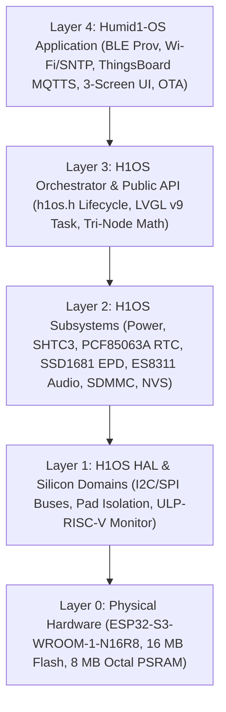
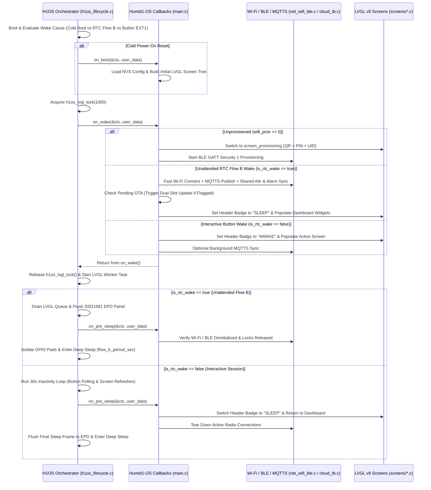

# APP_01: System Architecture, State Machine & Lifecycle Orchestration

* **Document ID:** `APP-ARCH-001` (Rev 2.0)
* **Parent Blueprint:** [`Architectural_Outline.md`](../../Architectural_Outline.md)
* **Normative Scope:** Layer 4 Application State Machine, H1OS Callback Execution Order, Dynamic Flow A/B Timing, and NVS/RTC State Partitioning

---

## 1. Five-Layer Architectural Hierarchy

The `humid1-os` firmware stack enforces strict unidirectional dependencies from Layer 4 (`firmware/main/`) into Layer 3 (`h1os.h`):

### 1.1 Architectural Boundaries

- **H1OS Responsibility (Layers 1–3):** Early boot wake-stub arbitration (`orch_wake_stub.c`), ULP-RISC-V button/RTC pin monitoring (`GPIO 0`, `GPIO 18`, `GPIO 5`), SHTC3 + MCU Die + EPD Glass Tri-Node temperature sampling, LiPo OCV battery metrology, SPI e-Paper LUT refresh waveforms, and deep-sleep GPIO pad hold isolation.
- **Humid1-OS Responsibility (Layer 4):** First-boot BLE Wi-Fi provisioning, SNTP wall-clock synchronization, ThingsBoard two-phase registration and claiming, server-driven MQTTS telemetry publishing and shared attribute synchronization, server alarm presentation, dual-slot OTA execution, and the 3-screen user interface.

---

## 2. Dynamic Wake Cadence: Flow A, Flow B & Interactive Sessions

H1OS operates two distinct periodic wake flows alongside user-initiated interactive wakes. As required by product specifications, the periods for **Flow A** and **Flow B** are dynamically controlled by the ThingsBoard server via Shared Attributes (`SHARED_SCOPE`), while the interactive inactivity timeout is hardcoded at **30 seconds**.

| Flow / Mode | Trigger Source | Radio State | Display State | Default Period | Configuration Source |
| :--- | :--- | :--- | :--- | :--- | :--- |
| **Flow A (Headless Sample)** | PCF85063A RTC Countdown (`GPIO 5`) when `wake_counter < ratio` | **OFF** (Zero RF) | **OFF** (High-Z) | `60 s` | Server Shared Attribute `flow_a_period_sec` (persisted in NVS `flow_a_sec`) |
| **Flow B (Telemetry & EPD Sync)** | PCF85063A RTC Countdown (`GPIO 5`) when `wake_counter >= ratio` | **ON** (Fast Wi-Fi + MQTTS Burst) | **ON** (Partial/Full Refresh with `SLEEP` badge) | `900 s` (15 min) | Server Shared Attribute `sleep_interval_sec` / `flow_b_period_sec` (persisted in NVS `flow_b_sec`) |
| **Interactive Session** | Tactile Button Press (`BOOT` `GPIO 0` or `POWER` `GPIO 18`) | **ON** (On-demand sync / actions) | **ON** (Active UI with `AWAKE` badge) | `30 s` timeout | Hardcoded constant `APP_INACTIVITY_TIMEOUT_SEC = 30U` |

### 2.1 Dynamic Flow A/B Synchronization Math

In H1OS, the wake stub (`orch_wake_stub.c`) wakes the main CPU into a full session (`Flow B`) every $R$ wakes of `Flow A`, where the integer ratio $R$ is computed as:

$$
R = \max\left(1, \left\lfloor \frac{T_{\text{Flow B}}}{T_{\text{Flow A}}} \right\rfloor\right)
$$

When the ThingsBoard server pushes an updated `sleep_interval_sec` (or `sleep_interval_min * 60`) or `flow_a_period_sec`:
1. The application validates bounds ($T_{\text{Flow A}} \in [15\,\text{s}, 3600\,\text{s}]$, $T_{\text{Flow B}} \in [60\,\text{s}, 86400\,\text{s}]$, and $T_{\text{Flow B}} \ge T_{\text{Flow A}}$).
2. The application commits the updated intervals to the `app_cfg` NVS namespace (`flow_a_sec`, `flow_b_sec`).
3. The application updates the active H1OS session timing configuration prior to `h1os_sleep()` so the PCF85063A alarm timer arms with the new interval immediately (see `MANDATE-04` in [`APP_07_os_api_mandates.md`](APP_07_os_api_mandates.md)).

---

## 3. H1OS Lifecycle Callback Execution Order

Understanding the exact call sequence inside `h1os_start()` (`h1os_lifecycle.c`) is mandatory for deterministic radio and UI operation:

### 3.1 Critical Execution Invariant on Unattended RTC Wakes (`Flow B`)

In `h1os_lifecycle.c`, when `is_rtc_wake == true` (unattended periodic Flow B wake), H1OS invokes `on_wake()`, starts the LVGL task, drains the display buffer once, and immediately invokes `h1os_sleep()`. Therefore:
- During an unattended RTC `Flow B` wake, the fast Wi-Fi connection, ThingsBoard MQTTS telemetry publish, shared attribute fetch, and OTA check **must execute synchronously inside `on_wake()`** (bounded to $\le 3500\,\text{ms}$) before `on_wake()` returns.
- Inside `on_wake()`, the application updates the LVGL screen labels with the latest psychrometric readings, active server alarm state, and the `SLEEP` status indicator, so the single post-`on_wake()` EPD flush writes the complete, up-to-date frame prior to deep sleep.

---

## 4. Application Finite State Machine

The application state machine (`app_fsm_state_t` in `app_types.h`) transitions deterministically across seven states:

| State Enum | Description | Entry Condition | Exit Transition |
| :--- | :--- | :--- | :--- |
| `APP_STATE_BOOT_INIT` | Initial NVS load, RTC fast-cache check, and hardware identity derivation (`HUMID1_<MAC>`). | Cold boot or wake from deep sleep. | Transitions to `BLE_PROV` if `wifi_prov == 0`, else evaluates token/claim state. |
| `APP_STATE_BLE_PROV` | BLE GATT Wi-Fi provisioning (`protocomm_ble` Security 1) with QR + PoP PIN on screen. | `wifi_prov == 0` in NVS. | Wi-Fi IP acquired $\rightarrow$ BLE stack completely deinitialized $\rightarrow$ `SNTP_SYNC`. |
| `APP_STATE_SNTP_SYNC` | NTP wall-clock acquisition (`pool.ntp.org`, `time.cloudflare.com`) written to PCF85063A RTC. | First Wi-Fi connection after provisioning, or RTC drift refresh ($\ge 24\,\text{h}$). | Valid Unix epoch ($\ge 2026$) $\rightarrow$ `TB_AUTO_PROV` or `TB_CLAIMING` or `FLOW_B_SYNC`. |
| `APP_STATE_TB_AUTO_PROV` | Phase 1 ThingsBoard device registration via `/provision/request` to obtain `tb_token`. | `wifi_prov == 1` and `tb_token` empty in NVS. | `credentialsValue` saved to NVS `tb_token` $\rightarrow$ `TB_CLAIMING`. |
| `APP_STATE_TB_CLAIMING` | Phase 2 customer device claiming via `v1/devices/me/claim` with 180s countdown on EPD. | `tb_token` valid, `claimed == 0` in NVS. | Customer claims device on dashboard (confirmed via attribute/RPC) $\rightarrow$ `INTERACTIVE`. |
| `APP_STATE_FLOW_B_SYNC` | Unattended RTC wake: fast Wi-Fi burst, MQTTS telemetry publish, attribute/alarm sync, OTA check. | Unattended RTC Flow B wake (`wifi_prov == 1 && claimed == 1`). | If OTA flagged $\rightarrow$ `OTA_UPDATE`; else EPD flush (`SLEEP` badge) $\rightarrow$ Deep Sleep. |
| `APP_STATE_INTERACTIVE` | User button wake: `AWAKE` badge, 30s inactivity timer, 2-button navigation across Screens 1–3. | `BOOT` (`GPIO 0`) or `POWER` (`GPIO 18`) button press. | 30s inactivity timeout $\rightarrow$ `SLEEP` badge flush $\rightarrow$ Deep Sleep. |
| `APP_STATE_OTA_UPDATE` | Dual-slot firmware download (`ota_0`/`ota_1`), SHA-256 verification, and reboot. | `manual_ota_trigger == true` or `auto_update_enabled && fw_version > current`. | Image verified $\rightarrow$ `esp_restart()`; on error $\rightarrow$ report `FAILED` and resume sleep. |

---

## 5. Non-Volatile Storage (`app_cfg`) & RTC Fast Cache Architecture

To prevent NVS flash wear (`PIT-05-D`) while surviving deep sleep resets (`PIT-05-A`), state is partitioned between the `app_cfg` NVS namespace (written only on configuration changes) and `RTC_DATA_ATTR` SRAM (retained across deep sleep with zero flash wear):

### 5.1 NVS Key Registry (Namespace: `"app_cfg"`)

| NVS Key | Type | Default | Description |
| :--- | :--- | :--- | :--- |
| `"wifi_prov"` | `u8` | `0` | `1` when Wi-Fi SSID/password are provisioned in NVS. |
| `"claimed"` | `u8` | `0` | `1` when customer claiming is completed and verified. |
| `"tb_token"` | `str` (64B) | `""` | Permanent device access token returned by ThingsBoard `/provision/response`. |
| `"nickname"` | `str` (32B) | `""` | User-assigned device nickname synchronized from ThingsBoard `device_nickname`. |
| `"temp_unit"` | `u8` | `0` (`'F'`) | Display temperature unit (`0` = Fahrenheit, `1` = Celsius, `2` = Kelvin). |
| `"theme_dark"` | `u8` | `0` | `0` = Light theme (black ink on white background), `1` = Dark theme (inverted). |
| `"sound_en"` | `u8` | `1` | `1` = Audio feedback enabled during interactive sessions, `0` = Muted. |
| `"auto_ota"` | `u8` | `1` | `1` = Automatic OTA updates enabled on wake check, `0` = Manual trigger only. |
| `"flow_a_sec"` | `u32` | `60` | Headless sensor sampling interval in seconds (`Flow A`). |
| `"flow_b_sec"` | `u32` | `900` | Telemetry publish and display sync interval in seconds (`Flow B`). |

### 5.2 RTC Slow SRAM Cache (`RTC_DATA_ATTR app_rtc_cache_t`)

| Field | Type | Purpose |
| :--- | :--- | :--- |
| `magic` | `uint32_t` | Validation constant (`0x48314150UL`, `"H1AP"`) verifying initialized RTC memory. |
| `last_bssid[6]` | `uint8_t[6]` | Cached AP BSSID for single-channel fast Wi-Fi scanning ($\le 300\,\text{ms}$ association). |
| `last_channel` | `uint8_t` | Cached Wi-Fi primary channel (1–13) to bypass full 13-channel scan on Flow B wakes. |
| `last_sntp_epoch` | `uint32_t` | Unix timestamp of last successful SNTP sync (re-syncs once every 24 hours). |
| `active_alarm` | `app_alarm_state_t` | Cached server alarm state (`active`, `severity`, `type`, `message`) for UI display. |
| `thresholds` | `app_thresholds_t` | Cached server alarm thresholds (in Kelvin and %RH) for local reference. |
| `consecutive_net_fails` | `uint16_t` | Exponential backoff counter when Wi-Fi or MQTTS broker is unreachable. |
| `last_err_code` | `int32_t` | Most recent `esp_err_t` or MQTT protocol error displayed on Screen 3 (`screen_system`). |
