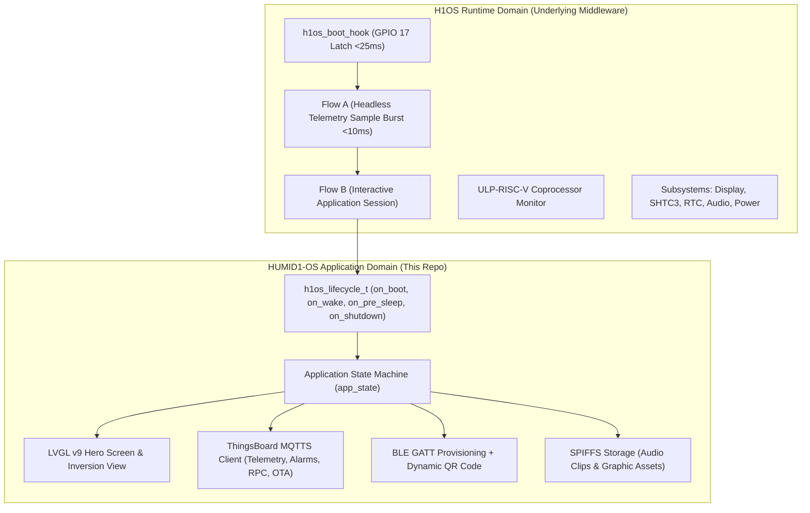

# APP_01: System Architecture & Application Lifecycle

## 1. Overview & Architectural Hierarchy
`HUMID1-OS` is an ultra-low-power, cloud-integrated environmental monitoring application for sealed cigar and tobacco humidors. It runs on the Waveshare ESP32-S3 ePaper 1.54" V2 development board with **H1OS v2.4.4-dev** as its bare-metal operating system and middleware foundation.

---

## 2. Complete Application Lifecycle

```mermaid
stateDiagram-v2
    [*] --> ColdBoot: Power On / Factory Reset
    ColdBoot --> StageProvisioning: Unprovisioned
    
    state StageProvisioning {
        [*] --> BLE_Adv: Generate TRNG PoP & Render QR Code
        BLE_Adv --> WiFi_Verify: Mobile App Sends Credentials
        WiFi_Verify --> BLE_Teardown: Association OK
    }
    
    StageProvisioning --> SntpSync: Wi-Fi Connected
    
    state SntpSync {
        [*] --> QueryNTP: Query 3rd-Party SNTP Server
        QueryNTP --> SetRTC: Update System Clock & PCF85063A RTC
    }
    
    SntpSync --> StageClaiming: Device Unclaimed
    SntpSync --> StageRunLoop: Device Already Claimed
    
    state StageClaiming {
        [*] --> GenClaimKey: TRNG Generates 6-Char Claim Key
        GenClaimKey --> PubClaim: Publish v1/devices/me/claim
        PubClaim --> RenderClaimUI: Display Key & Name on EPD
        RenderClaimUI --> AwaitClaim: User Binds on Humid1.com
        AwaitClaim --> ClaimDone: Server Pushes Shared Attrs
    }
    
    StageClaiming --> StageRunLoop: Claim Confirmed
    
    state StageRunLoop {
        [*] --> FastConnect: Wake & Connect via RTC Wi-Fi Cache (<400ms)
        FastConnect --> SampleTelemetry: Query H1OS Psychrometric Data
        SampleTelemetry --> PubTelemetry: Publish QoS 1 Telemetry to TB
        PubTelemetry --> SyncAttrs: Receive Dynamic Server Attrs
        SyncAttrs --> CheckChannels: Monitor Alarms & OTA Channels
        CheckChannels --> ExecRPC: Execute Pending RPC / Remote Commands
        ExecRPC --> RadioTeardown: Power Off Wi-Fi Stack
        RadioTeardown --> UpdateDisplay: Render Hero Screen (or Inverted Alert)
        UpdateDisplay --> ScheduleSleep: h1os_sleep()
    }
    
    StageRunLoop --> DeepSleep: Sleep Window
    DeepSleep --> StageRunLoop: Timer Wake / Button Press
```

---

## 3. Lifecycle Stage Definitions

### 1. `APP_STAGE_PROVISIONING`
- **Entry Trigger:** Unprovisioned device boot or manual factory reset (>3.0s `BOOT` button hold).
- **Behavior:**
  - Hardware TRNG (`esp_random()`) generates a cryptographically random 8-character Proof of Possession (PoP) PIN.
  - Generates the standard ESP-IDF Wi-Fi Provisioning payload:
    `{"ver":"v1","name":"PROV_HUMID1_XXXX","pop":"XXXXXXXX","transport":"ble"}`
  - LVGL generates and renders an on-screen QR code (`lv_qrcode_create`) along with the human-readable device name and PoP PIN.
  - Mobile user scans QR code with the Humid1 companion app and transmits Wi-Fi credentials over encrypted BLE GATT (Security 1).
  - **Teardown Invariant:** Upon verified Wi-Fi association, the entire BLE stack is de-initialized and unmapped to reclaim memory and power.

### 2. Network Time Protocol (SNTP) Synchronization
- **Entry Trigger:** Immediately following successful Wi-Fi connection on initial boot or every 24 hours.
- **Why External SNTP is Mandatory:** ThingsBoard communication uses TLS/SSL (MQTTS on port 8883 / HTTPS), which requires an accurate epoch timestamp for X.509 certificate validation. Because ThingsBoard does not provide an NTP server command, the device connects to an external pool NTP server (e.g., `pool.ntp.org`).
- Once synced, POSIX system time is latched into the **NXP PCF85063A hardware RTC** via `h1os_time_set()`. Between periodic daily SNTP syncs, the hardware RTC serves as the continuous local source of truth.

### 3. `APP_STAGE_CLAIMING`
- **Entry Trigger:** Device has valid Wi-Fi credentials but has not been claimed in ThingsBoard (`is_claimed == false`).
- **Behavior:**
  - TRNG generates an unambiguous 6-character claiming token (e.g., `B7X4K2`).
  - Publishes claiming intent to ThingsBoard topic `v1/devices/me/claim` with a 180-second timeout.
  - Renders the claiming screen on the e-Paper display with the 6-character token, device name, and device nickname (if configured).
  - The humidor owner enters this token into their dashboard on [Humid1.com](https://www.humid1.com/) to bind ownership.
  - Upon claim confirmation, ThingsBoard pushes the dynamic shared attributes, and the device transitions to `APP_STAGE_RUN_LOOP`.

### 4. `APP_STAGE_RUN_LOOP` (Steady-State Telemetry & Management)
- **Primary Operational Mode:** Executes the **Wake-Sample-Sync-Sleep** duty cycle:
  1. **Wake Event:** System wakes from deep sleep via periodic timer (configurable, default 1800s / 30 min) or physical button actuation.
  2. **Fast Wi-Fi Reconnect:** Uses RTC Fast Memory cache (BSSID, channel, auth tokens) to re-associate to Wi-Fi in <400 ms without scanning.
  3. **Sample Telemetry:** Acquires steady-state SHTC3 temperature, relative humidity, psychrometric dew point, and battery voltage via `h1os_get_telemetry()`.
  4. **Publish Telemetry:** Publishes QoS 1 telemetry to ThingsBoard topic `v1/devices/me/telemetry`.
  5. **Dynamic Attribute Sync:** Synchronizes dynamic server attributes (`temp_unit`, `sleep_interval_sec`, `sound_enabled`, alarm thresholds).
  6. **Monitor Alarms Channel:** Checks ThingsBoard active alarms endpoint. (Note: ThingsBoard server handles user alert dispatching; the device monitors the alarm state to reflect active alerts on the display).
  7. **Monitor OTA Channel & RPC:** Checks for pending firmware OTA updates or server-side RPC device execution commands.
  8. **Clean Radio Teardown:** Immediately disconnects and powers down the Wi-Fi radio stack.
  9. **Render Display:** Updates the 1-bit monochrome e-Paper display with the Hero layout (or high-visibility inverted alert view if an active alarm is flagged).
  10. **Sleep Transition:** Calls `h1os_sleep()` to assert battery power latch (`GPIO 17`) and enter deep sleep.

### 5. `APP_STAGE_SHUTDOWN`
- Orderly power-down triggered by long-press on the physical power button or critical battery brownout.
- Flushes buffers, unmounts SPIFFS storage, renders clean power-off screen, and de-asserts `BAT_CTRL` (GPIO 17) to release power.

---

## 4. Turnkey Single-Build Firmware Strategy
`HUMID1-OS` is designed as a **turnkey single universal build**:
- Developers and users flash the exact same binary release.
- Device identity, Wi-Fi credentials, user binding, and configuration parameters are established dynamically post-flash through guided on-screen BLE provisioning and ThingsBoard claiming on [Humid1.com](https://www.humid1.com/).
- No per-device hardcoded credentials or customized firmware compilations required.
