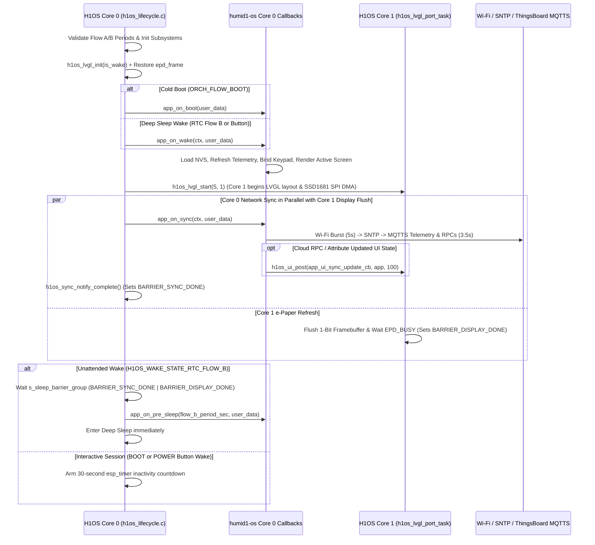

# APP_01: System Architecture, Dual-Core Lifecycle & State Model

> **Module Scope:** `firmware/main/main.c`, `firmware/main/app_state.c`, `firmware/main/app_types.h`, `firmware/main/app_config.h`
> **Target OS:** `H1OS >= v2.4.9-dev` (ESP-IDF `>= v6.1.0`, `ESP32-S3-PICO-1-N8R8`)

---

## 1. Architectural Layering & Strict Boundary Law

`humid1-os` operates exclusively at the **User Application Layer** above the 4-layer **H1OS** middleware component (`components/h1os`):

1. **Layer 1 (`hal_*` — H1OS Internal):** Stateless register and peripheral primitives. **Forbidden in app code.**
2. **Layer 2 (`sub_*` — H1OS Internal):** Encapsulated hardware drivers (`sub_display`, `sub_rtc`, `sub_power`, `sub_audio`, `sub_nvs`, `sub_sdcard`). **Forbidden in app code.**
3. **Layer 3 (`orch_*` — H1OS Internal):** Flow arbiter, `648-byte` `RTC_SLOW_MEM` state, `-O2` RTC wake stub (`orch_wake_stub.c`), and Pure Event Mode ULP-RISC-V monitor (`ulp/main.c`). **Direct `orch_state_get()` mutation is strictly forbidden in app code.**
4. **Layer 4 (`h1os_*` — Public OS Boundary):** `<h1os/h1os.h>`, `<h1os/h1os_lvgl.h>`, `<h1os/h1os_time.h>`, and `h1os_fonts.h`.
5. **User Application (`humid1-os`):** Declarative lifecycle hooks (`app_on_boot`, `app_on_wake`, `app_on_sync`, `app_on_pre_sleep`, `app_on_shutdown`, `app_on_error`), NVS configuration (`app_state.c`), cloud telemetry (`cloud_tb.c`), BLE/Wi-Fi onboarding (`net_wifi_ble.c`), Dual-OTA verification (`app_ota.c`), and 4 LVGL screens (`screens/screen_*.c`).

---

## 2. Declarative Lifecycle & Parallel Dual-Core Execution (`MANDATE-04`)

`app_main()` initializes `h1os_lifecycle_t` via `H1OS_LIFECYCLE_DEFAULT_CONFIG()` and transfers control to `h1os_start(&lifecycle)`:

---

## 3. Flow A & Flow B Silicon Timing Invariants (`MANDATE-02`)

All runtime changes to `flow_a_sec` (headless sensor burst interval) and `flow_b_sec` (display & cloud sync interval) MUST pass `app_state_validate_flow_periods()` and be committed via `h1os_set_flow_periods(flow_a_sec, flow_b_sec)`:

| Invariant | Constraint | Hardware / Architectural Reason |
| :--- | :--- | :--- |
| **1. Flow A Bounds** | `60 s <= flow_a_sec <= 14400 s` (`1 min` .. `4 hr`) | Prevents SHTC3 thermal self-heating (`>= 60 s`) and bounds sample latency. |
| **2. Flow B Bounds** | `300 s <= flow_b_sec <= 86400 s` (`5 min` .. `24 hr`) | Bounds e-Paper mechanical refresh wear and LiPo RF current draw. |
| **3. Prescaler Alignment** | If `flow_a_sec > 255 s`, `flow_a_sec % 60 == 0` | NXP `PCF85063A` countdown timer switches from `1 Hz` to `1/60 Hz` clock above `255 s`. |
| **4. Strict Ordering** | `flow_b_sec > flow_a_sec` | Flow B presentation wakes must span multiple headless Flow A bursts. |
| **5. Remainder Floor** | `remainder = flow_b_sec % flow_a_sec` is `0` or `>= 60 s` | Prevents sub-60s final slices before Flow B. |
| **6. Remainder Alignment** | If `remainder > 255 s`, `remainder % 60 == 0` | Matches `PCF85063A` `1/60 Hz` countdown prescaler on the final slice. |

---

## 4. Persistent NVS Configuration Schema (`app_nvs_config_t`)

All NVS keys are strictly `<= 15` ASCII characters (`app_config.h`) and accessed through `h1os_nvs_*`:

| NVS Key | Type | Default | Description |
| :--- | :--- | :--- | :--- |
| `prov_done` | `u8` | `0` (`false`) | Wi-Fi credentials provisioned flag. |
| `tb_claimed` | `u8` | `0` (`false`) | ThingsBoard cloud claiming completed flag. |
| `tb_token` | `str` | `""` | ThingsBoard device access token (up to 63 chars). |
| `claim_sec` | `str` | `"H1-XXXXXXXX"` | MAC-derived device claiming secret key. |
| `nick_str` | `str` | `"Main Humidor"` | User-assigned humidor display name (up to 23 chars). |
| `flow_a_s` | `u32` | `180` (`3 min`) | Headless sensor sample burst interval in seconds. |
| `flow_b_s` | `u32` | `900` (`15 min`) | Display refresh & cloud sync interval in seconds. |
| `unit_t` | `u8` | `0` (`°C`) | Temperature unit (`0 = °C`, `1 = °F`, `2 = K`). |
| `unit_vp` | `u8` | `0` (`hPa`) | Vapor pressure unit (`0 = hPa`, `1 = kPa`). |
| `ui_theme` | `u8` | `0` (`LIGHT`) | Display polarity (`0 = Black-on-White`, `1 = White-on-Black`). |
| `snd_en` | `u8` | `1` (`true`) | Master acoustic feedback enable flag. |
| `vol_pct` | `u8` | `75` (`75%`) | Speaker volume percentage (`0..100%`). |
| `alrt_mode` | `u8` | `2` (`EITHER_OR`) | Compound alarm trigger mode (`0..3`). |
| `th_t_hi` | `i32` | `2300` (`23.00°C`) | High temperature limit in centi-degrees Celsius. |
| `th_t_lo` | `i32` | `1600` (`16.00°C`) | Low temperature limit in centi-degrees Celsius. |
| `th_rh_hi` | `i32` | `7200` (`72.00%`) | High relative humidity limit in centi-percent. |
| `th_rh_lo` | `i32` | `6200` (`62.00%`) | Low relative humidity limit in centi-percent. |
