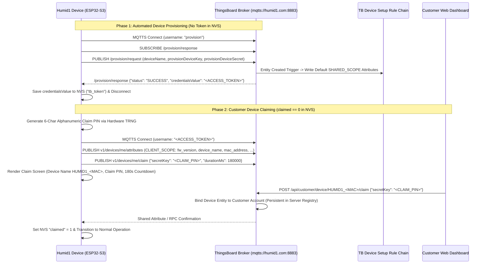

# APP_02: ThingsBoard Cloud Protocol, Onboarding & Server-Driven Telemetry

* **Document ID:** `APP-ARCH-002` (Rev 2.0)
* **Parent Blueprint:** [`Architectural_Outline.md`](../../Architectural_Outline.md)
* **Normative Scope:** MQTTS Transport, Two-Phase Device Onboarding (Auto-Provisioning + Claiming), Server-Driven Telemetry Schema (Kelvin Base Unit), Shared/Client Attributes, and Server-Managed Alarms

---

## 1. Cloud Transport & Security Architecture

All cloud communication targets the ThingsBoard Community Edition broker over mutually verifiable TLS (`MQTTS`):

- **Broker Endpoint:** `mqtts://humid1.com:8883` (production alias `mqtts://app.humid1.com:8883`)
- **TLS Verification:** Enforced via ESP-IDF `esp_crt_bundle_attach` (Mozilla Root CA bundle). Plaintext MQTT (`1883`) and unverified TLS connections are strictly prohibited in production builds.
- **Prerequisite Wall-Clock Gate:** X.509 certificate expiration verification requires a valid system clock ($\text{year} \ge 2026$). On first boot after Wi-Fi provisioning (or if `h1os_rtc_is_time_valid()` returns `false`), the firmware executes SNTP synchronization (`pool.ntp.org`, `time.cloudflare.com`) and updates the PCF85063A hardware RTC via `h1os_set_time()` **before** initiating the TLS handshake.

---

## 2. Two-Phase ThingsBoard Onboarding Protocol

Inspection of the production ThingsBoard Device Profile (`Humid1 Device`, profile ID `f00235c0-a123-11f1-b530-9b9631e0c365`) and rule chains establishes a mandatory **two-phase onboarding sequence** separating device identity creation from customer ownership claiming.



### 2.1 Phase 1: Device Auto-Provisioning (`/provision/request`)

When `tb_token` is absent in NVS, the device connects to `mqtts://humid1.com:8883` using MQTT username `"provision"` (empty password), subscribes to `/provision/response`, and publishes the following JSON document to `/provision/request`:

```json
{
  "deviceName": "HUMID1_A1B2C3",
  "provisionDeviceKey": "joz5hqceqbkzzft3qzaf",
  "provisionDeviceSecret": "d9xpuylns0pdlk2w70hc"
}
```

- **`deviceName`:** Deterministic hardware UID formatted as `HUMID1_<MAC_LAST_3_BYTES_HEX>` (derived from `esp_read_mac(mac, ESP_MAC_WIFI_STA)`).
- **Server Action:** ThingsBoard creates the device under the `Humid1 Device` profile and executes the `Device Setup Chain` (`838f4410-a3f7-11f1-9ad5-91546bc9dd79`), initializing default `SHARED_SCOPE` attributes.
- **Response (`qos = 1` on `/provision/response`):**
  ```json
  {
    "status": "SUCCESS",
    "credentialsType": "ACCESS_TOKEN",
    "credentialsValue": "AbCdEfGhIjKlMnOpQrSt"
  }
  ```
- The firmware stores `credentialsValue` in NVS key `"tb_token"` and calls `nvs_commit()`.

### 2.2 Phase 2: Persistent Customer Claiming (`v1/devices/me/claim`)

Once `tb_token` is stored in NVS (and while NVS `"claimed" == 0`):
1. The firmware reconnects to `mqtts://humid1.com:8883` using `tb_token` as the MQTT username.
2. The firmware generates a random 6-character alphanumeric Claim PIN via `esp_fill_random()`.
3. The firmware publishes the claiming initiation JSON document to `v1/devices/me/claim`:
   ```json
   {
     "secretKey": "9K4M2P",
     "durationMs": 180000
   }
   ```
4. The e-Paper display renders `screen_claiming`, showing the **Device Name** (`HUMID1_A1B2C3`), **Claim PIN** (`9K4M2P`), optional **Nickname**, and a live **180-second countdown timer**.
5. If the 180-second window expires before the user completes claiming on the Web Dashboard (`POST /api/customer/device/{deviceName}/claim`), the user can press a button to regenerate a fresh PIN and restart the 180-second window.
6. **Persistence Rule:** Once claimed, ownership is permanently stored in the ThingsBoard server database and cached in NVS (`"claimed" = 1`). Across reboots and OTA firmware updates, the device does **not** re-enter claiming mode unless the customer explicitly unclaims the device or triggers a full factory reset on Screen 3 (`screen_system`).

---

## 3. Server-Driven Telemetry Architecture & Kelvin Base Unit

### 3.1 Server-Driven Data Structure Principle

To prevent firmware fragmentation across hardware revisions and OTA updates, **the server dictates the telemetry structure**:
- The server specifies enabled telemetry fields via the shared attribute `telemetry_schema_mask` (defaulting to the canonical 4-key set if unspecified).
- The firmware populates a unified internal telemetry dictionary from `h1os_get_telemetry()` and serializes only the server-requested keys into a single JSON document published to `v1/devices/me/telemetry`.
- **Canonical Base Unit for Temperature:** All temperature values transmitted to ThingsBoard (`temp`) and all temperature alarm thresholds (`tempLowCritical`, `tempLowWarning`, `tempHighWarning`, `tempHighCritical`, `tempHist`) are strictly represented in **Kelvin ($\text{K}$)**:

$$
T_{\text{K}} = T_{^\circ\text{C}} + 273.15
$$

Using Kelvin eliminates negative numbers, prevents Fahrenheit/Celsius ambiguity inside server rule chains, and aligns with the `Alarms`, `Compose and Send Email`, and `POST FCM Alerts` ThingsBoard rule chains.

### 3.2 Canonical Telemetry JSON Document (`v1/devices/me/telemetry`)

Published on every `Flow B` wake and interactive sync (`QoS 1`):

```json
{
  "ts": 1774310400000,
  "values": {
    "rh": 68.42,
    "temp": 294.26,
    "battery": 88,
    "rssi": -62
  }
}
```

#### Extended Server-Selectable Telemetry Keys (Optional via `telemetry_schema_mask`)

When diagnostic telemetry is requested by the server via `telemetry_schema_mask`, the unified serializer appends the requested fields from `h1os_telemetry_t`:

| JSON Key | Unit | Source in `h1os_telemetry_t` | Bitmask Flag | Description |
| :--- | :--- | :--- | :--- | :--- |
| `"rh"` | `%` | `ambient_rh_pct` | `BIT(0)` (Default) | Compensated relative humidity ($0.0\text{--}100.0\%$). |
| `"temp"` | $\text{K}$ | `ambient_temp_c + 273.15f` | `BIT(1)` (Default) | Tri-Node compensated ambient temperature in **Kelvin**. |
| `"battery"` | `%` | `battery.soc_pct` | `BIT(2)` (Default) | LiPo state-of-charge percentage ($0\text{--}100\%$). |
| `"rssi"` | $\text{dBm}$ | `esp_wifi_sta_get_ap_info()` | `BIT(3)` (Default) | Wi-Fi AP received signal strength indicator. |
| `"dew_point"` | $\text{K}$ | `dew_point_c + 273.15f` | `BIT(4)` (Extended) | Psychrometric dew point temperature in **Kelvin**. |
| `"vbat_mv"` | $\text{mV}$ | `battery.voltage_mv` | `BIT(5)` (Extended) | Raw calibrated battery terminal voltage in millivolts. |
| `"autonomy_days"` | $\text{days}$ | `battery.autonomy_days` | `BIT(6)` (Extended) | Projected remaining battery life in days. |
| `"confidence"` | `%` | `confidence_pct` | `BIT(7)` (Extended) | Tri-Node thermal equilibrium confidence ($0\text{--}100\%$). |

---

## 4. Client & Shared Attribute Schemas

### 4.1 Client Attributes (`CLIENT_SCOPE` -> `v1/devices/me/attributes`)

Published by the device on boot, after OTA updates, and whenever network metadata changes:

```json
{
  "fw_version": "0.1.0-dev",
  "fw_title": "humid1-os",
  "h1os_version": "2.4.4-dev",
  "device_name": "HUMID1_A1B2C3",
  "device_nickname": "Desktop Humidor",
  "mac_address": "34:85:18:A1:B2:C3",
  "ssid": "Humidor_VLAN",
  "ip_address": "192.168.1.142",
  "has_sd_card": true,
  "audio_synced": true
}
```

### 4.2 Shared Attributes (`SHARED_SCOPE` <- `v1/devices/me/attributes/response/+`)

Requested on every `Flow B` wake via `v1/devices/me/attributes/request/1`:

```json
{
  "shared": {
    "sleep_interval_sec": 900,
    "sleep_interval_min": 15,
    "flow_a_period_sec": 60,
    "device_theme": "light",
    "sound_enabled": false,
    "auto_update_enabled": true,
    "manual_ota_trigger": false,
    "email_alerts_enabled": true,
    "temp_unit": "F",
    "device_nickname": "Desktop Humidor",
    "telemetry_schema_mask": 15,
    "alarm_thresholds": {
      "rhLowCritical": 60.0,
      "rhLowWarning": 62.0,
      "rhHighWarning": 72.0,
      "rhHighCritical": 75.0,
      "tempLowCritical": 288.71,
      "tempLowWarning": 290.93,
      "tempHighWarning": 295.37,
      "tempHighCritical": 297.59,
      "batteryLowCritical": 10.0,
      "batteryLowWarning": 20.0,
      "rhHist": 1.0,
      "tempHist": 0.3,
      "battHist": 2.0
    },
    "alarm_state": {
      "active": false,
      "severity": "NONE",
      "type": "",
      "message": "All metrics within nominal range"
    }
  }
}
```

---

## 5. Server-Driven Alarm Synchronization Protocol

Per system requirements, **all alarm threshold evaluation and hysteresis logic execute exclusively on the ThingsBoard server** (`Alarms` Rule Chain `92da2e30-a9ab-11f1-9663-1fc19e23cbce`):

1. **Why Shared Attributes + MQTT Notification Are Used:** Because the Humid1 instrument spends $>99.8\%$ of its lifecycle in deep sleep with Wi-Fi powered down, an asynchronous RPC pushed while the device is asleep would be missed. By storing the evaluated `alarm_state` JSON object in `SHARED_SCOPE` (with `notifyDevice: true` in the `Alarms` Rule Chain) AND subscribing to `v1/devices/me/attributes` while awake:
   - If the device is currently in an **Interactive Session (`AWAKE`)**, it receives the alarm transition immediately over `v1/devices/me/attributes`.
   - If the device is in **Deep Sleep (`SLEEP`)**, it retrieves the authoritative `alarm_state` during its next `Flow B` wake via `v1/devices/me/attributes/request/1`.
2. **Device Response to Active Server Alarm (`alarm_state.active == true`):**
   - **Screen 1 (`screen_dashboard`) & Screen 3 (`screen_system`):** Displays an inverted high-contrast alarm banner indicating the alarm type (`RH`, `TEMP`, `BATTERY`) and severity (`WARNING` or `CRITICAL`).
   - **Critical Alarm Full-Screen Inversion:** When `alarm_state.severity == "CRITICAL"`, the dashboard header and breached metric box invert polarity to maximize visual visibility across the room on the bistable e-Paper panel.
   - **Audio Alert Gate:** If `alarm_state.active == true` AND the device is in an interactive session (`is_rtc_wake == false`) AND `sound_enabled == true` AND `has_sd_card == true`, the device plays `/sdcard/alarm_warn.wav` or `/sdcard/alarm_crit.wav` via `h1os_audio_play_Async()`. Unattended RTC wakes remain strictly silent.

---

## 6. RPC Command Contract (`v1/devices/me/rpc/request/+`)

While awake, the firmware subscribes to `v1/devices/me/rpc/request/+` and supports the following server-to-device and device-to-server RPC methods:

| Method Direction | `"method"` Name | `"params"` Structure | Action & Response (`v1/devices/me/rpc/response/{id}`) |
| :--- | :--- | :--- | :--- |
| Device $\rightarrow$ Server | `"getCurrentTime"` | `{}` | Fallback time query handled by `Boot RPC Trigger` rule chain; returns `{"epoch_ms": 1774310400000}`. |
| Server $\rightarrow$ Device | `"setTheme"` | `{"theme": "dark"}` | Updates NVS `"theme_dark"`, triggers `h1os_lvgl_request_full_refresh()`, replies `{"status": "OK"}`. |
| Server $\rightarrow$ Device | `"triggerOta"` | `{"version": "0.2.0"}` | Flags immediate transition to `APP_STATE_OTA_UPDATE`, replies `{"status": "OTA_SCHEDULED"}`. |
| Server $\rightarrow$ Device | `"clearSettings"` | `{"factoryReset": false}` | Clears Wi-Fi credentials (and claim state if `factoryReset == true`) and reboots into BLE provisioning. |
