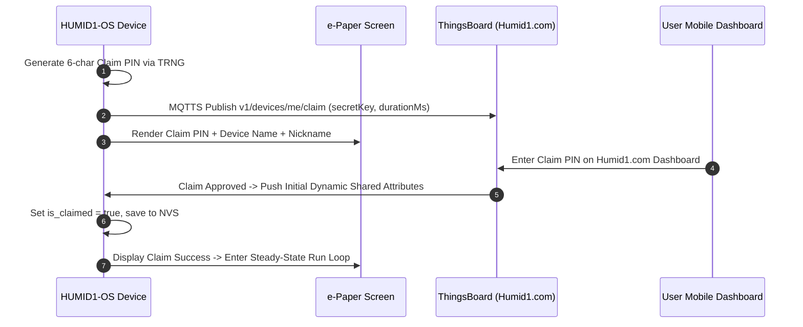

# APP_02: Self-Hosted ThingsBoard & Cloud Integration

## 1. Custom Cloud Infrastructure & Philosophy
`HUMID1-OS` connects to an independent, self-hosted deployment of **ThingsBoard Community Edition** running on **Humid1's custom cloud infrastructure ([Humid1.com](https://www.humid1.com/))**.

- **Protocol:** MQTTS (TLS v1.3 / Port 8883) & HTTPS REST
- **Broker Endpoint:** `mqtts://thingsboard.humid1.com:8883`
- **REST/HTTP Endpoint:** `https://thingsboard.humid1.com`
- **Data Sovereignty:** Private self-hosted infrastructure. Completely independent of third-party SaaS cloud platforms.
- **Turnkey Integration:** All devices run a single universal binary. Onboarding, claiming, and device telemetry contracts are server-driven.

---

## 2. Network Time Synchronization (SNTP)

### Why 3rd-Party SNTP is Mandatory
1. **TLS / SSL Mandate:** ThingsBoard MQTTS and HTTPS connections mandate TLS certificate validation (checking expiration dates and validity periods). This requires an accurate POSIX epoch timestamp before establishing the encrypted transport.
2. **ThingsBoard Lacks NTP Service:** ThingsBoard does not provide an NTP server command over MQTT/RPC. Therefore, the device must query a dedicated 3rd-party SNTP server (`pool.ntp.org` / `time.google.com`) during the initial network connection.
3. **Hardware RTC Latching:** Once SNTP time is obtained, it is committed to system time and latched into the **NXP PCF85063A hardware RTC** via `h1os_time_set()`.
4. **24-Hour Periodic Sync:** During normal deep sleep wake cycles, the hardware RTC serves as the continuous local ground truth. Network SNTP sync is re-triggered on a periodic 24-hour schedule to prevent quartz oscillator drift.

---

## 3. Device Claiming Architecture & Workflow

To achieve turnkey user onboarding without factory pre-provisioning:



### Claim Payload (`v1/devices/me/claim`)
```json
{
  "secretKey": "B7X4K2",
  "durationMs": 180000
}
```
- **Claim Token:** 6-character uppercase alphanumeric string generated via hardware TRNG (`esp_random()`).
- **On-Screen Information:** The e-Paper display presents the Claim Token, unique Device Name (`HUMID1_XXXX`), and optional User Nickname (if set).
- **Duration:** 3-minute (180,000 ms) claim window.

---

## 4. Telemetry Contract & Payload Schemas

### Server-Driven Philosophy
ThingsBoard dictates the telemetry schema. Upon claim and during wake cycles, ThingsBoard pushes dynamic configuration attributes. The device echoes valid data fields back to the server:

```json
{
  "temp_k": 294.65,
  "temp_c": 21.5,
  "temp_f": 70.7,
  "rh_pct": 68.4,
  "dew_point_k": 288.35,
  "dew_point_c": 15.2,
  "dew_point_f": 59.4,
  "vapor_pressure_hpa": 17.2,
  "absolute_humidity_g": 12.8,
  "battery_pct": 92,
  "battery_mv": 4080,
  "rssi_dbm": -56,
  "cycle_count": 214,
  "uptime_sec": 128400,
  "trinode_confidence_pct": 98,
  "is_thermally_settled": true
}
```

### Base Unit Invariant: Kelvin
- **Internal Math:** The canonical scientific unit for temperature within the firmware core is **Kelvin** (`temp_k`).
- **Display Representation:** The hero display screen renders either **Fahrenheit (°F)** or **Celsius (°C)** based dynamically on the `temp_unit` server attribute.

---

## 5. Dynamic Shared Attributes (Server-to-Device Control)

ThingsBoard pushes configuration attributes over `v1/devices/me/attributes`. The device subscribes and updates persistent NVS state accordingly:

| Attribute Key | Type | Description | Default | Valid Range |
| :--- | :--- | :--- | :--- | :--- |
| `temp_unit` | string | Active display temperature unit | `"F"` | `"F"`, `"C"`, `"K"` |
| `sleep_interval_sec` | integer | Duty cycle sleep interval | `1800` | `60` .. `86400` |
| `sound_enabled` | boolean | Master audio feedback switch | `true` | `true`, `false` |
| `device_nickname` | string | User-customized display alias | `""` | Up to 32 chars |
| `rh_low_warning` | float | Low humidity warning threshold (%) | `62.0` | `40.0` .. `75.0` |
| `rh_low_critical` | float | Low humidity critical alarm threshold (%) | `58.0` | `30.0` .. `70.0` |
| `rh_high_warning` | float | High humidity warning threshold (%) | `73.0` | `65.0` .. `85.0` |
| `rh_high_critical` | float | High humidity critical alarm threshold (%) | `78.0` | `70.0` .. `90.0` |

---

## 6. Server-Managed Alarms Architecture

### Alarm Ownership Invariant
- **Server Owns Alerts:** Alert notifications (SMS, email, push notifications) are managed **exclusively by ThingsBoard Rule Chains** on [Humid1.com](https://www.humid1.com/). The device does *not* originate alarm alerts to end users.
- **Device Alarm Monitoring:** During the wake cycle, the device monitors the active alarm channel/attributes from ThingsBoard:
  - If an active alarm condition is flagged by the server (`is_alarm_active == true`), the device updates its local display state to render the **high-visibility inverted alert screen** (pure black background, stark white text).
  - If `sound_enabled == true`, the device triggers the local alert warble chime (`CHIME_ALARM`).
  - When the environmental metrics return to normal and ThingsBoard clears the alarm, the display restores the standard white background hero layout.

---

## 7. Remote Device Execution (RPC) & Remote OTA

The device supports server-initiated Remote Procedure Calls (RPC) on topic `v1/devices/me/rpc/request/+`:

| RPC Method | Parameters | Action |
| :--- | :--- | :--- |
| `reboot` | None | Triggers clean teardown and hardware reboot (`esp_restart()`). |
| `factory_reset` | None | Clears all NVS credentials, audio chimes, and reboots into `APP_STAGE_PROVISIONING`. |
| `force_sample` | None | Forces immediate sensor sample and telemetry publish without sleeping. |
| `set_telemetry_interval` | `{"interval_sec": 900}` | Updates active sleep duration attribute. |
| `trigger_ota` | `{"url": "...", "version": "..."}` | Initiates immediate OTA firmware update stream. |
