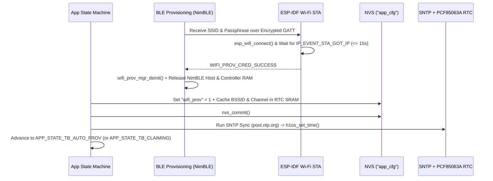

# APP_03: BLE Wi-Fi Provisioning, Device Identity & Credential Reset

* **Document ID:** `APP-ARCH-003` (Rev 2.0)
* **Parent Blueprint:** [`Architectural_Outline.md`](../../Architectural_Outline.md)
* **Normative Scope:** First-Boot BLE GATT Onboarding, `protocomm_ble` Security 1 Encryption, Simultaneous QR + PIN Display, Radio Teardown, and Credential Reset Flows

---

## 1. Onboarding Trigger & Security Model

When the device boots and NVS key `"wifi_prov"` in namespace `"app_cfg"` equals `0` (or when the user invokes **Clear Wi-Fi / Factory Reset** from Screen 3), the firmware enters `APP_STATE_BLE_PROV`.

### 1.1 Encrypted `protocomm_ble` Security 1 Transport

- **Transport Stack:** ESP-IDF `wifi_provisioning` manager over NimBLE (`WIFI_PROV_SCHEME_BLE`) with `WIFI_PROV_EVENT_HANDLER_FREE_BTDM` so Bluetooth controller and host memory are completely freed the instant provisioning completes.
- **Encryption Level:** **`WIFI_PROV_SECURITY_1`** (Curve25519 Elliptic-Curve Diffie-Hellman key exchange + AES-CTR session encryption authenticated with a Proof-of-Possession PIN). Unencrypted `WIFI_PROV_SECURITY_0` is strictly prohibited.
- **Hardware TRNG Proof-of-Possession (PoP) PIN:** On entering provisioning mode, the firmware generates a random 8-character numeric/alphanumeric PoP code using the ESP32-S3 hardware true random number generator (`esp_fill_random()`).

---

## 2. Deterministic Hardware Identity (`HUMID1_<MAC>`)

Every Humid1 unit derives a unique, immutable hardware identifier from its factory-burned IEEE 802.11 Station MAC address:

```c
uint8_t mac[6] = {0};
esp_read_mac(mac, ESP_MAC_WIFI_STA);
snprintf(dev_uid, sizeof(dev_uid), "HUMID1_%02X%02X%02X", mac[3], mac[4], mac[5]);
```

- **Format:** `HUMID1_A1B2C3` (13 characters, uppercase hexadecimal).
- **Usage:**
  1. Advertised as the BLE GATT service name during Wi-Fi provisioning.
  2. Sent as `"deviceName"` in ThingsBoard Phase 1 Auto-Provisioning (`/provision/request`).
  3. Displayed on the Claiming Screen (`screen_claiming`) so the user can enter the exact Device Name and Claim PIN in the Web Dashboard (`ClaimDeviceModal.tsx`).
  4. Displayed on the Main Dashboard (`screen_dashboard`) whenever a custom `device_nickname` has not yet been assigned on the server.

---

## 3. Simultaneous On-Screen QR Code & Manual PIN Display

To support both camera-based mobile app scanning and manual entry in the Web Dashboard (Web Bluetooth API or companion utility), `screen_provisioning` **must simultaneously render both the QR code and the human-readable credentials** on the $200 \times 200$ e-Paper panel:

### 3.1 ESP-IDF Provisioning QR URI Format

The QR code encodes the standard ESP-IDF JSON provisioning string:

```json
{"ver":"v1","name":"HUMID1_A1B2C3","pop":"84920173","transport":"ble"}
```

### 3.2 `screen_provisioning` Layout Contract ($200 \times 200$, $188\,\text{px}$ Usable Width)

| Region | Vertical Band ($Y$) | Content | Typography & Rendering |
| :--- | :--- | :--- | :--- |
| **Header Bar** | $0\text{--}22\,\text{px}$ | `"WIFI SETUP"` (Left) + `"AWAKE"` (Right) | `h1os_font_ui_12` ($12\,\text{pt}$ Bold), 2px bottom divider. |
| **QR Canvas** | $26\text{--}130\,\text{px}$ | $100 \times 100\,\text{px}$ 1-bit QR code centered horizontally ($X = 50$). | Crisp 1-BPP module matrix (`lv_qrcode` or static bitmap generator), zero anti-aliasing. |
| **Device ID Row** | $134\text{--}154\,\text{px}$ | `"ID: HUMID1_A1B2C3"` | `h1os_font_ui_12` centered, guaranteed $\le 188\,\text{px}$. |
| **PoP PIN Row** | $156\text{--}178\,\text{px}$ | `"PIN: 8492-0173"` | `h1os_font_mono_14` / `h1os_font_ui_14` high-contrast inverted box. |
| **Footer Hint** | $180\text{--}196\,\text{px}$ | `"SCAN QR OR ENTER PIN"` | `h1os_font_ui_10` centered. |

---

## 4. Post-Provisioning BLE Teardown & Transition Sequence

Per system requirements (*"once wifi is up, shut down ble"*), BLE is used exclusively during Wi-Fi credential onboarding and must never remain active during normal operation:



1. **Immediate Radio Teardown:** Upon receiving `WIFI_PROV_END` after `IP_EVENT_STA_GOT_IP`, `wifi_prov_mgr_deinit()` stops the NimBLE GATT server, disables the BLE controller, and releases all Bluetooth RAM (`ESP_BT_MODE_BLE` memory freed).
2. **Failure Handling:** If the supplied Wi-Fi credentials fail authentication (`WIFI_PROV_CRED_FAIL`), the screen updates the footer status to `"AUTH FAILED - RETRY"` and resets the provisioning state so the user can submit corrected credentials without rebooting.
3. **Provisioning Timeout:** If no user connects over BLE within $180\,\text{seconds}$, the device renders `"SETUP PAUSED - PRESS BTN"` on the e-Paper panel and enters deep sleep (`h1os_sleep(0)` waiting for an `EXT1` button press wake) to protect the LiPo battery from depletion on a warehouse shelf.

---

## 5. Clearing Settings & Factory Reset (Screen 3 Actions)

Users can reset device settings directly from **Screen 3 (`screen_system`)** using the 2-button interface. The firmware supports two distinct reset scopes:

| Reset Action | Trigger on Screen 3 | NVS Keys Cleared | ThingsBoard Impact | Next Boot State |
| :--- | :--- | :--- | :--- | :--- |
| **Clear Wi-Fi Only (Re-Provision Network)** | Select `"CLEAR WIFI"` $\rightarrow$ Hold `POWER` (`GPIO 18`) for $2\,\text{s}$ to confirm. | Clears ESP-IDF `nvs.net80211` Wi-Fi credentials and sets `"wifi_prov" = 0`. Preserves `"tb_token"` and `"claimed" = 1`. | Device retains its ThingsBoard identity and customer claim; reconnects to new Wi-Fi AP and resumes telemetry. | `APP_STATE_BLE_PROV` $\rightarrow$ `APP_STATE_FLOW_B_SYNC`. |
| **Full Factory Reset (Re-Provision & Re-Claim)** | Select `"FACTORY RESET"` $\rightarrow$ Hold `POWER` (`GPIO 18`) for $3\,\text{s}$ to confirm. | Erases `"nvs.net80211"` and resets all `"app_cfg"` keys (`"wifi_prov" = 0`, `"claimed" = 0`, `"nickname" = ""`, default intervals). | If still connected prior to wipe, publishes `{"claimed": false}` / unclaim telemetry; re-enters full onboarding flow on reboot. | `APP_STATE_BLE_PROV` $\rightarrow$ `APP_STATE_TB_AUTO_PROV` $\rightarrow$ `APP_STATE_TB_CLAIMING`. |
