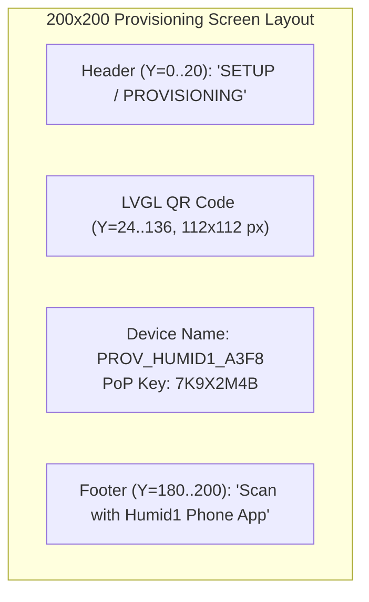

# APP_03: Bluetooth Low Energy (BLE) Provisioning Specification

## 1. Overview & Core Directives
Device onboarding is engineered for a frictionless, guided consumer setup experience. Provisioning operates **exclusively over Bluetooth Low Energy (BLE)** using the ESP-IDF `protocomm` / `wifi_provisioning` stack. SoftAP Wi-Fi broadcast modes are strictly disabled for security.

### Key Behavioral Invariants
1. **Exclusive BLE Transport:** BLE is used solely for initial Wi-Fi credential provisioning.
2. **Immediate BLE Teardown:** Once Wi-Fi association is successfully verified, the BLE stack (NimBLE / controller) is completely unmounted, de-initialized, and powered down to eliminate background RF emission and reclaim ~60 KB of heap.
3. **Hardware Randomness (TRNG):** The Proof of Possession (PoP) PIN and temporary session keys are seeded directly from the ESP32-S3 True Random Number Generator (TRNG) hardware peripheral (`esp_random()`).
4. **Dynamic LVGL QR Code Generation:** The e-Paper display uses LVGL's built-in QR code generator (`lv_qrcode_create`) to synthesize a camera-scannable QR code on the fly for rapid mobile camera pairing.
5. **RTC Domain Fast Reconnect:** Upon verified provisioning, Wi-Fi network parameters (SSID, PMK/PSK, BSSID, channel) are committed to non-volatile storage (NVS) and cached in the RTC domain, enabling <400 ms fast reconnection on subsequent deep sleep wake cycles without active AP scanning.

---

## 2. Provisioning Protocol & Security Architecture

- **Transport:** BLE GATT (Bluetooth 5.0 LE).
- **Service Name (Advertised):** `PROV_HUMID1_<MAC_LAST_4>` (e.g., `PROV_HUMID1_A3F8`). Derived from the lower two bytes of the factory MAC address.
- **Security Scheme:** `Security 1` (AES-128 CTR encrypted key exchange with Proof of Possession).
- **Proof of Possession (PoP):** An unambiguous 8-character alphanumeric string generated via hardware TRNG during first boot:
  ```c
  static void generate_hardware_pop_pin(char *out_pin, size_t len)
  {
      static const char charset[] = "23456789ABCDEFGHJKLMNPQRSTUVWXYZ"; // Ambiguity-free (no 0, 1, I, O)
      for (size_t i = 0; i < len - 1; i++) {
          out_pin[i] = charset[esp_random() % (sizeof(charset) - 1)];
      }
      out_pin[len - 1] = '\0';
  }
  ```

---

## 3. LVGL QR Code Synthesis & Display Layout

The 200×200 1-bit monochrome display renders a dedicated high-contrast layout during `APP_STAGE_PROVISIONING`:



### QR Code JSON Payload
The QR code encodes the standard ESP-IDF provisioning payload recognized by the mobile app:
```json
{
  "ver": "v1",
  "name": "PROV_HUMID1_A3F8",
  "pop": "7K9X2M4B",
  "transport": "ble"
}
```

### LVGL Implementation Pattern
```c
/* Ensure LVGL draw lock is acquired */
h1os_lvgl_lock(100);

lv_obj_t *scr = lv_obj_create(NULL);
lv_obj_set_style_bg_color(scr, lv_color_white(), 0);
lv_obj_set_style_bg_opa(scr, LV_OPA_COVER, 0);

/* Create 112x112 1-bit QR code widget */
lv_obj_t *qr = lv_qrcode_create(scr);
lv_qrcode_set_size(qr, 112);
lv_qrcode_set_dark_color(qr, lv_color_black());
lv_qrcode_set_light_color(qr, lv_color_white());

/* Format standard JSON provisioning payload */
char qr_payload[128];
snprintf(qr_payload, sizeof(qr_payload),
         "{\"ver\":\"v1\",\"name\":\"%s\",\"pop\":\"%s\",\"transport\":\"ble\"}",
         device_name, pop_pin);
lv_qrcode_update(qr, qr_payload, strlen(qr_payload));
lv_obj_align(qr, LV_ALIGN_TOP_MID, 0, 26);

/* Display Device Identifier and Human-Readable PoP Key */
lv_obj_t *lbl_info = lv_label_create(scr);
lv_label_set_text_fmt(lbl_info, "%s\nKEY: %s", device_name, pop_pin);
lv_obj_set_style_text_font(lbl_info, H1OS_FONT_14, 0);
lv_obj_set_style_text_align(lbl_info, LV_TEXT_ALIGN_CENTER, 0);
lv_obj_align(lbl_info, LV_ALIGN_BOTTOM_MID, 0, -6);

lv_screen_load(scr);
h1os_lvgl_unlock();
```

---

## 4. Onboarding Workflow & Lifecycle Transitions

1. **Trigger Condition:**
   - Fresh unprovisioned device boot.
   - User triggers manual factory reset by holding the physical `BOOT` button for **>3.0 seconds**.
2. **Execution Steps:**
   - Application verifies that Wi-Fi credentials do not exist in NVS.
   - TRNG generates 8-character PoP PIN.
   - BLE GATT advertising starts.
   - LVGL renders the provisioning QR code and credentials on the e-Paper display.
3. **Mobile App Pairing:**
   - User opens the Humid1 mobile app (or ESP BLE Prov app) and scans the e-Paper QR code.
   - Mobile app establishes encrypted BLE connection via PoP handshake.
   - Mobile app scans local Wi-Fi networks and transmits selected SSID and passphrase.
4. **Credential Verification & Teardown:**
   - Device tests Wi-Fi connection with received credentials.
   - **On Success:** Chimes notification audio pattern (`CHIME_NOTIFY`), writes credentials to NVS, caches connection context in RTC memory, unregisters and terminates the entire BLE radio stack, and advances state machine to `APP_STAGE_CLAIMING`.
   - **On Failure:** Chimes alert pattern (`CHIME_ALARM`), displays error screen, and re-arms BLE advertising.
