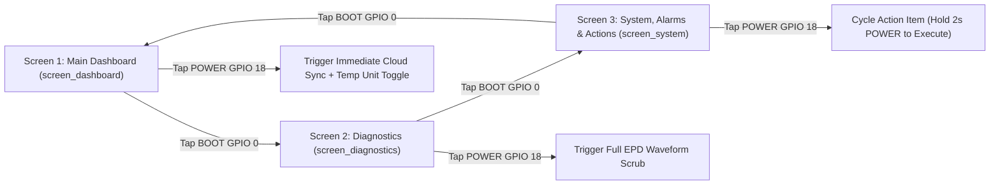

# APP_04: User Interface, 3-Screen Navigation & 1-Bit LVGL Architecture

* **Document ID:** `APP-ARCH-004` (Rev 2.0)
* **Parent Blueprint:** [`Architectural_Outline.md`](../../Architectural_Outline.md)
* **Normative Scope:** $200 \times 200$ 1-Bit Monochrome Display Rules, Mandatory `AWAKE`/`SLEEP` Indicator, 2-Button Interaction Matrix, 3 Core User Screens, and 3 Lifecycle Modal Screens

---

## 1. Physical Display & Typography Constraints

The Humid1 instrument uses a **Waveshare 1.54-inch SSD1681 electrophoretic (e-Paper) panel** driven via H1OS LVGL v9 integration:

- **Resolution:** $200 \times 200\,\text{pixels}$ ($1\,\text{bit per pixel}$, pure black `#000000` and pure white `#FFFFFF`).
- **Safe Text Width Budget:** Every screen enforces a $6\,\text{px}$ horizontal margin on left and right edges, leaving a **maximum usable horizontal width of $188\,\text{px}$** (`APP_UI_MAX_WIDTH_PX = 188`).
- **Zero Anti-Aliasing & Zero Animations:** All LVGL widgets must use `0px` shadow, `100%` opacity, crisp $1\,\text{px}$ or $2\,\text{px}$ borders, and static text labels (`LV_LABEL_LONG_CLIP`). Scrolling marquees (`LV_LABEL_LONG_SCROLL`) and opacity fades are prohibited because e-Paper refresh latency ($\sim 300\,\text{ms}$ partial, $\sim 2000\,\text{ms}$ full) cannot render continuous animations.
- **Kelvin-to-User-Unit Display Conversion:** All internal and cloud temperatures are stored in **Kelvin ($\text{K}$)**. Screen rendering converts Kelvin on the fly according to NVS/Shared Attribute `temp_unit`:
  - **Fahrenheit (`'F'`):** $T_{^\circ\text{F}} = (T_{\text{K}} - 273.15) \times 1.8 + 32.0$
  - **Celsius (`'C'`):** $T_{^\circ\text{C}} = T_{\text{K}} - 273.15$
  - **Kelvin (`'K'`):** $T_{\text{K}}$

---

## 2. Mandatory Operating Mode Indicator (`AWAKE` vs. `SLEEP`)

Because a bistable e-Paper display retains its image indefinitely without power, the user must always be able to tell at a glance whether the instrument is currently awake and responsive to single-tap navigation (**Interactive Mode**) or asleep in micro-amp deep sleep (**Sleep Mode**).

1. **Interactive Mode (`AWAKE`):** Whenever the device wakes from a button press (`is_rtc_wake == false`), the top-right status pill in the header bar renders `[ AWAKE ]` in **inverted colors** (white text on solid black pill in light theme) indicating buttons are live and the 30-second inactivity timer is active.
2. **Sleep Mode (`SLEEP`):** Immediately prior to entering deep sleep (inside `on_pre_sleep()` after the 30-second interactive timeout expires, and during unattended `Flow B` wakes), the firmware switches the active screen back to **Screen 1 (`screen_dashboard`)** and sets the top-right status pill to `ZZZ SLEEP` in standard outline style so the persisted e-Paper image clearly communicates that the CPU is asleep.

---

## 3. Two-Button Hardware Interaction Matrix

The hardware provides two tactile pushbuttons monitored by both the ULP-RISC-V wake stub and the H1OS interactive input poller:

- **Button 1 (`BOOT` / `GPIO 0`, Active-Low):** Screen Cycle & Cursor Advance (`NEXT`).
- **Button 2 (`POWER` / `GPIO 18`, Active-Low):** Context Action, Selection & Confirmation (`SELECT / ACTION`).



| Current Screen | `BOOT` (`GPIO 0`) Short Tap | `BOOT` (`GPIO 0`) 2s Hold | `POWER` (`GPIO 18`) Short Tap | `POWER` (`GPIO 18`) 2s–3s Hold |
| :--- | :--- | :--- | :--- | :--- |
| **Screen 1: Main Dashboard** | Advance to **Screen 2 (Diagnostics)** | Toggle display unit (`°F` $\rightarrow$ `°C` $\rightarrow$ `K`) | Trigger immediate Wi-Fi + MQTTS sync | Enter Storage Power-Off (`h1os_power_off()`) |
| **Screen 2: Diagnostics** | Advance to **Screen 3 (System & Actions)** | Force Tri-Node sensor resample | Trigger full e-Paper waveform scrub (`h1os_lvgl_request_full_refresh()`) | Return to **Screen 1 (Main Dashboard)** |
| **Screen 3: System & Actions** | Advance to **Screen 1 (Main Dashboard)** | Clear non-critical local error log | Cycle highlighted action button (`Invert Theme` $\rightarrow$ `Clear Wi-Fi` $\rightarrow$ `Factory Reset` $\rightarrow$ `Sleep Now`) | **Execute** the currently highlighted action (with confirmation prompt for resets) |
| **Claiming Screen (`screen_claiming`)** | Regenerate new 6-char Claim PIN & restart 180s timer | — | Force immediate claim-status check with ThingsBoard | Cancel & enter Clear Wi-Fi flow |

*Note: Every button tap or hold resets the hardcoded **30-second inactivity timer** (`APP_INACTIVITY_TIMEOUT_SEC = 30U`).*

---

## 4. The Three Core User Screens ($200 \times 200$ Layouts)

### 4.1 Screen 1: Main Dashboard (`screen_dashboard`)

The primary everyday instrument face displaying essential humidor conditions and system status:

```
+----------------------------------+  Y=0
| WIFI OK  [Desktop Hum] [ AWAKE ] |  Header (Y=0..24): Conn Status, Nickname/UID, Mode Pill
+----------------------------------+  Y=24 (2px solid divider)
| [ ! CRITICAL: RH HIGH (76.2%) ! ]|  Optional Alarm Banner (Y=26..44, shown when alarm_state.active)
|                                  |
|           68.4 %                 |  Primary Hero Metric (Y=48..108): Relative Humidity (RH%)
|         REL HUMIDITY             |
+----------------------------------+  Y=112 (1px divider)
|   TEMP (F)      |   DEW POINT    |  Secondary Split Row (Y=114..168):
|    70.0 F       |    57.6 F      |  Left: Ambient Temp (F/C/K) | Right: Dew Point (F/C/K)
+----------------------------------+  Y=170 (2px solid divider)
| BAT: 88% (4.06V)   SYNC: 14:30   |  Footer (Y=172..199): VBAT% / mV (or USB) + Last Sync Time
+----------------------------------+  Y=200
```

- **Required Elements:**
  1. **Connection Status:** `"WIFI OK"` (with RSSI bars), `"OFFLINE"`, or `"SYNCING"`.
  2. **Identity:** Server `device_nickname` (truncated to 11 chars) or hardware UID `HUMID1_XXXX`.
  3. **Mode Badge:** `[ AWAKE ]` (inverted pill when interactive) or `ZZZ SLEEP` (when sleeping).
  4. **Primary Metric:** Relative Humidity (`RH%`) to 1 decimal place (`%.1f%%`).
  5. **Secondary Metrics:** Ambient Temperature and Dew Point converted from Kelvin to the user's selected unit (`°F`, `°C`, or `K`).
  6. **Footer:** Battery State of Charge (`%`), voltage (`V`) or `"USB CHG"` when `vbus_present == true`, and wall-clock time of the last cloud sync.

### 4.2 Screen 2: Diagnostics & Metrology (`screen_diagnostics`)

Provides full engineering visibility into the H1OS Tri-Node compensation engine, battery autonomy model, and network timing:

```
+----------------------------------+  Y=0
| [2/3] DIAGNOSTICS      [ AWAKE ] |  Header (Y=0..22)
+----------------------------------+  Y=22
| TRI-NODE (K/C/F)   CONF:  96%    |  Section 1 (Y=24..74): Tri-Node Thermal Engine
| SHTC3: 294.3K  MCU: 296.1K       |  Raw SHTC3, MCU Die TSENS, EPD Glass 0x1B
| EPD:   294.4K   settled: YES      |
+----------------------------------+  Y=76
| PSYCHROMETRICS                   |  Section 2 (Y=78..116): Vapor Physics
| VP: 17.4 / 25.4 hPa  AH: 12.8g/m3|  Actual/Sat Vapor Pressure & Absolute Humidity
+----------------------------------+  Y=118
| POWER & AUTONOMY                 |  Section 3 (Y=120..156): Battery Metrology
| 4062mV | 0.18mA avg | ~142 days  |  Calibrated mV, Average Draw mA, Autonomy Days
+----------------------------------+  Y=158
| NET: -62dBm 192.168.1.142        |  Section 4 (Y=160..199): Network & Wake Cadence
| FLOW A: 60s | B: 900s | W:#1042  |  Dynamic Flow A/B Intervals & Wake Counter
+----------------------------------+  Y=200
```

### 4.3 Screen 3: System States, Alarms & Interactive Actions (`screen_system`)

Displays active ThingsBoard alarm details, diagnostic error logs, firmware slot metadata, and the interactive user action menu:

```
+----------------------------------+  Y=0
| [3/3] SYSTEM & ALARMS  [ AWAKE ] |  Header (Y=0..22)
+----------------------------------+  Y=22
| ALARM: NONE (SERVER NOMINAL)     |  Section 1 (Y=24..64): Active Server Alarm Box
| THR: 62-72% RH | 290.9-295.4K    |  (Inverts if WARNING/CRITICAL alarm is active)
+----------------------------------+  Y=66
| SYS: FW 0.1.0 (ota_0) ERR: 0x0   |  Section 2 (Y=68..104): Firmware, Partition & Last Error
| UID: HUMID1_A1B2C3  SD: OK       |  Hardware UID, SD Card Status, Audio State
+----------------------------------+  Y=106
| ACTIONS (PWR=NEXT, HOLD=EXEC):   |  Section 3 (Y=108..199): 4-Item Action Selector
| > [ INVERT DISPLAY THEME     ]   |  Item 0: Flip Light/Dark Theme
|   [ CLEAR WIFI CREDENTIALS   ]   |  Item 1: Wipe Wi-Fi & Reboot to BLE Setup
|   [ FULL FACTORY RESET       ]   |  Item 2: Wipe Wi-Fi + Claim Token & Reboot
|   [ POWER OFF (STORAGE MODE) ]   |  Item 3: Cut System Latch (h1os_power_off)
+----------------------------------+  Y=200
```

---

## 5. Lifecycle Modal Screens (`screen_onboarding.h/.c`)

In addition to the 3 user screens cycled during normal operation, `screen_onboarding.c` provides three dedicated lifecycle screens:

1. **Provisioning Screen (`screen_provisioning`):** Rendered during `APP_STATE_BLE_PROV`. Displays the $100 \times 100\,\text{px}$ provisioning QR code, hardware UID (`ID: HUMID1_A1B2C3`), and 8-digit TRNG PoP PIN (`PIN: 8492-0173`).
2. **Claiming Screen (`screen_claiming`):** Rendered during `APP_STATE_TB_CLAIMING`. Displays `"CLAIM DEVICE ON DASHBOARD"`, `ID: HUMID1_A1B2C3`, large high-contrast 6-character TRNG Claim PIN (`PIN: 9K4M2P`), and a partial-refreshed countdown bar (`TIME LEFT: 165s`).
3. **OTA Update Progress Screen (`screen_ota`):** Rendered during `APP_STATE_OTA_UPDATE`. Displays target version (`UPDATING TO v0.2.0`), target partition (`SLOT: ota_1`), a segmented progress bar updated every $20\%$ chunk boundary (minimizing e-Paper partial refreshes), and status text (`DOWNLOADING` $\rightarrow$ `VERIFYING SHA256` $\rightarrow$ `REBOOTING`).
