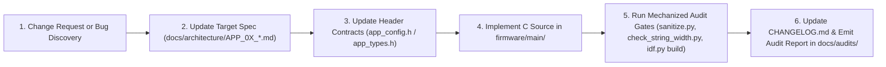

# APP_08: Code Audit Standard (`APP-STD-001`) & Documentation Governance

* **Document ID:** `APP-ARCH-008` (Rev 2.0)
* **Parent Blueprint:** [`Architectural_Outline.md`](../../Architectural_Outline.md)
* **Aligned OS Standard:** `H1OS-STD-001` (Rev 2.0)
* **Normative Scope:** How to Audit Application Code, 8-Domain Application Pitfall Catalog, Automated Pre-Flight Verification Gates, and Mandatory Protocol for Documenting Changes ("Documentation is Law")

---

## 1. Philosophy: "Documentation is Law"

In the `humid1-os` repository, the specifications in `Architectural_Outline.md` and `docs/architecture/APP_01..08` are the single authoritative source of truth. Code does not define architecture; architecture defines code.

### 1.1 The Four Laws of Change Governance

1. **Law 1 — Spec Before Code:** No engineer or AI agent may add or modify a state transition, MQTT topic, JSON key, NVS key, button binding, or LVGL screen layout in `firmware/main/` without **first** updating the corresponding specification in `docs/architecture/APP_01..07`.
2. **Law 2 — OS Boundary Integrity:** Application code must never modify H1OS managed component source files directly. If a change in H1OS is required, it must be formally specified in [`docs/architecture/APP_07_os_api_mandates.md`](APP_07_os_api_mandates.md) with an explicit `MANDATE-XX` entry.
3. **Law 3 — Traceable Changelog & SemVer:** Every user-visible feature, protocol update, or bug fix must be recorded in [`CHANGELOG.md`](../../CHANGELOG.md) under the active `[Unreleased]` or versioned section (`Added`, `Changed`, `Fixed`, `Security`) adhering to Semantic Versioning 2.0.0.
4. **Law 4 — Immutable Audit Certification:** Every completed milestone or pull request must undergo the 5-step `APP-STD-001` audit pipeline defined below and record its verification report in `docs/audits/YYYY-MM-DD_<slug>.md`.

---

## 2. How to Document Architectural or Code Changes

Whenever a change is requested or discovered during development, execute this exact sequence:



### 2.1 Documentation Formatting & Lexicon Rules

All Markdown files, Doxygen blocks, commit messages, and code comments must comply with `.agents/rules/gfm.md` and `.agents/rules/lexicon.md`:
- **Mermaid Diagrams:** Always open with `graph TD;` or `graph LR;` (with semicolon), wrap all node labels in double quotes (`Node["Label Text"]`), and never include `<br/>`, `&`, `•`, or non-ASCII symbols inside node labels.
- **LaTeX Math Blocks:** Place `$$` delimiters on their own lines at column 0, and never use escaped underscores (`\_`) inside `\text{...}`.
- **Professional Engineering Lexicon:** Avoid informal metaphors or prohibited terms (`stand-down`, `sentinel`, `tripwire`, `sprint`, `recon`, `scaffold purge`, `neutralize`, `kill`, `fallback`, `doctrine`, `bones/muscle/vanity`). Verify every Markdown and C file with `python3 firmware/tools/agent/sanitize.py`.

---

## 3. Application Audit Standard (`APP-STD-001`): The 8-Domain Pitfall Catalog

Extending `H1OS-STD-001` to Layer 4 wireless, cloud, and UI operations, every audit evaluates code against three severity classes (`S0` Blocker/Hazard, `S1` State/Protocol Integrity, `S2` Determinism/UX) across eight application domains:

| Domain | Pitfall ID | Class | Failure Mode & Root Cause | Audit Verification Procedure |
| :--- | :--- | :---: | :--- | :--- |
| **D1: LVGL & Cross-Core Concurrency** | `APP-PIT-01` | `S0` | Mutating LVGL labels/screens from an MQTT, Wi-Fi, or timer callback outside `on_wake()` without acquiring `h1os_lvgl_lock()`. | Inspect all calls to `lv_*` and `screen_*_update()`. Outside `on_boot()`/`on_wake()`, every UI mutation must be wrapped in `if (h1os_lvgl_lock(200)) { ... h1os_lvgl_unlock(); }`. |
| **D2: Radio Teardown & Sleep Leakage** | `APP-PIT-02` | `S0` | Leaving BLE controller active after provisioning or entering deep sleep while Wi-Fi/MQTT is still connected, draining $>20\,\text{mA}$. | Verify `wifi_prov_mgr_deinit()` runs immediately after `WIFI_PROV_END`, and `on_pre_sleep()` verifies `net_wifi_stop_burst()` and `cloud_tb_disconnect()` completed before `h1os_sleep()`. |
| **D3: TLS & Wall-Clock Ordering** | `APP-PIT-03` | `S0` | Initiating MQTTS (`mqtts://humid1.com:8883`) before PCF85063A RTC holds a valid epoch ($\ge 2026$), causing X.509 certificate verification failure. | Confirm `net_sntp_ensure_valid_time()` is executed prior to `esp_mqtt_client_start()`, and `esp_crt_bundle_attach` is always enabled in `esp_mqtt_client_config_t`. |
| **D4: Server-Driven & Kelvin Fidelity** | `APP-PIT-04` | `S1` | Publishing ambient temperature in Celsius or Fahrenheit instead of **Kelvin ($\text{K}$)**, corrupting ThingsBoard `Alarms` Rule Chain evaluations. | Verify `cloud_tb_publish_telemetry()` converts `ambient_temp_c + 273.15f` to Kelvin for `"temp"`, and local UI converts Kelvin back to `temp_unit` (`F`/`C`/`K`). |
| **D5: NVS Wear & Claim Persistence** | `APP-PIT-05` | `S1` | Writing telemetry counters or cached alarms to NVS on every 15-minute `Flow B` wake, wearing out flash pages or wiping `tb_token` on OTA. | Confirm per-wake state uses `RTC_DATA_ATTR`, NVS writes occur only when user/server configuration changes, and every `nvs_set_*` is followed by `nvs_commit()`. |
| **D6: Static Memory & Numeric Typing** | `APP-PIT-06` | `S1` | Using runtime `malloc`/`free` in periodic telemetry loops, naked `int`/`long` types, or unsuffixed float literals (`273.15` instead of `273.15f`). | Run regex gates for dynamic allocation, naked C types, and double-promotion literals (`-Wdouble-promotion -Werror`). Ensure `cJSON` buffers use bounded static buffers or `snprintf` where deterministic. |
| **D7: 1-Bit EPD & 188px Width Gate** | `APP-PIT-07` | `S2` | Rendering strings wider than $188\,\text{px}$, using scrolling marquees (`LV_LABEL_LONG_SCROLL`), or omitting the `AWAKE`/`SLEEP` mode badge. | Execute `python3 firmware/tools/agent/check_string_width.py` on all UI strings and confirm `on_pre_sleep()` sets the header indicator to `SLEEP` before final EPD flush. |
| **D8: Bounded Waits & Error Recovery** | `APP-PIT-08` | `S0` | Blocking on Wi-Fi, SNTP, or MQTT event bits with `portMAX_DELAY`, hanging the CPU and draining the battery if an AP or broker drops offline. | Verify every `xEventGroupWaitBits()` and network poll uses an explicit millisecond timeout ($\le 5000\,\text{ms}$) and increments `consecutive_net_fails` on timeout before sleeping safely. |

---

## 4. Five-Step Standard Operating Procedure (SOP) for Code Audits

Every code audit must execute the following five steps in sequential order:

### Step 1: Diff & Architectural Alignment Check
Compare all modified files (`git status` / `git diff`) against `docs/architecture/APP_01..07`. Verify that every new constant, state, topic, or UI widget is documented in the architecture specifications.

### Step 2: Automated Static Pre-Flight Gates
Run the automated verification scripts from the repository root:

```bash
# Gate 2A: Lexicon & GFM Markdown Sanitizer
python3 firmware/tools/agent/sanitize.py

# Gate 2B: 188-Pixel Display String Width Verifier
python3 firmware/tools/agent/check_string_width.py

# Gate 2C: Unbounded Wait & Double-Promotion Literal Scans
rg "portMAX_DELAY" firmware/main/
rg "\b[0-9]+\.[0-9]+(?!f|F)\b" firmware/main/
```

*Pass Criteria:* Zero prohibited lexicon terms, zero strings exceeding $188\,\text{px}$, zero `portMAX_DELAY` calls in application code, and zero unsuffixed floating-point literals in C source files.

### Step 3: 8-Domain Semantic Review
Inspect each modified C/H file line-by-line against `APP-PIT-01` through `APP-PIT-08` in Section 3. Verify all `esp_err_t` return values are checked and all error paths cleanly release locks and deinitialize radios.

### Step 4: Hardened Compiler & Stack Frame Gate
Compile the firmware inside `firmware/` with strict compiler flags (`-Wall -Wextra -Werror -Wdouble-promotion -fstack-usage`):

```bash
cd firmware && idf.py build
```

*Pass Criteria:* `0 errors, 0 warnings`, binary image size $< 3.5\,\text{MB}$ (fitting cleanly inside the $4\,\text{MB}$ `ota_0`/`ota_1` slots), and worst-case `.su` stack frames within task stack budgets.

### Step 5: Emit Formal Audit Certification Report
Create a permanent audit report in `docs/audits/YYYY-MM-DD_<slug>.md` using the template below.

---

## 5. Standardized Application Audit Report Template

```markdown
# Humid1-OS Audit Certification Report: [YYYY-MM-DD]-[SHORT_SLUG]

* **Audit Standard:** `APP-STD-001 (Rev 2.0)` / `H1OS-STD-001`
* **Target Version / Commit:** `<version-or-sha>`
* **Audited Modules:** `[List files, e.g., firmware/main/cloud_tb.c, docs/architecture/APP_02_cloud_and_telemetry.md]`
* **Auditor:** `[Engineer / Agent Identifier]`
* **Final Disposition:** `[PASS | PASS WITH WAIVERS | FAIL]`

---

## 1. Automated Pre-Flight Gate Results (Steps 2 & 4)
* **Lexicon & GFM Sanitizer (`sanitize.py`):** `[PASS - 0 Violations]`
* **188px UI Width Gate (`check_string_width.py`):** `[PASS - Max string width: X px <= 188 px]`
* **Unbounded Wait Scan (`portMAX_DELAY`):** `[PASS - 0 Matches in firmware/main/]`
* **Float Suffix Scan (`-Wdouble-promotion`):** `[PASS - 0 Unsuffixed Literals]`
* **Compiler Build (`idf.py build`):** `[PASS / VERIFIED SKELETON - 0 Errors, 0 Warnings]`

## 2. 8-Domain Application Compliance Matrix (Step 3)

| Domain | Pitfall ID | Evaluated | Evidence & File:Line Reference | Verdict |
| :--- | :--- | :---: | :--- | :---: |
| **D1: LVGL Concurrency** | `APP-PIT-01` | `[Yes/No]` | `[e.g., main.c:112 h1os_lvgl_lock bounded to 200ms]` | `[PASS/FAIL/N/A]` |
| **D2: Radio Teardown** | `APP-PIT-02` | `[Yes/No]` | `[e.g., net_wifi_ble.c:145 BLE deinit on WIFI_PROV_END]` | `[PASS/FAIL/N/A]` |
| **D3: TLS & SNTP Order** | `APP-PIT-03` | `[Yes/No]` | `[e.g., cloud_tb.c:88 esp_crt_bundle_attach & RTC gate]` | `[PASS/FAIL/N/A]` |
| **D4: Kelvin & Schema** | `APP-PIT-04` | `[Yes/No]` | `[e.g., cloud_tb.c:210 temp serialized in Kelvin]` | `[PASS/FAIL/N/A]` |
| **D5: NVS & RTC Persistence**| `APP-PIT-05` | `[Yes/No]` | `[e.g., app_state.c:94 RTC_DATA_ATTR cache + nvs_commit]` | `[PASS/FAIL/N/A]` |
| **D6: Memory & Types** | `APP-PIT-06` | `[Yes/No]` | `[e.g., app_types.h fixed-width stdint.h types]` | `[PASS/FAIL/N/A]` |
| **D7: 1-Bit EPD & Mode UI** | `APP-PIT-07` | `[Yes/No]` | `[e.g., screen_dashboard.c AWAKE/SLEEP indicator]` | `[PASS/FAIL/N/A]` |
| **D8: Bounded Network Waits**| `APP-PIT-08` | `[Yes/No]` | `[e.g., net_wifi_ble.c:98 5000ms timeout bound]` | `[PASS/FAIL/N/A]` |

## 3. Defects Found & Remediations Applied
* **[Finding ID | Severity S0-S2]:** `[Root cause, affected file:line, and exact remediation applied]`
```
