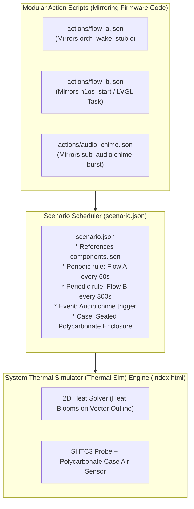

# HUMID1 Thermal Sim — Compound System Thermal & Metrology Specification
## Engineering Plan, Mathematical Formulation & Architecture (Revision 5)

**Target Device:** Waveshare ESP32-S3 Touch ePaper 1.54" V2 ($48\text{ mm} \times 35\text{ mm}$ PCB) inside Polycarbonate Case  
**Power Domain Policy:** **Strictly Battery LiPo / POR Operation (Zero USB / Untethered).** The device operates exclusively untethered on its internal 3.7V Li-ion battery (Model 502535, 400 mAh). USB charging and VBUS tethering are omitted from the thermal model. All operational states, heat dissipation, and cooling curves reflect independent, sealed-case battery runtime.  
**Volumetric & Enclosure Architecture (Two-Stage Domain):**
* **Device Gross Volume ($V_{\text{gross}}$):** Calculated directly from outer case dimensions ($53.0\text{ mm} \times 39.8\text{ mm} \times 16.9\text{ mm}$):
  $$V_{\text{gross}} = 5.30\text{ cm} \times 3.98\text{ cm} \times 1.69\text{ cm} = \mathbf{35.65\text{ cm}^3 \ (35.65\text{ mL})}$$
* **Device Free Air Space ($25\%\text{–}35\%$):** Solid components (400 mAh LiPo battery, display glass sandwich, PCB, structural polycarbonate ribs, connectors) occupy $65\%\text{–}75\%$ ($23.2\text{–}26.7\text{ mL}$) of the enclosure. The net internal free air volume is strictly:
  $$V_{\text{air,internal}} = 25\%\text{–}35\% \times 35.65\text{ mL} = \mathbf{8.91\text{ mL to } 12.48\text{ mL}} \quad (\text{Nominal } 30\% \approx \mathbf{10.70\text{ mL}})$$
  *Thermodynamic Implication:* With a minute air mass ($m_{\text{air}} \approx 12.8\text{ mg}$), the internal thermal capacitance of this trapped air pocket is ultra-low ($C_{\text{air}} \approx 0.013\text{ J/K}$). Any thermal flux radiating from the PCB warms this internal dead space almost instantaneously.
* **Environmental Chamber Net Air Volume:** For a nominal $2.0\text{ L}$ ($2,000\text{ mL}$) test chamber minus the device displacement:
  $$V_{\text{chamber,net}} = 2,000.0\text{ mL} - 35.65\text{ mL} = \mathbf{1,964.35\text{ mL}} \quad (\mathbf{1.964\text{ Liters}})$$
  The chamber air volume is $\mathbf{184\times}$ larger than the device's internal air pocket ($1,964\text{ mL}$ vs $10.7\text{ mL}$), acting as a massive external thermal reservoir.
**Core Goal:** Model board heat transfer, approximate runtime thermal saturation, and compute exact cooling intervals across battery operational lifecycles (Flow A, Flow B, Audio, Deep Sleep) using a **script-driven architecture**.

---

## 1. Script Architecture: Modular Actions vs. Single Master Scenario

You asked whether we should use separate action scripts per operating state or a single master script.



### Recommendation: The Hybrid "Firmware Mirror" Architecture
The optimal architecture uses **modular action scripts referenced by a master scenario**:
1. **Action Scripts (`tools/thermal_sim/actions/`)**:
   - [`flow_a.json`](file:///tools/thermal_sim/actions/flow_a.json) $\to$ Mirrors [`orch_wake_stub.c`](file:///components/h1os/src/orch_wake_stub.c). Describes single burst: Core 0 80 MHz for 10 ms, SHTC3 read for 8 ms, buck losses.
   - [`flow_b.json`](file:///tools/thermal_sim/actions/flow_b.json) $\to$ Mirrors [`h1os_start()`](file:///components/h1os/src/h1os_lifecycle.c) and Core 1 LVGL task. Describes active UI: 240 MHz Turbo for 18s, SSD1681 booster active for 2.5s.
   - [`audio_chime.json`](file:///tools/thermal_sim/actions/audio_chime.json) $\to$ Mirrors chime playback: ES8311 codec + NS4150B amplifier active for 3s.
2. **Master Timeline (`tools/thermal_sim/scenario.json`)**:
   - Declares the compounding schedule on pure battery power: e.g. "run `flow_a` every 60s", "run `flow_b` every 300s", "trigger chime at t=600s".
   - As time advances, the engine compounds the heat pulses from active battery discharge and simulates physical cooling during deep sleep intervals.
3. **Single-File Fallback**:
   - The visualizer also allows running in "All-In-One" mode where presets are pre-loaded in the UI dropdown so you can test instantly without touching files.

---

## 2. The "System Thermal Simulator" Visualizer Design

The tool behaves exactly like a **thermal video player**:

```
┌───────────────────────────────────────────────────────────────────────────────────────────────────┐
│  HUMID1 Thermal Video Profiler & Runtime Simulator                           [ Preset: Normal Run ]│
├──────────────────────────────────────┬────────────────────────────────────────────────────────────┤
│  2D VECTOR BOARD & HEATMAP VIEWPORT   │  STATIC SHTC3 & ENCLOSURE AIR PROBE METRICS                │
│                                      │                                                            │
│   0mm                         48mm   │  Chamber Ambient (2L): 22.0°C | 69.0% RH                   │
│   ┌───────────────────────────┐      │  SHTC3 Probe Temp:    24.28°C  (+2.28°C Heat Soak)         │
│ 0 │ [MP1605]   [SD CARD]      │      │  Case Air (10.7mL):   24.18°C  (+2.18°C Micro-Rise)        │
│   │ [ETA6098]                 │      │  Chamber Air (1.96L): 22.05°C  (+0.05°C Macro-Rise)        │
│   │ [Type-C]  [ESP32-S3] ♨    │      │  Indicated RH:        60.1% RH (-8.9% Error!)              │
│   │ (Off/NC)   (heat bloom)   │      │  Metrology Status:    HOT (UNSETTLED)                      │
│   │                          │      │  Est. Time to Settle: 21 min 15 sec of deep sleep          │
│   │ [U10] [U11]      [BOOST]  │      ├────────────────────────────────────────────────────────────┤
│   │  (hot) (hot)             │      │  HEAT SOAK COMPOUNDING STRIP CHART                         │
│35 │  [U1:SHTC3]  [12-PIN HDR] │      │   Temp (°C) ── SHTC3 Node  ── Case Air  ── Chamber (2L)    │
│35 │  [U1:SHTC3]  [12-PIN HDR] │      │   28 ┌─────────────────────────────────────────────────┐   │
│   └───────────────────────────┘      │   22 └─────────────────────────────────────────────────┘   │
│   Vector PCB Silkscreen Outline with │   RH (%)    ── Indicated SHTC3 RH   ── True Ambient (69%)  │
│   Smooth False-Color Thermal Blooms  │   70 ┌─────────────────────────────────────────────────┐   │
│   [Blue: Cold (22°C) ──> Red: Hot]   │   55 └─────────────────────────────────────────────────┘   │
├──────────────────────────────────────┴────────────────────────────────────────────────────────────┤
│  VIDEO PLAYBACK TRANSPORT CONTROLS                                                                │
│  [  ▶ PLAY  ]   [ ❚❚ PAUSE ]   [ ◼ RESET ]   [ ⏭ STEP (+10s) ]                                     │
│  Timeline: 00:04:30 / 01:00:00  [──────────────────●────────────────────────]                     │
│  Playback Speed:  ( ) 1:1 (Realtime)   (o) 5:1   ( ) 20:1   ( ) 60:1   ( ) Max Speed              │
│  Active State: [ Flow B Display Refresh ] -> Next Event: [ Flow A Sample in 30s ]                  │
└───────────────────────────────────────────────────────────────────────────────────────────────────┘
```

### Visual & Physical Effects:
1. **2D Vector Rendering:** Clean vector traces and component outlines on a PCB silkscreen style canvas ($48\text{ mm} \times 35\text{ mm}$ at $10\times$ scale = $480\times 350\text{ px}$).
2. **Dynamic Heat Blooms:** Active components radiate circular/diffuse Gaussian heat blooms that expand into the PCB copper plane at copper conduction speed ($k_{\text{Cu}} = 385\text{ W/(m}\cdot\text{K)}$).
3. **Sleep Color Fade & Decay:** When the SoC enters deep sleep, component heat sources extinguish immediately, and the board colors gradually shift from orange/yellow back toward cold blue according to the exponential cooling curve.
4. **Speed Control:** Play in real time ($1:1$) or accelerate by $2:1, 5:1, 20:1, 60:1$ to watch hours of sleep settling in seconds.
5. **Static SHTC3 Probe:** Continuously displays local sensor temperature, case air temperature, and exact Clausius-Clapeyron $RH$ depression.

---

## 3. Actionable Implementation Plan

## 5. Spatial Transform & Critical Hardware Layout Findings

Using the 100 DPI high-resolution optical benchmark image with board corner fiducials $(111, 96)$, $(811, 83)$, $(807, 592)$, $(114, 578)$ mapped to the $48.0\text{ mm} \times 35.0\text{ mm}$ physical substrate:

| Component | Image Pixel Coords $(x_{\text{px}}, y_{\text{px}})$ | Calculated Physical Coords $(X_{\text{mm}}, Y_{\text{mm}})$ | Direct Distance to SHTC3 Pad |
| :--- | :--- | :--- | :--- |
| **Sensirion SHTC3 (`U1`)** | $(116, 200)$ | **$(0.5\text{ mm}, 7.5\text{ mm})$** | **$0.0\text{ mm}$ (Target Probe Node)** |
| **MP1605 Buck Inductor (`L7`)** | $(275, 198)$ | **$(10.5\text{ mm}, 6.5\text{ mm})$** | **$10.0\text{ mm}$! (Critical Nearby Dissipator)** |
| **MP1605 Buck Regulator (`U7`)**| $(276, 247)$ | **$(11.5\text{ mm}, 10.5\text{ mm})$** | **$11.4\text{ mm}$! (Critical Nearby Dissipator)** |
| **Power Button (`SW1`)** | $(229, 96)$ | **$(7.5\text{ mm}, 0.0\text{ mm})$** | $10.2\text{ mm}$ |
| **Type-C Receptacle (`J1`)** | $(95, 327)$ | **$(0.0\text{ mm}, 13.5\text{ mm})$** | $6.0\text{ mm}$ (Overhanging left edge, unpowered) |
| **ES8311 Codec (`U10`)** | $(326, 396)$ | **$(14.0\text{ mm}, 20.5\text{ mm})$** | $18.7\text{ mm}$ (Quiescent standby in chamber) |
| **NS4150B PA (`U11`)** | $(425, 397)$ | **$(21.0\text{ mm}, 20.5\text{ mm})$** | $24.2\text{ mm}$ (Shutdown in chamber) |
| **ESP32-S3 SoC (`U9`)** | $(532, 391)$ | **$(26.5\text{ mm}, 17.5\text{ mm})$** | **$27.8\text{ mm}$** (Central ground plane conduction) |
| **MicroSD Slot (`TF1`)** | $(578, 185)$ | **$(26.0\text{ mm}, 1.5\text{ mm})$** | $26.2\text{ mm}$ (Passive thermal mass) |
| **MEMS Mic (`MIC1`)** | $(127, 469)$ | **$(0.5\text{ mm}, 25.5\text{ mm})$** | $18.0\text{ mm}$ |
| **SSD1681 Booster (`BOOST`)** | $(650, 380)$ | **$(35.0\text{ mm}, 20.0\text{ mm})$** | $36.7\text{ mm}$ |

### Critical Spatial Discovery: The 11 mm Buck Converter Proximity
The pixel mapping revealed that the **Sensirion SHTC3 is situated on the upper-left board edge, a mere $10.0\text{ to }11.4\text{ mm}$ from the MP1605 buck regulator IC and its switching power inductor (`L7`)**.
* During Flow B active display sessions ($I_{\text{load}} \approx 85\text{–}95\text{ mA}$), switching losses in the MP1605 and inductor magnetic core heat up this upper-left quadrant rapidly.
* Because the distance is so short ($10\text{ mm}$), thermal conduction across the copper ground plane reaches the SHTC3 center pad in under **$0.5\text{ to }1.0\text{ second}$**, making the buck regulator a dominant local heat injector during active blits.

---

## 6. 4-Layer PCB Stackup & Copper Weight Thermodynamic Derivation

To guarantee physical accuracy in the thermal finite-difference solver, the PCB substrate cannot be treated as homogeneous material. An FR4 board is an anisotropic laminated composite where thin copper foil layers ($k_{\text{Cu}} = 385\text{ W/(m}\cdot\text{K)}$) dominate lateral heat spreading, while FR4 dielectric ($k_{\text{FR4}} = 0.25\text{ W/(m}\cdot\text{K)}$) dominates through-plane thermal resistance.

### 6.1 Generic 1.6 mm 4-Layer Stackup Architecture (Budget Baseline: Default & Only Option)
The HUMID1 board exclusively employs the industry-standard commercial budget 1.6 mm 4-layer stackup configured in **Sig – GND – GND – Sig (1.0 oz Finished Outer / 0.5 oz Foil Inner)**:

| Layer / Interface | Material Description | Thickness | Finished Cu Weight | Estimated Cu Coverage | Effective Cu Thickness |
| :--- | :--- | :--- | :--- | :--- | :--- |
| **Layer 1 (Top)** | Signal Traces, Component Pads & Ground Flood | $35\text{ µm}$ | $1.0\text{ oz finished}$ | $55\%$ | $19.25\text{ µm}$ |
| **Dielectric 1** | FR4 Prepreg (Glass Fabric / Resin Matrix) | $0.15\text{ mm}$ | — | — | — |
| **Layer 2 (Inner 1)**| Continuous Ground (GND) Reference Plane | $17.5\text{ µm}$ | $0.5\text{ oz foil}$ | $95\%$ | $16.63\text{ µm}$ |
| **Core** | FR4 Foundational Rigid Core | $1.10\text{ mm}$ | — | — | — |
| **Layer 3 (Inner 2)**| Secondary Continuous Ground / Power Plane | $17.5\text{ µm}$ | $0.5\text{ oz foil}$ | $90\%$ | $15.75\text{ µm}$ |
| **Dielectric 2** | FR4 Prepreg (Glass Fabric / Resin Matrix) | $0.15\text{ mm}$ | — | — | — |
| **Layer 4 (Bottom)**| Secondary Signal Routing & Ground Flood | $35\text{ µm}$ | $1.0\text{ oz finished}$ | $50\%$ | $17.50\text{ µm}$ |
| **Total PCB Stackup**| **Laminated Composite Substrate** | **$1.60\text{ mm}$** | **$1.0\text{ oz out} / 0.5\text{ oz in}$**| — | **$t_{\text{Cu,eff}} = 69.1\text{ µm}$** |

### 6.2 Analytical Copper Mass & Thermal Conductivity Formulations
Given board dimensions $W = 48.0\text{ mm}$, $H = 35.0\text{ mm}$ ($\text{Area } A = 1,680\text{ mm}^2 = 1.68 \times 10^{-3}\text{ m}^2$):

1. **Total Copper Mass ($m_{\text{Cu}}$):**
   $$V_{\text{Cu}} = A \cdot t_{\text{Cu,eff}} = (1.68 \times 10^{-3}\text{ m}^2) \times (69.13 \times 10^{-6}\text{ m}) = 1.161 \times 10^{-7}\text{ m}^3 = 0.1161\text{ cm}^3$$
   $$m_{\text{Cu}} = V_{\text{Cu}} \cdot \rho_{\text{Cu}} = (0.1161\text{ cm}^3) \times (8.96\text{ g/cm}^3) = \mathbf{1.041\text{ grams}}$$

2. **FR4 Dielectric Mass ($m_{\text{FR4}}$):**
   $$t_{\text{FR4}} = t_{\text{total}} - t_{\text{Cu,eff}} = 1.60\text{ mm} - 0.06913\text{ mm} = 1.5309\text{ mm}$$
   $$V_{\text{FR4}} = (1.68 \times 10^{-3}\text{ m}^2) \times (1.5309 \times 10^{-3}\text{ m}) = 2.5719 \times 10^{-6}\text{ m}^3 = 2.5719\text{ cm}^3$$
   $$m_{\text{FR4}} = V_{\text{FR4}} \cdot \rho_{\text{FR4}} = (2.5719\text{ cm}^3) \times (1.85\text{ g/cm}^3) = \mathbf{4.758\text{ grams}}$$
   $$\text{Bare Board Mass } m_{\text{PCB}} = 1.041\text{ g} + 4.758\text{ g} = \mathbf{5.798\text{ grams}} \quad (\text{Copper Fraction: } 17.9\%)$$

3. **In-Plane Effective Thermal Conductivity ($k_{\parallel}$):**
   In the plane of the board, heat conducts in parallel through copper foils and FR4:
   $$k_{\parallel} = \frac{k_{\text{Cu}} \cdot t_{\text{Cu,eff}} + k_{\text{FR4}} \cdot t_{\text{FR4}}}{t_{\text{total}}} = \frac{(385 \times 0.06913\text{ mm}) + (0.25 \times 1.5309\text{ mm})}{1.60\text{ mm}} = \mathbf{16.87\text{ W/(m}\cdot\text{K)}}$$

4. **Through-Plane Effective Thermal Conductivity ($k_{\perp}$):**
   Normal to the board, heat conducts in series across copper and FR4 laminates:
   $$k_{\perp} = \frac{t_{\text{total}}}{\frac{t_{\text{Cu,eff}}}{k_{\text{Cu}}} + \frac{t_{\text{FR4}}}{k_{\text{FR4}}}} = \frac{1.60\text{ mm}}{\frac{0.06913}{385} + \frac{1.5309}{0.25}} = \frac{1.60}{0.00018 + 6.1236} = \mathbf{0.261\text{ W/(m}\cdot\text{K)}}$$
   *(Note: The substrate exhibits a $\sim 65:1$ conductivity anisotropy ratio $k_{\parallel} / k_{\perp}$, channeling dissipation laterally through inner ground planes).*

5. **Volumetric Heat Capacity ($C_v$) & Thermal Diffusivity ($\alpha$):**
   $$C_{\text{total}} = (m_{\text{Cu}} \cdot c_{p,\text{Cu}}) + (m_{\text{FR4}} \cdot c_{p,\text{FR4}}) = (1.041\text{g} \times 0.385\text{ J/g}\cdot\text{K}) + (4.758\text{g} \times 1.10\text{ J/g}\cdot\text{K}) = \mathbf{5.634\text{ J/K}}$$
   $$C_v = \frac{C_{\text{total}}}{V_{\text{total}}} = \frac{5.634\text{ J/K}}{2.688 \times 10^{-6}\text{ m}^3} = \mathbf{2.096 \times 10^6\text{ J/(m}^3\cdot\text{K)}}$$
   $$\alpha = \frac{k_{\parallel}}{C_v} = \frac{16.87\text{ W/(m}\cdot\text{K)}}{2.096 \times 10^6\text{ J/(m}^3\cdot\text{K)}} = 8.049 \times 10^{-6}\text{ m}^2/\text{s} = \mathbf{8.05\text{ mm}^2/\text{s}}$$
   $$\tau_{\text{transit}} \approx \frac{x^2}{4\alpha} = \frac{(10.0\text{ mm})^2}{4 \times 8.05\text{ mm}^2/\text{s}} = \mathbf{3.10\text{ seconds}}$$

---

## 7. Polycarbonate Shell Conduction, Aperture Venting & Continuous Cooling Model

The micro-enclosure does not trap heat indefinitely. Heat generated during active bursts continuously dissipates into the 2.0 L environmental chamber via two parallel thermodynamic mechanisms: solid shell conduction/convection and micro-aperture air exchange.

### 7.1 Polycarbonate Shell Geometry & Conduction Areas
* **Outer Dimensions:** $53.0\text{ mm} \times 39.8\text{ mm} \times 16.9\text{ mm}$.
* **Total Outer Surface Area ($A_{\text{case}}$):**
  $$A_{\text{case}} = 2 \times (53.0 \times 39.8 + 53.0 \times 16.9 + 39.8 \times 16.9) = 7,355.4\text{ mm}^2 \approx \mathbf{0.00736\text{ m}^2}$$
* **Shell Conduction Resistance ($R_{\text{cond}}$):**
  For wall thickness $t_{\text{wall}} = 1.5\text{ mm}$ and $k_{\text{PC}} = 0.20\text{ W/(m}\cdot\text{K)}$:
  $$R_{\text{cond}} = \frac{t_{\text{wall}}}{k_{\text{PC}} \cdot A_{\text{case}}} = \frac{0.0015\text{ m}}{(0.20\text{ W/m}\cdot\text{K}) \times (0.007355\text{ m}^2)} = \mathbf{1.02\text{ K/W}}$$
* **Outer Convective & Radiative Dissipation ($R_{\text{ext}}$):**
  With natural convection coefficient $h_{\text{conv}} \approx 10.0\text{ W/(m}^2\cdot\text{K)}$ and linearized radiative coefficient $h_{\text{rad}} = 4 \epsilon \sigma T^3 \approx 5.24\text{ W/(m}^2\cdot\text{K)}$ ($\epsilon_{\text{PC}} = 0.90$):
  $$h_{\text{total,ext}} = 10.0 + 5.24 = 15.24\text{ W/(m}^2\cdot\text{K)}$$
  $$R_{\text{ext}} = \frac{1}{h_{\text{total,ext}} \cdot A_{\text{case}}} = \frac{1}{15.24 \times 0.007355} = \mathbf{8.92\text{ K/W}}$$
  $$R_{\text{wall,total}} = R_{\text{cond}} + R_{\text{ext}} = 1.02 + 8.92 = \mathbf{9.94\text{ K/W}}$$

### 7.2 Open Aperture Venting & Air Exchange ($R_{\text{aperture}}$)
The enclosure is not hermetically sealed. Direct physical openings provide continuous air exchange with the chamber:
* USB Type-C Receptacle: $\approx 30.0\text{ mm}^2$
* Button Actuator Slots ($2\times$): $\approx 16.0\text{ mm}^2$
* SHTC3 Sensor Port / Vent Hole: $\approx 1.8\text{ mm}^2$
* MEMS Microphone Acoustic Port: $\approx 0.8\text{ mm}^2$
* MicroSD Slot Clearance: $\approx 20.0\text{ mm}^2$
* **Total Venting Area ($A_{\text{aperture}}$):** $\mathbf{68.6\text{ mm}^2 = 6.86 \times 10^{-5}\text{ m}^2}$.
* **Aperture Convective/Diffusive Equivalent Resistance:** $\mathbf{R_{\text{aperture}} \approx 25.0\text{ K/W}}$.

### 7.3 Effective Thermal Path to 2.0 L Chamber
The parallel combination of shell conduction and aperture air exchange yields the net thermal resistance from the internal cavity to the chamber:
$$R_{\text{case}\to\text{chamber}} = \frac{R_{\text{wall,total}} \cdot R_{\text{aperture}}}{R_{\text{wall,total}} + R_{\text{aperture}}} = \frac{9.94 \times 25.0}{9.94 + 25.0} = \mathbf{7.11\text{ K/W}}$$

### 7.4 Thermal Capacitance & Deep Sleep Settling
The internal domain thermal capacitance is dominated by the solid masses ($30.89\text{ J/K}$ total) rather than the trapped air ($0.0128\text{ J/K}$):
* Trapped Stagnant Air ($10.7\text{ mL}$): $C_{\text{air}} = 0.0128\text{ J/K}$
* Polycarbonate Shell ($12.8\text{ g}$): $C_{\text{case}} = 15.36\text{ J/K}$
* LiPo Battery ($9.0\text{ g}$): $C_{\text{battery}} = 9.90\text{ J/K}$
* Budget FR4 PCB ($5.8\text{ g}$): $C_{\text{pcb}} = 5.63\text{ J/K}$

During deep sleep ($P_{\text{quiescent}} \approx 0.68\text{ mW}$), the rate of heat dissipation ($dQ = \frac{\Delta T}{7.11}$) vastly exceeds heat generation ($\approx 0.00068\text{ W}$). The internal air pocket and SHTC3 node exponentially decay back to ambient with a settling time constant $\tau \approx 4\text{–}6\text{ minutes}$. Continuous cooling is therefore actively maintained between measurement cycles.

---

## 8. The 3-Node Lumped-Element Thermal RC Network Architecture

Because the internal air pocket is so small ($10.7\text{ mL}$) and holds negligible thermal capacitance ($C_{\text{air}} \approx 0.013\text{ J/K}$), treating air as an independent accumulating heat capacitor is physically incorrect. The system is accurately represented as a **3-Node Lumped Thermal RC Network** where internal air is modeled as a resistive pass-through:

```mermaid
graph TD
    Node1["Node 1: Component Junctions (T_junction)<br>ESP32-S3, MP1605 Buck, Boost, Codec<br>C_th ≈ 0.005–0.12 J/K"]
    -->|R_j_b: 20–30 K/W (Direct Conduction)| Node2["Node 2: Solid Buffer (T_board)<br>4-Layer PCB (5.63 J/K) + LiPo Battery (9.90 J/K)<br>Total C_board ≈ 15.53 J/K"]
    -->|R_b_c: 5.5 K/W (Stagnant Air + Radiation + Standoffs)| Node3["Node 3: Polycarbonate Shell (T_case)<br>12.8g Polycarbonate Enclosure<br>C_case ≈ 15.36 J/K"]
    -->|R_c_env: 7.11 K/W (Convection + Radiation + 68.6mm² Vents)| Sink["Chamber Environment (T_chamber)<br>2.0 L Net Buffer<br>C_chamber ≈ 2.37 J/K"]
    -->|R_chamber_ext: 8.0 K/W| Lab["Laboratory Ambient (22.0°C)"]
```

### 8.1 Physical Roles of the 3 Critical Nodes
1. **Node 1: Silicon Die Junctions ($T_{\text{junction}}$):**
   - Generates heat $Q_{\text{in}} = P_{\text{state}}$ during operational flows (Flow A burst: $115\text{ mW}$ for $10\text{ ms}$; Flow B display session: $280\text{ mW}$ for $18\text{ s}$).
   - Low thermal mass causes sharp, immediate temperature rises during activity.
2. **Node 2: PCB + LiPo Battery Solid Sink ($T_{\text{board}}$, $C_{\text{board}} \approx 15.53\text{ J/K}$):**
   - The massive 4-layer copper ground planes and the physical aluminum-polymer pouch of the 400 mAh LiPo battery act as the primary thermal buffer.
   - Dampens active spikes, limiting transient board temperature rise to $<0.4^\circ\text{C}$ during standard display blits.
3. **Node 3: Polycarbonate Case Shell ($T_{\text{case}}$, $C_{\text{case}} \approx 15.36\text{ J/K}$):**
   - Captures thermal flux passing from the internal cavity ($R_{\text{b-c}} \approx 5.5\text{ K/W}$) before shedding heat to the chamber.
   - Acts as a high-capacitance thermal cushion, preventing external skin temperature fluctuations.
4. **Pass-Through Micro-Cavity Air:**
   - With $C_{\text{air}} \approx 0.013\text{ J/K}$, cavity air cannot store heat; it instantaneously assumes the intermediate temperature between the PCB and the case shell:
     $$T_{\text{cavity\_air}}(t) = 0.55 \cdot T_{\text{board}}(t) + 0.45 \cdot T_{\text{case}}(t)$$
5. **SHTC3 Sensor Metrology ($X=0.5\text{ mm}, Y=7.5\text{ mm}$):**
   - Soldered via thermal pad EP 5 to the PCB ground plane on the upper-left perimeter, with sensing window exposed to cavity air:
     $$T_{\text{SHTC3}}(t) = 0.85 \cdot T_{\text{board}}(\text{node}) + 0.15 \cdot T_{\text{case}}(t)$$
     $$RH_{\text{indicated}}(t) = RH_{\text{ambient}} \cdot \frac{e_{\text{sat}}(T_{\text{ambient}})}{e_{\text{sat}}(T_{\text{SHTC3}}(t))}$$
